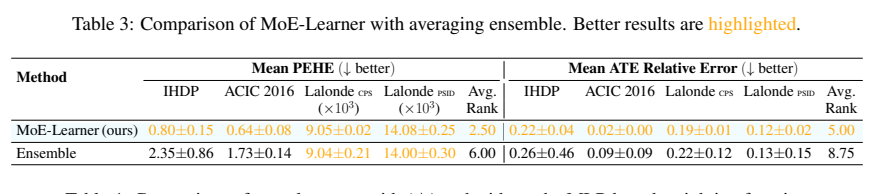

# Data-informed Adaptation of Foundation Models for Causal Effect Estimation

<!-- 全库方法复筛开始 -->
> **方法储备 · 推荐排序与特征表示**。保留“Data-informed Adaptation of Foundation Models for Causal Effect Estimation”这一研究问题或机制；是否用于当前业务另行验证。
> 原有阅读范围与证据等级不变；储备不等于效果已验证。
> [[研究前沿/论文库复筛与阅读路线|全库阅读路线]] · [[研究前沿/推荐排序与特征表示/存量论文分层索引|本方向完整分层]]
<!-- 全库方法复筛结束 -->

处理组和对照组可以各选一种邻居表示。作者用观察到的结局差与距离的秩相关选表示；四个半合成基准支持这种路由，但相关性本身无法检验无隐藏混杂。

Chunwei Ma、Russell D. Wolfinger。arXiv v1 首投 2026-11-08。[版本记录](https://arxiv.org/abs/2611.11504v1) · [原文 PDF](./assets/source/paper.pdf)

## 研究问题与方法

每个样本仅观察到分配档的结局，无法直接用个体反事实标签挑选估计器。§4 把估计改写成两次检索。对每个人，四种候选表示分别来自结局对处理和特征的回归、处理对特征的回归、结局对特征的回归、标准化原始特征。前三种取冻结 TabPFN 的上下文嵌入，附录 A.3 用五折生成，避免样本自己的标签进入构造其表示的上下文。只有第一种表示需要对处理和值为零的对照分别编码。

给定查询，在每一档的上下文中找余弦距离最近的 $K$ 人，由小型 MLP 产生归一化权重，估计潜在结局。路由器在该档以最远点采样选锚点，对每个锚点求「到其他人的嵌入距离」和「结局绝对差」的 Spearman 相关，再取锚点均值。组内选分数最高的专家，最终相减得到条件增量：

$$
e_t^*=\arg\max_e M^{-1}\sum_{k=1}^M\operatorname{corr}_{\rm rank}(D^e_{ki},|Y_k-Y_i|),\qquad
\hat\tau(x)=\hat\mu_{1,e_1^*}(x)-\hat\mu_{0,e_0^*}(x).
$$

## 原文比较

表 1 对比传统因果估计器、因果基础模型和通用表格基础模型。IHDP、ACIC 及两种 Lalonde 构造上，按 CATE 的 PEHE 计，MoE 平均排名 2.50，CausalPFN 为 3.50，TabPFN 为 4.00；其中 IHDP 上 MoE 的 PEHE 为 0.80，TabPFN 为 0.51。附表 3 的四专家均值控制了候选集合；两种 Lalonde 的 CATE 上简单均值与分档路由接近。附表 4、5 分别替换邻居权重和路由分数。

## 适用条件与迁移

相同距离上结局差小可说明预后平滑，无法排除漏测共同原因或证明正值性。组内筛出的良好专家在另一组没有对应邻域时仍要外推。迁移时可把候选表示冻结，先用随机化留出数据测真实分配预算下的效果。

**精读范围**　§§4–5、表 1、附表 3–5 和折外表示说明；未复算定理 1 及附录所有区间。

**作者实现**　作者给出仓库，检索时公开根目录只有 README、许可证和忽略配置，未核到可执行实现。[作者仓库](https://github.com/horsepurve/MoE-Learner)

[[研究前沿/uplift模型迭代/02-可复用方法卡/按治疗档位用变异函数选择邻居表示|按治疗档位用变异函数选择邻居表示]] · [[研究前沿/uplift模型迭代/03-实验假设与结果/同一候选表示下分档路由能否改善条件增量误差|候选实验]]
