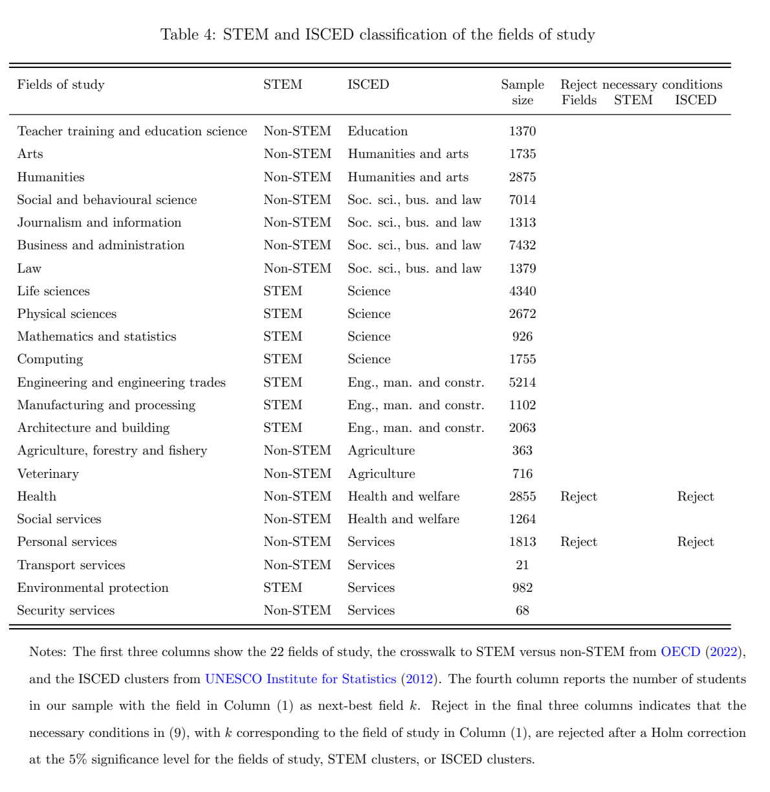

# Instrumental variables with treatment clusters

<!-- 全库方法复筛开始 -->
> **方法储备 · 训练目标与数据反馈**。保留“工具变量与处理效应分群”这一研究问题或机制；是否用于当前业务另行验证。
> 原有阅读范围与证据等级不变；储备不等于效果已验证。
> 已恢复此前因业务距离被移出的原笔记；旧取舍原因仅作历史记录。
> [[研究前沿/论文库复筛与阅读路线|全库阅读路线]] · [[研究前沿/训练目标与数据反馈/存量论文分层索引|本方向完整分层]]
<!-- 全库方法复筛结束 -->

把多个处理档合成两类后，工具变量可能让人换了具体档位，却没有换大类。作者给出可以用原档位证伪合并解释的条件。

Nibbering, Didier、Oosterveen, Matthijs、Silva, Pedro Luis。arXiv 首投 2026-11-09，本次版本 v1（2026-11-09，按来源日期）。 [版本记录](https://arxiv.org/abs/2611.13313v1) · [本地原文](./assets/source/paper.pdf) · [原文 HTML](./assets/source/paper.html)

## 研究问题与机制

§3–4 把工具从 k 改成 j 时的反应分解为跨组变动、反向变动及两组内部的替换。工具有效、相关且满足文中在原档位上定义的单调性和限制时，粗分组的 Wald 系数是原档位之间局部平均效应的正权平均。若保留了具体选择和结果，可在不同结果子集中检验工具是否把各档的概率按预期方向移动。超过两个大类时还要排除经第三类的相应替换。

对结果集合 $B$，比较 $P(Y\in B,D=l\mid Z=j)-P(Y\in B,D=l\mid Z=k)$。$l$ 所属的组决定期望的符号或零约束，见命题 1。

## 对照与证据

葡萄牙大学专业录取线形成模糊断点。表 4 的 Holm 检验在八个 ISCED 大类划分中对 Health 和 Personal services 的条件给出拒绝，而同样的拒绝没有推翻 STEM/非 STEM 的划分。表 5 中，优先选 STEM 的局部人群多修 STEM 的估计为 −3.15 个二年级学分；反向偏好人群选非 STEM 为 +1.33。这两组的权重与局部人群不同。

表 4，根据具体专业检验不同聚合口径。

## 假设、局限与复核范围

必要条件通过不证明可识别；粗分组后无原档位数据便无法作这项检查。断点还要有连续性，二年级是否仍在样本中也可能受录取影响。研究团队 2022 年 3 月已公开同题前身；本次日期是这版 arXiv 上架。

正文和公开题名检索未定位到可核实的作者实现，代码入口未知。

[2022 年 IZA 工作论文](https://www.iza.org/publications/dp/15159/clustered-local-average-treatment-effects-fields-of-study-and-academic-student-progress)

本次核查了上文的方法、直接对照与适用条件，尚未本地复现实验。

[[研究前沿/uplift模型迭代/02-可复用方法卡/合并处理档前先用原档位检验工具变量的必要条件|合并处理档前先用原档位检验工具变量的必要条件]] · [[研究前沿/uplift模型迭代/03-实验假设与结果/哪些同组档位替换在合并后的第一阶段中不可见|哪些同组档位替换在合并后的第一阶段中不可见]]
