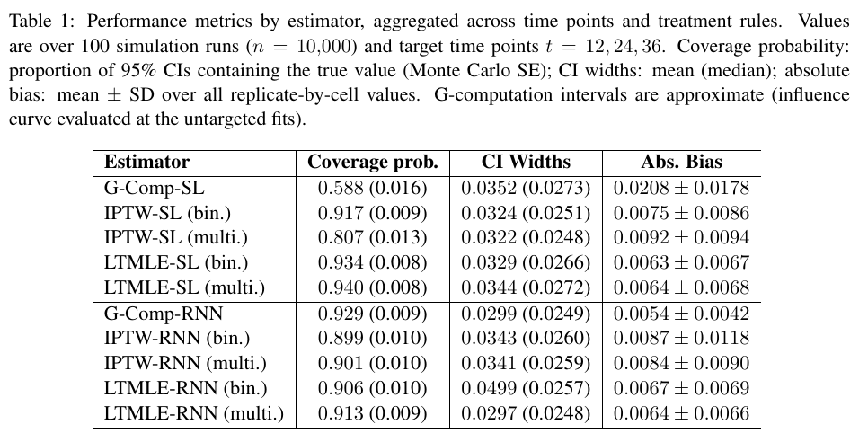

# Doubly-robust causal inference for multi-valued treatment regimes with recurrent neural networks

六选一的纵向干预中，用多类别倾向概率（multinomial）和反向靶向更新估计预先指定策略的累计风险。模拟里，动态规则下仅用 Super Learner 做 g-computation 的 95% 区间覆盖率为 0.013，加入多类别 LTMLE 后为 0.920。

Jason Poulos。arXiv 首次提交 2026-11-05，本次核验 v1（2026-11-05）。[论文与版本记录](https://arxiv.org/abs/2611.08077v1) · [原文 HTML](https://arxiv.org/html/2611.08077v1) · [本地完整 PDF](./assets/source/paper.pdf)

**阅读覆盖**　§§2–6、图 1、表 1–2 及补表 S2–S4；未逐式复算附录生成机制。证据来自模拟。

**代码与数据**　作者库给出 src/tmle_fns.R、src/tmle_IC.R、src/train_lstm.py、diagnostic_gcomp_sl.R 以及已算好的模拟输出。未运行。[作者仓库](https://github.com/jvpoulos/multi-ltmle)

## 1. 目标量与可识别性

每位受试者有基线和月度协变量 $L_s$、六类药物之一 $A_s$、留观指示 $C_s$ 及累积事件。给定静态、依病史改变的动态或随机规则 $d$，估计 $\psi_t=E[Y_t^d]$。两条规则的均值之差才是策略增量。§2 是临床动机，论文没有检验真实患者疗效。识别依赖一致性、给历史的序贯可交换性及治疗和删失的支持。

## 2. 为什么要向后修正

在时点 $k$ 的风险集中预测下一时点已修正的结局，确定性策略把本期动作替为 $d_k$，历史动作保留实值。随机策略逐动作预测，按已知 $g_k^*$ 加权。§3.5 给出确定性规则的权重，以下以 $h_s$ 表示相应的可用历史。

$$
H_k=\prod_{s=0}^{k}\frac{\mathbf 1(A_s=d_s,C_s=1)}
{\widehat g_s(d_s\mid h_s)\widehat c_s(1\mid h_s,A_s)}.
$$

以观测动作下初始预测的 logit 为 offset，用 $H_k$ 加权拟合仅有截距的 logistic fluctuation。把同一截距加到规则下预测的 logit 上，以所得概率作为前一时点的软标签；到基线后取样本均值。随机策略的分子用干预动作概率替代治疗命中指示，基线动作按原始规则处理。治疗／删失机制或完整结局回归链正确可带来一致性，有限样本和弱支持仍会损害区间。

## 3. 哪个组件确有比较

图 1、§§3.6–3.7 中，治疗与删失分别使用逐月输出的 LSTM，治疗用六类 softmax 或六个独立二分类器。结局回归每步用最近 12 个月、单层 32 单元 LSTM，向前回溯时继承下一步网络权重。多类别、二分类及 SL、RNN 在同一生成机制上交叉比较；单个注意力层和权重继承没有单独消融。

## 4. 证据与长时域限制

100 次模拟，每次 10,000 人，在 12、24、36 月测量。表 1 中多类别 LTMLE-SL / LTMLE-RNN 的平均绝对偏差均为 0.0064，覆盖率分别为 0.940 / 0.913。RNN 内多类别 / 二项式平均区间宽度为 0.0297 / 0.0499，后者中位数为 0.0257，均值差受极端重复影响。补表 S2 的动态规则结果只跨时点汇总。补表 S3 中第 36 月动态规则下累积动作概率低于 0.025 的未删失遵循者占比，SL 为 0.954、RNN 为 0.269。两者都基于拟合倾向，不能当作真实支持。作者未交叉拟合，RNN 在后期区间偏窄，机制归因仍是推测。

序贯营销若只保留最后一次曝光，以上估计目标与数据不匹配。需保存早期动作、干预前历史、退出过程及预先给定的可执行策略。

## 方法卡与实验

[[研究前沿/uplift模型迭代/02-可复用方法卡/多值纵向策略的倾向建模与靶向回溯|多值纵向策略的倾向建模与靶向回溯]]

[[研究前沿/uplift模型迭代/03-实验假设与结果/序贯多档干预的折外靶向与覆盖率|序贯多档干预的折外靶向与覆盖率]]
