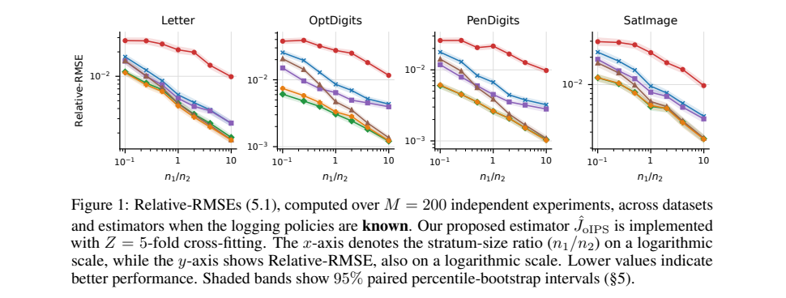

# 多套日志策略该如何合并才有较小估值方差

<!-- 全库方法复筛开始 -->
> **方法储备 · 训练目标与数据反馈**。保留“Variational Approach to Optimal IPS Estimator for Multi-logger Off-Policy Evaluation”这一研究问题或机制；是否用于当前业务另行验证。
> 原有阅读范围与证据等级不变；储备不等于效果已验证。
> [[研究前沿/论文库复筛与阅读路线|全库阅读路线]] · [[研究前沿/训练目标与数据反馈/存量论文分层索引|本方向完整分层]]
<!-- 全库方法复筛结束 -->

**能改哪一环？** 改多套折扣分流日志合并后的离线策略估值。附录 A 图 1 改变日志规模比例，对照不同加权方法，适合检验哪个来源撑大了估值方差。

**第一步怎么验证？** 选各来源都覆盖的目标策略，固定真实分流概率、补贴预算和折外划分，对照来源内 IPS 的加权平均与论文的联合加权。用独立随机留出核对平均价值偏差、区间宽度和各档有效样本量；若区间变窄伴随偏差变大，或关键档缺乏支持，就不用联合估值选模。（本地验证未运行。）

Variational Approach to Optimal IPS Estimator for Multi-logger Off-Policy Evaluation。作者为 Huh, Joon Suk、Seo, Junghoon。arXiv 首投 2026-11-09，本次核验 v1。作者将此标为 NeurIPS 2026 camera-ready。 [版本记录](https://arxiv.org/abs/2611.11712v1) · [本地 PDF](./assets/source/paper.pdf) · [本地 HTML](./assets/source/paper.html)

## 研究问题

同一目标政策可由多个历史分流样本评价，不同来源的覆盖、量级与收入波动各异。

## 方法与关键计算

在满足无偏约束的广义逆倾向加权估计器内最小化方差；使用各来源的样本比例及有限维矩得到自适应权重。K 个来源只需估计 K×K 矩阵和 K 维向量，交叉拟合后计算测试折贡献，亦可加入奖励回归作 DR 校正。

$$
\widehat V=\sum_{k,i}w_k(X_{ki},A_{ki})R_{ki}
$$

简记把分层样本数和政策概率纳入 w。选择满足无偏约束的样本依赖权重，使方差最小；训练折估矩、评价折使用。 [原文定位](https://arxiv.org/html/2611.11712v1#S3)

## 对照、结果和限制

附录 A 图 1 在四个分类转 bandit 的公开数据集、200 次独立重复中，改变两个日志的样本量比例，比较朴素、混合分母、按来源加权及新 IPS。区间来自配对 bootstrap。表 2 可看偏差和标准差分解；优势随样本比例变化。 [原文证据](https://arxiv.org/html/2611.11712v1#A1.F1)

原文 PDF 第 13 页。

其最优性限定在文中的加权 IPS 类与渐近情形。不同日志必须覆盖目标动作，并具有可比较的奖励机制。

## 复用和阅读范围

已核问题设定、方法与上文所列的关键对照，详细证明及未列出的实验以所附全文为准。本次未核实作者公开实现入口。

[[研究前沿/uplift模型迭代/02-可复用方法卡/MultiLoggerIPS-自适应多来源倾向权重|自适应多来源倾向权重]] · [[研究前沿/uplift模型迭代/03-实验假设与结果/MultiLoggerIPS-当分流样本比例差十倍时，自适应来源权重能否降低模型排序波动|当分流样本比例差十倍时，自适应来源权重能否降低模型排序波动]]
