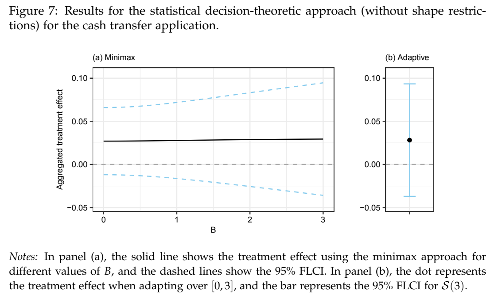

# Aggregating treatment effects across multiple outcomes

当多个观测结局代理同一决策目标时，先限制每项效应相对目标的偏差，再选非负权重。加纳现金转移试验的六项指标中，PCA 汇总在 1% 水平显著；放宽代理偏差、保留非负权重后，图 7 的结论在 10% 水平也不显著。

Chun Pong Lau。arXiv v1 首次提交 2026-11-03，PDF 题页日期为 11-05。作者主页有同题 2026-01-07 工作稿；本周新事件为 arXiv 公开归档。[早期作者稿](https://conroylau.github.io/conroy_lau_jmp.pdf) [版本记录](https://arxiv.org/abs/2611.05456v1) · [已保存的原文 PDF](./assets/source/paper.pdf)

**阅读覆盖**　§§2–6，式 16–25，图 6–8；未复证附录全部渐近结果。

**代码与数据**　作者给出附录 D 的凸优化实现方式；本次未核实独立发布的本论文复现代码。

## 1. 汇总的目标是什么

每项结局先统一方向并标准化，其处理效应记作 $\beta_j$；研究者希望了解的潜在概念效应为 $\theta$，二者偏差 $b_j=\beta_j-\theta$。PCA 按观测结局方差取方向，符号依赖归一化，可能给出负权重。逆协方差加权也可出现负权重；简单平均虽然可解释，通常没有利用各效应估计量的精度。作者针对随机化等已能识别各结局效应的设计；换一套权重并不能修复处理混杂。

## 2. 固定偏差上界或在范围内自适应

式（16）–（18）给定允许的偏差集合 $S(B)$，在所有非负且和为 1 的权重上最小化最坏均方误差。$\Sigma$ 是处理效应**估计量**的协方差，和定义 PCA 的原始样本结局协方差不同。在论文的高斯近似标度下，

$$
R_{\max}(B,w)=w^\top\Sigma w+\sup_{b\in S(B)}(w^\top b)^2,\qquad
w^*(B)=\arg\min_{w\ge 0,\,\mathbf 1^\top w=1}R_{\max}(B,w).
$$

当 $\|b\|_2\le B$ 时，第二项为 $B^2\|w\|_2^2$。若只能为 $B$ 给定区间，式（20）–（22）让一个固定权重最小化最坏**相对**风险 $\sup_B R_{\max}(B,w)/R_{\max}(B,w^*(B))$；相对基准是在同一个 $B$ 的最优权重。式（25）用最坏有偏正态分布校准固定长度区间（FLCI）。实际大样本公式约束 $\sqrt n(\beta-\theta\mathbf1)$，协方差需计入估算标准差的步骤。$B$ 的单位必须随估计采用的标度记录。

## 3. 一次结论翻转怎样发生

图 6 用加纳现金转移试验的两轮六项社交距离指标。两轮都有两项 PCA 权重为负，“戴口罩”的处理效应和权重均为最负，二者相乘推高指数。PCA 效应超过各单项效应的凸包，达到 1% 显著；六项单独检验均未达到这一水平。简单平均和逆协方差指数在 10% 水平亦不显著。

图 7 采用欧氏偏差球，逐点极小极大权重和跨 $[0,3]$ 自适应权重均给出正点估计，在 10% 水平都不显著。图 8 允许更低估“戴口罩”和“访客天数”的代理质量；在较大的 $B$ 且将其余四项设为显著更可信时（如 $\kappa=5$），逐点结论才达到 5%。同图用 $S(3)$ 作推断的自适应区间仍包含零。可迁移的是汇总目标和质量假设的显式审计；论文没有逐用户 CATE 排名、政策价值或业务提升对照。

## 方法与实验

[[研究前沿/uplift模型迭代/02-可复用方法卡/用代理偏差上界汇总多项处理效应|用代理偏差上界汇总多项处理效应]] · [[研究前沿/uplift模型迭代/03-实验假设与结果/多结局代理偏差对综合增量区间的影响|多结局代理偏差对综合增量区间的影响]]
