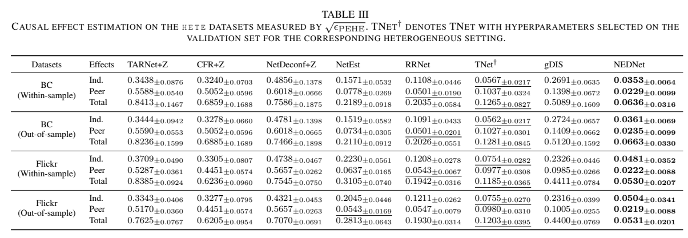

# Network Effect Decomposition for Causal Effect Estimation under Network Interference

如果同一张券同时影响拿券的人和他的邻居，需要明确这两种暴露怎样组合。先核对加性假设，再看社会网络上的半合成对照，其中结局来自作者设定的机制。

[[研究前沿/uplift模型迭代/README#哪些数据足以识别增量|比较同一问题的其他方法]] · [[研究前沿/uplift模型迭代/02-可复用方法卡/网络干扰下自身与邻居暴露的加性分支|直接效应与溢出效应的分支]] · [[研究前沿/uplift模型迭代/03-实验假设与结果/检验网络暴露分支遗漏的处理交互|未运行：遗漏交互的压力测试]]

将固定网络上下文中的结局拆为基线、自身处理和邻居暴露三项，分别查询直接效应与溢出效应。这样做要求自身处理与邻居暴露没有交互；两个社交图上的半合成实验支持该约束匹配生成机制时的效果。

Zhirong Huang、Wenzhen Zhang、Guangquan Lu、Boyan Chen、Debo Cheng、Shichao Zhang。arXiv 首次提交 2026-11-05，已读 v1（2026-11-05）。 [版本记录](https://arxiv.org/abs/2611.07879v1) · [已保存的原文 PDF](./assets/source/paper.pdf)

**阅读覆盖**　§§III–VI、命题 1、算法 1、表 I–IV；未穷尽网络形成假设及每一基线实现。

**代码与数据**　作者使用 BlogCatalog 与 Flickr 网络作半合成，正文未给出可核验的 NEDNet 作者仓库。

## 1. 网络暴露需要先定义

每个节点有干预前特征和固定的邻接关系，其二元处理为 $T_i$，邻居暴露 $Z_i$ 为邻居中被处理者的比例（式 1）。个人干预效应比较同一暴露下 $T=1,0$；同伴效应在固定自身处理下改变暴露；总效应同时改变两者。因果解释依赖一致性、所选暴露映射足以概括干扰、联合处理–暴露的正值性及给定干预前上下文的无混杂。节点度数决定可实现的暴露网格，孤立节点没有这里定义的暴露值。

## 2. 一项明确的函数限制

图 2 和算法 1 先用 GCN 编码固定图与特征，再经紧凑特征编码，分别处理自身动作和邻居暴露。各分支在干预前邻居信息下聚合，输出基线与两个响应项之和，使用事实结局 MSE 端到端训练。推断两次查询固定同一图和协变量，仅修改自身处理或暴露。用参考点 $(t_0,z_0)$ 归一化后，

$$
\widehat\mu_i(t,z)=\widehat\mu_i(t_0,z_0)+r_i^T(t)+r_i^Z(z),
\qquad r_i^T(t_0)=r_i^Z(z_0)=0.
$$

命题 1 证明这种**拟合函数**的唯一参考分解，与所有可行查询的混合差分均为零等价。它约束固定人的自身处理效应不会随着邻居暴露改变；两条分支仍可分别随节点协变量产生异质性。模型的结构不证明真实网络满足该等式。

## 3. 半合成结果与反例

BlogCatalog 与 Flickr 提供真实图及协变量，干预/结果由作者设定的机制生成。表 I 的 BlogCatalog 留出子图上，NEDNet 自身、同伴、总效应的根 PEHE 为 0.0504、0.0256、0.0568，RRNet 同伴为 0.0501。表 III 的协变量异质情形，同一留出图三项为 0.0361、0.0235、0.0663，数值是五次独立运行均值，标准差保留于原表。

表 II 受控去掉各分支的表示项，但保留其直接读出；另将两编码器共享或改用联合解码。并非每格都支持加性分支：Flickr 同质场景样本内总效应，联合解码 0.0429、共享编码 0.0440，完整模型 0.0443。尚无独立实验证明含重大交互或错误暴露映射时同样占优。迁移可先在可识别的随机化或仿真网络中打破加性假设，尤其要区分真实用户间干扰与相似人群的共同趋势。

## 方法与实验

[[研究前沿/uplift模型迭代/02-可复用方法卡/网络干扰下自身与邻居暴露的加性分支|网络干扰下自身与邻居暴露的加性分支]] · [[研究前沿/uplift模型迭代/03-实验假设与结果/检验网络暴露分支遗漏的处理交互|检验网络暴露分支遗漏的处理交互]]
