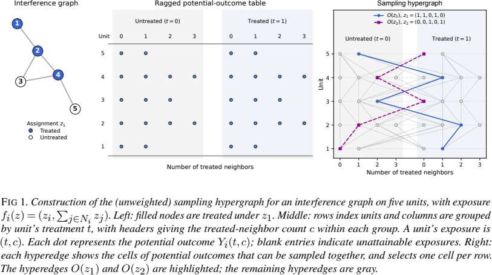

# 干扰网络中的联合曝光与设计风险

Minimax designs and estimators for causal inference under network interference · Karwa, Vishesh, Airoldi, Edoardo M.。arXiv 首投 2026-11-05，本次阅读版本 v1（2026-11-05）。 [版本记录](https://arxiv.org/abs/2611.08560v1) · [本地 PDF](./assets/source/paper.pdf) · [本地 HTML](./assets/source/paper.html)

## 研究问题

有限实验预算下，怎样判断换估计器是否还能降低风险，还是需要重做随机分配？常规的单个单位倾向概率看不到多个潜在结果能否一起出现。

## 方法及关键计算

把每个“单位 $i$、可达曝光 $e$”作为顶点。一项可行分配 $z$ 决定一条超边 $O(z)=\{(i,f_i(z)):i=1,\ldots,n\}$；对生成同一超边的分配概率求和即为边权。给定曝光表与目标权重，可区分固定分配、受限设计族、全体设计三种最坏均方风险。构造在联合缺失单元上取不同值的结果表，得到任何估计器均须承受的风险下界，再和可行估计器的上界比较。

## 关键公式

$$
\tau_{a}(Y)=\sum_{(i,e)\in K}a_{(i,e)}Y_{i}(e)
$$

每个可达的单位–曝光组合对应一项潜在结果，权重决定要估计直接效应、溢出效应还是其他对比。集合 K 是曝光表中可达的单元格。先指定目标权重，再判断拟议分配给哪些单元格提供信息。 [公式原文](https://arxiv.org/html/2611.08560v1#S3.E4)

## 证据、对照与边界

理论证据。§8.1 定理 8.1.2 的核心–外围图中，核心大小为 S，外围内部度数有界。遍历所有可行设计时，直接效应的最优风险量级为 1/n＋S²/n²；限于设计无偏估计器为 S/n。当 S 与 √n 同阶，无偏要求可使最坏风险高出 √n 的量级。

图 1　由干扰图和分配得到可同时观测的曝光单元，原文 PDF 第 3 页。

差距来自特定图、目标和最坏潜在结果表。它不能直接预测某城市实验的方差。实际落地需说明共享司机构成的干扰边及曝光映射，并单独验证这种简化。

## 阅读覆盖与复用

已核对上述设定、关键计算、主对照及限制，附录证明未逐行复证。未从作者版本页、正文或公开检索核实可用的作者代码入口。

[[研究前沿/uplift模型迭代/02-可复用方法卡/NetworkDesignRisk-干扰网络中的联合曝光与设计风险|干扰网络中的联合曝光与设计风险]] · [[研究前沿/uplift模型迭代/03-实验假设与结果/NetworkDesignRisk-不同分流方案能否改善拥挤区效应可估性|不同分流方案能否改善拥挤区效应可估性]]

[[研究前沿/uplift模型迭代/01-论文原文与精读/NetworkDesignRisk/原文导航|原文章节和图表索引]]
