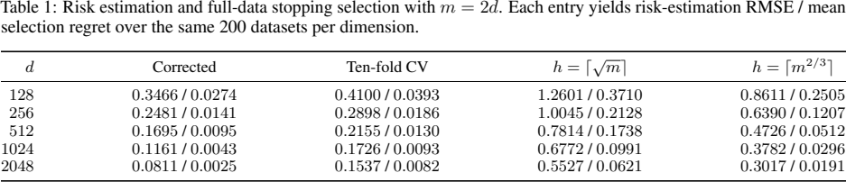

# 同样本奖励模型的早停与策略价值校正

High-Dimensional Off-Policy Evaluation without Sample Splitting using an Onsager Correction · Jain, Saksham, Braun, Guillaume, Imaizumi, Masaaki。arXiv 首投 2026-11-05，本次阅读版本 v1（2026-11-05）。 [版本记录](https://arxiv.org/abs/2611.08794v1) · [本地 PDF](./assets/source/paper.pdf) · [本地 HTML](./assets/source/paper.html)

## 研究问题

特征维数和样本数同比增长时，留出训练的最优迭代步数可能与用全部样本重训时不同。直接用训练残差选步数又会乐观。

## 方法及关键计算

按处理臂记录全批梯度下降轨迹，式 (5) 在第一层预激活上加回各步残差梯度乘 Onsager 校正矩阵的历史和，近似去除该观测对自身预测的影响。用修正预测计算按目标策略加权的残差平方，以式 (6)–(7) 分臂选步数。式 (8)–(10) 对参与该臂训练的样本使用修正预测，构成调整后的直接法与双稳健价值估计；独立新样本仍用原网络。

## 关键公式

$$
\widehat{\mathcal{E}}_{a}^{(t)}\coloneqq\frac{1}{N_{a}}\sum_{i\in\mathcal{I}_{a}}w_{a}(X_{i})\left(R_{i}-G_{W_{a,[2:L]}^{(t)}}(\widehat{U}_{i,a}^{(t)})\right)^{2}
$$

对动作 a 的训练记录，以目标策略与日志策略的概率比加权残差平方。G 是从修正的第一层输入到输出的网络，t 是训练步数。对不同 t 的风险求最小值来选停点。 [公式原文](https://arxiv.org/html/2611.08794v1#S3.E6)

## 证据、对照与边界

附录 J 表 1 在 m=2d、每个维度 200 份模拟数据下比较全样本早停。d=2048 时，校正法的风险估计 RMSE 为 0.0811，十折 CV 为 0.1537；平均选步遗憾为 0.0025 与 0.0082。表 3 另列价值估计偏差和方差，两个任务的指标须分开看。

附录 J 表 1　各训练集规模的估计误差与选步遗憾，原文 PDF 第 70 页。

定理依赖已知且与上下文无关的日志策略、高斯上下文、固定网络宽深和有限候选步。不能直接将该校正套入任意高维日志或生产网络。

## 阅读覆盖与复用

已核对上述设定、关键计算、主对照及限制，附录证明未逐行复证。未从作者版本页、正文或公开检索核实可用的作者代码入口。

[[研究前沿/uplift模型迭代/02-可复用方法卡/OnsagerOPE-同样本奖励模型的早停与策略价值校正|同样本奖励模型的早停与策略价值校正]] · [[研究前沿/uplift模型迭代/03-实验假设与结果/OnsagerOPE-高维随机实验中全样本早停是否减少选错模型|高维随机实验中全样本早停是否减少选错模型]]

[[研究前沿/uplift模型迭代/02-可复用方法卡/OnsagerOPE-同样本双稳健策略估值|同样本双稳健策略估值]]

[[研究前沿/uplift模型迭代/01-论文原文与精读/OnsagerOPE/原文导航|原文章节和图表索引]]
