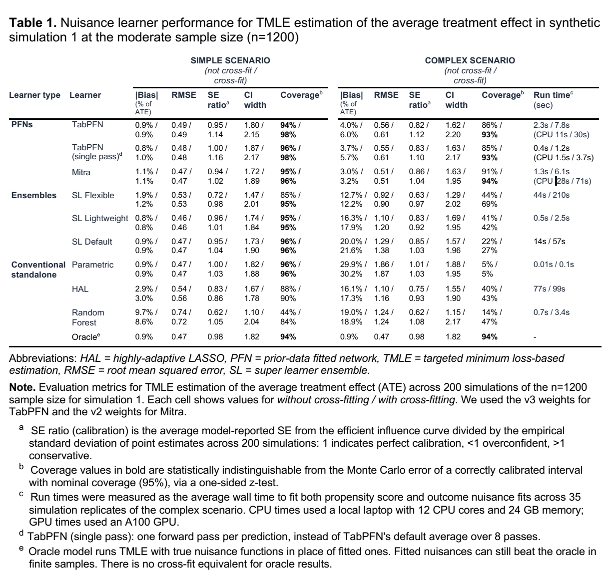

# Does Predictive Performance Translate to Causal Performance? Evaluating tabular foundation models as nuisance learners for causal effect estimation

<!-- 全库方法复筛开始 -->
> **方法储备 · 训练目标与数据反馈**。保留“Does Predictive Performance Translate to Causal Performance? Evaluating tabular foundation models as nuisance learners for causal effect estimation”这一研究问题或机制；是否用于当前业务另行验证。
> 原有阅读范围与证据等级不变；储备不等于效果已验证。
> [[研究前沿/论文库复筛与阅读路线|全库阅读路线]] · [[研究前沿/训练目标与数据反馈/存量论文分层索引|本方向完整分层]]
<!-- 全库方法复筛结束 -->

**能改哪一环？** 改折扣因果评估里预测事实结果的辅助模型。原文合成实验显示，折外拟合能改善因果区间覆盖；事实预测很准也可能掩盖辅助模型的过拟合。

**第一步怎么验证？** 从两个有随机覆盖的折扣档起步，固定已知分流概率、按乘客交叉拟合的折和外层双稳健估计器，只替换现有结果回归器与 TabPFN。用独立随机样本的两臂差核对预设人群的增量估计，同时记录事实预测误差。若只有事实预测改善、增量估计反而更偏，保留原回归器。（本地验证未运行。）

同一个 TabPFN 既可提供结局模型也可提供倾向模型。复杂合成场景中，折外拟合将 TMLE 的 95% 区间覆盖从 86% 提至 93%；另一个半合成设置里，在训练行上几乎完美预测谁接受了处理，反而最偏离真实倾向。

Andrew R. Weckstein、Issa J. Dahabreh、Marinka Zitnik、Sonia Hernández-Díaz、Sebastian Schneeweiss。arXiv v1 首投 2026-11-08。[版本记录](https://arxiv.org/abs/2611.11381v1) · [原文 PDF](./assets/source/paper.pdf)

## 研究问题与方法

二元干预下，倾向 $e(x)=P(A=1|X=x)$ 和结局回归 $m_a(x)=E[Y|A=a,X=x]$ 是辅助函数。作者分别将冻结的 TabPFN、Mitra 及传统学习器用于这两项预测，再固定因果估计器比较。以 AIPW 为例，单行得分是

$$
\hat m_1-\hat m_0 + \frac{A(Y-\hat m_1)}{\hat e}-\frac{(1-A)(Y-\hat m_0)}{1-\hat e}.
$$

TMLE 则利用倾向构造的权重修正初始结局预测，再对目标人群标准化。是否进行交叉拟合决定每行输入哪个上下文：拆折时该行的处理与结局均不在学习其辅助函数的训练集中。主要目标是 ATE/ATT 与其区间覆盖，不能从这些实验直接推出个体分档准确。

## 原文比较

表 1 固定 TMLE，复杂设定 n=1,200、200 次模拟，TabPFN 不拆折/拆折覆盖为 86%/93%，Mitra 为 91%/94%，灵活 Super Learner 为 44%/69%；TabPFN 对应相对绝对偏差反从 4.0% 变为 6.0%。可见提高覆盖并不要求每个设定的点估计都更准。简单设定 n=200 时同样本 TabPFN 覆盖仅 66%。在 ACIC 半合成中，无拆折时 TabPFN 的平均 AUC 接近 1，而真实倾向值的 RMSE 为 0.377；其余学习器为 0.076–0.141。图 5 及补表 S7 报告了该现象对 TMLE 的影响。

## 适用条件与迁移

基准给定可识别的目标，仿真二仅每个机制 50 次，覆盖估计有 Monte Carlo 误差。高样本内 AUC 可能来自记忆标签；真实日志通常没有真实倾向，可用已知分配概率的实验或仿真先诊断。

**精读范围**　原文方法、两种仿真、图 2–5、表 1、补表 S7 的倾向诊断；未运行开源管道。

**作者实现**　两套仓库均有 02_run_nuisance_learners.R 及 03_run_ate_estimators.R；ACIC 仓库另有 04_evaluate_metrics.R。[合成实验](https://github.com/a-weckstein/Tabular-FM-causal-simulations) · [ACIC 管道](https://github.com/a-weckstein/ACIC-plasmode-pipeline)

[[研究前沿/uplift模型迭代/02-可复用方法卡/交叉拟合表格基础模型并审计倾向记忆|交叉拟合表格基础模型并审计倾向记忆]] · [[研究前沿/uplift模型迭代/03-实验假设与结果/拆折能否修正表格基础模型的倾向记忆与区间欠覆盖|候选实验]]

折外训练缓解拟合偏差，隐藏分流还需要额外识别证据。 [[研究前沿/面向决策的履约建模/01-论文原文与精读/JubileeOPE/精读|另一方向的对照]]
