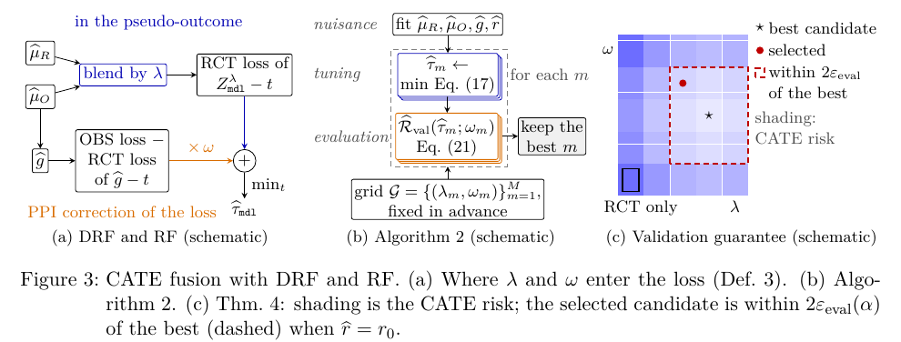
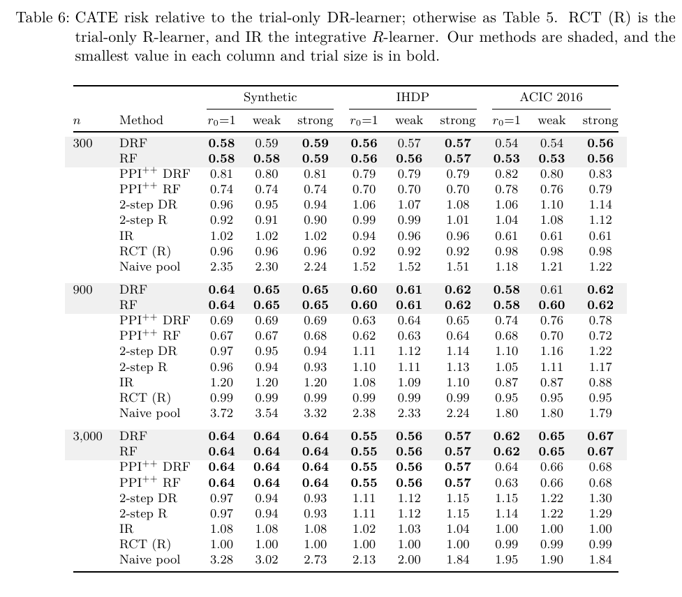

# PPDF：Prediction-Powered Data Fusion for Treatment Effect Estimation

作者：Yonghan Jung、Shu Yang。首次提交：2026-10-08；修订：2026-10-23；本次阅读：2026-11-05。状态：arXiv 预印本，未据此认定会议录用。

[官方摘要与版本](https://arxiv.org/abs/2610.12332) · [已读 HTML](https://arxiv.org/html/2610.12332v2) · [本地 PDF](./assets/source/paper.pdf) · [本地 HTML](./assets/source/paper.html)

**阅读深度：关键方法精读。** 已读方法、主实验及下列关键附录；不声称逐节全文精读或已完成复现。PDF 是完整原文；HTML 已保存，但其外链资源不保证离线加载。

## 问题与整体流程

小 RCT 提供因果识别，大 OBS 提供预测信息。本文将两者分工：先各自训练结果回归，再在 RCT 中形成有效伪结果，并加入均值相消的 OBS 校正项。目标仍是 **RCT 人群** 的 ATE/CATE；不是把 OBS 的处理差当作真值。

## 核心方法

记随机试验倾向概率为 $e(X)$，混合回归为 $\widehat\mu_\lambda=(1-\lambda)\widehat\mu_R+\lambda\widehat\mu_O$。其 AIPW 伪结果为：

$$
Z^\lambda=\widehat\mu_\lambda(X,1)-\widehat\mu_\lambda(X,0)+\frac{A}{e(X)}(Y-\widehat\mu_\lambda(X,1))-\frac{1-A}{1-e(X)}(Y-\widehat\mu_\lambda(X,0)).
$$

这是原文公式（1）代入混合回归。已知有效的 RCT 倾向概率和独立拟合下，OBS 回归即使受混杂影响，仍可作为降低方差的辅助量。

令 $\widehat g=\widehat\mu_O(\cdot,1)-\widehat\mu_O(\cdot,0)$，$r=p_R(X)/p_O(X)$。ATE 将 RCT 伪结果均值加上 $\omega(\mathbb P_O r\widehat g-\mathbb P_R\widehat g)$，见公式（2）。两路分别用 $\lambda$ 改善伪结果、用 $\omega$ 控制协变量均值校正。

DR-Fusion 的 CATE 目标（原文公式（17），取 $\kappa=1$）是：

$$
\widehat R(t)=\mathbb P_R(Z^\lambda-t)^2+\omega\mathbb P_O[r(\widehat g-t)^2]-\omega\mathbb P_R(\widehat g-t)^2.
$$

**直观理解：** OBS 给出更稳定的辅助预测，RCT 中对应的减项消除把辅助预测误当因果目标的偏移。R-Fusion 使用归一化 R-learner 残差及权重；不能只复制 DR 的公式并改名。

Figure 3（原文 p.13）：左侧展示两条信息通道，中间是独立拟合、调参、评价，右侧是有限候选集的验证保证。实现需要保留这三个数据角色；不能在同一批数据上选择权重并报告无偏结果。

## 效果与边界

Table 6（p.19）：作者在合成数据、IHDP 和 ACIC 2016 的模拟处理/结果设定中报告，45 个设置的 DRF/RF CATE 风险为 trial-only DR 的 **0.53–0.67 倍**。这是整体学习器的离线风险结果，不是线上收益或某张独立方法卡的贡献。Table 5 的 ATE MSE 比为 0.40–1.00；附录 B.3/Table 10 显示，大 RCT 时部分 CATE 优势来自把 $\widehat g$ 加入基函数，应做相同表示的对照。

同表示的更严格对照下，Table 10 中 RCT 样本数 300 时融合风险是该对照的 0.59–0.76 倍，样本数 3,000 时变为 0.98–1.03 倍。附录 B.3 还报告协变量偏移时仅使用混合回归的一路，在 30 个设置中的 28 个略优于完整 ATE 融合。因此值得保留退回简化版本的选择，不预设两路相加总是更好。

理论要求随机试验有效、处理概率正且已知、样本角色分离及协变量支持重叠。精确密度比下保持目标；估计密度比有误会产生偏移。有限样本矩平衡不等于总体偏移精确为零，区间还需计入校准噪声。当前实验和公开实现主要是二元处理与线性 sieve；多值、连续处理或深网需另行推导验证。

## 可复用模块与代码

[[研究前沿/uplift模型迭代/02-可复用方法卡/PPDF-drfusion|DR-Fusion：保留RCT目标的OBS融合损失]]

[[研究前沿/uplift模型迭代/02-可复用方法卡/PPDF-balance|目标相关矩平衡与校准噪声]]

[作者仓库](https://github.com/CausalDataScience/DataFusionPPI) 已核验，快照 `04c7f3447b02fa09f875e68e8c47100a7207d546`。已读 `dfppi/api.py` 的 `fuse_ate`、`fuse_cate`：CATE 采用三折轮换、5 个主成分加 $\widehat g$ 的 sieve，不能当作通用深网训练器。仓库当前稿可能超出 arXiv v2，论文数字以保存的 v2 为准。本次只读代码，未安装或执行。

## 迁移推断与候选验证

适合研究小流量随机探索如何利用大规模历史日志；跨领域的医疗或营销 RCT 都可考虑。最先比较“同表示 RCT-only、只混合回归、完整融合”，避免把表征增益误判为融合损失增益。

[[研究前沿/uplift模型迭代/03-实验假设与结果/2026-11-05-PPDF-候选假设|候选实验：待设计、未运行]]
