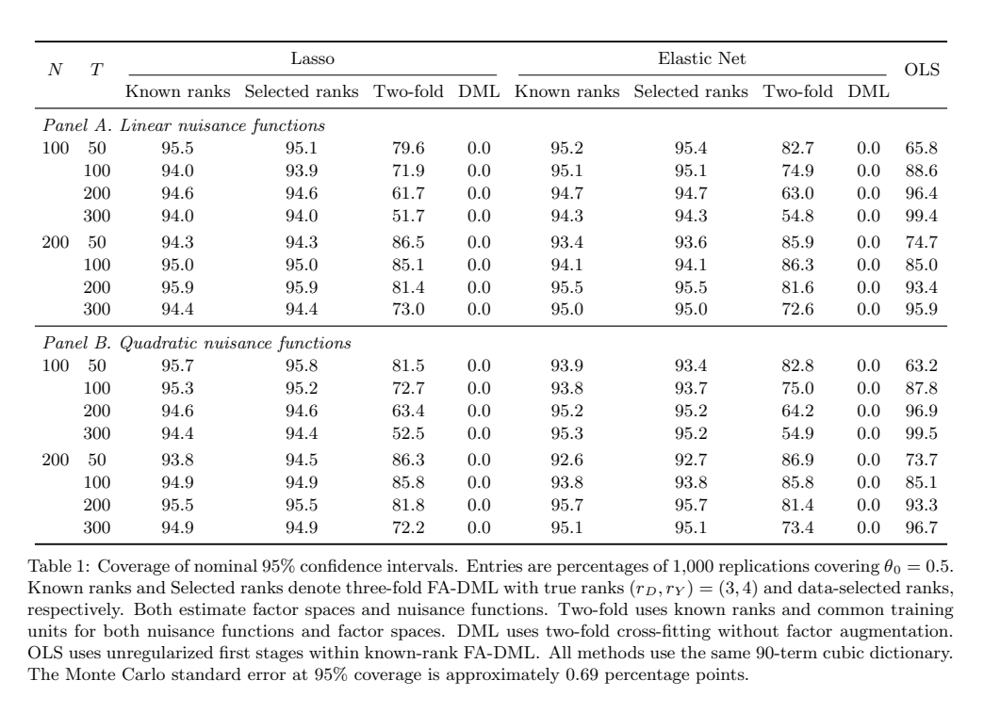

# Semiparametric Inference in Panel Data with Interactive and High-dimensional Confounding

<!-- 全库方法复筛开始 -->
> **方法储备 · 训练目标与数据反馈**。保留“面板因子模型与交叉拟合”这一研究问题或机制；是否用于当前业务另行验证。
> 原有阅读范围与证据等级不变；储备不等于效果已验证。
> 已恢复此前因业务距离被移出的原笔记；旧取舍原因仅作历史记录。
> [[研究前沿/论文库复筛与阅读路线|全库阅读路线]] · [[研究前沿/训练目标与数据反馈/存量论文分层索引|本方向完整分层]]
<!-- 全库方法复筛结束 -->

面板中处理和结局可能同时受未观测的共同时间因子影响。把两侧因子分开用不同单位估计，再到第三组求处理系数，能改善区间覆盖。

Chen, Bin、Ma, Yukun、Yu, Qiyang。arXiv 首投 2026-11-10，本次版本 v1（2026-11-10，按来源日期）。 [版本记录](https://arxiv.org/abs/2611.14385v1) · [本地原文](./assets/source/paper.pdf) · [原文 HTML](./assets/source/paper.html)

## 研究问题与机制

§2–3 针对一个在单位和时期之间共用的低维处理系数。先以完整单位而非单行拆成三组。第一组在处理方程的残差上交替作 PCA 与投影后回归，第二组在结局的约化式残差上独立做同样的事。第三组计算两侧残差，用两个补投影的乘积求系数，最后将三组角色的六种排列求平均。分开训练针对同一单位的噪声被重复用于估计两个因子空间所致的偏差。

$M_G=I-G(G^\top G)^{-1}G^\top$。评价折使用 $A=M_{\hat G_D}M_{\hat G_Y}$，以 $\sum_i v_{D,i}^{\top}Av_{Y,i}/\sum_i v_{D,i}^{\top}Av_{D,i}$ 求共同斜率。

## 对照与证据

表 1 的线性干扰函数场景，100 个单位、50 期、Lasso、真实因子秩为 (3,4)，1,000 次仿真。名义 95% 区间覆盖为三折已知秩 95.5%、三折估秩 95.1%、同一训练组估两空间的两折已知秩 79.6%、无因子 DML 0.0%。主表的两折还共用两侧辅助学习器的训练组，不能把全部差异单独归给 PCA。

表 1，按两侧训练方式和因子秩比较覆盖率。

## 假设、局限与复核范围

理论需要固定的因子维数、共同因子的信号足够强、严格外生以及单位数和期数都增长。动态面板中受过去结果影响的处理未获该定理覆盖；估计的是共同系数，个体异质性须另建目标。

正文和公开题名检索未定位到可核实的作者实现，代码入口未知。

本次核查了上文的方法、直接对照与适用条件，尚未本地复现实验。

[[研究前沿/uplift模型迭代/02-可复用方法卡/用互不重叠的两组面板学习处理与结局因子|用互不重叠的两组面板学习处理与结局因子]] · [[研究前沿/uplift模型迭代/03-实验假设与结果/因子空间共用训练单位会损失多少覆盖率|因子空间共用训练单位会损失多少覆盖率]]
