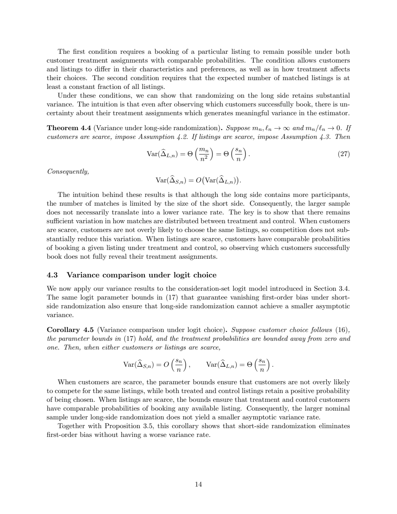

# One-Sided Randomization in Two-Sided Platform Experiments: Which Side Should be Randomized?

<!-- 全库方法复筛开始 -->
> **方法储备 · 训练目标与数据反馈**。保留“One-Sided Randomization in Two-Sided Platform Experiments: Which Side Should be Randomized?”这一研究问题或机制；是否用于当前业务另行验证。
> 原有阅读范围与证据等级不变；储备不等于效果已验证。
> [[研究前沿/论文库复筛与阅读路线|全库阅读路线]] · [[研究前沿/训练目标与数据反馈/存量论文分层索引|本方向完整分层]]
<!-- 全库方法复筛结束 -->

**能改哪一环？** 改共享司机供给下评估折扣策略的随机分流设计。命题 3.5 与推论 4.5 比较供需极不平衡时按哪一侧分流的干扰偏差与方差，证据来自特定市场模型的理论结果。

**第一步怎么验证？** 在能定义两侧处理暴露的城市时段模拟中固定到达、司机容量和同一干预，对照乘客侧与供给侧随机。以同一模拟里全处理减全对照的完单差为参照，按供需紧张度比较偏差和方差。若供给侧分流不能实现同一折扣干预，或稀缺侧随时段翻转且结果不稳，不据此改分流。（本地验证未运行。）

## 双边市场的一侧明显更少时，哪一侧适合做随机实验？

在先到先得、每次成交消耗一个名额的模型里，较多一侧的人数并不等于独立成交数。供需极不平衡时，按稀缺一侧随机化能消除一阶干扰偏差；在给定条件下，方差的渐近阶也不比另一侧差。

Johari, Ramesh、Murthy, Anushka。arXiv 首投 2026-11-12，本次核验 v1（2026-11-12，来源日期）。[论文与版本](https://arxiv.org/abs/2611.16406v1) · [本地原文](./assets/source/paper.pdf) · [本地 HTML](./assets/source/paper.html)

## 方法与估计对象

固定客户的到达次序和单容量供给，分别构造客户随机、供给随机的两种市场。用相同尺度的处理与对照成交均值差，估全处理与全对照每单位市场规模的成交差。将需求集中度、供给饱和及两种分配下的预订概率写入条件，分别推导偏差和方差。

记短边人数为 $m_n$，长边为 $\ell_n$，短边占比 $s_n=m_n/n$。当两侧都增长且 $m_n/\ell_n\to0$，所给 logit 条件下，短边偏差为 $o(s_n)$。

## 对照与证据

命题 3.5 和推论 4.5 给出受限选择集 logit 模型的理论比较。短边方差为 $O(s_n/n)$，长边方差为 $\Theta(s_n/n)$。长边保留正的一阶偏差还要求所有客户–供给组合的吸引力有统一正增量。正文未提供线上或仿真收益。

定理 4.4 与推论 4.5，方差阶的条件。原始 PDF 第 14 页。

## 识别条件与适用范围

仅适用于文中的顺序、容量、异质选择和日益失衡等假设。结论比较方差阶，不能据此断言每个有限市场的方差都更小。

本轮从论文正文与作者标注中未取得可验证的配套代码入口。

本次精读覆盖上述方法、证据页和相关限制。附录中的其他推导与实验未逐项复算。

[[研究前沿/uplift模型迭代/02-可复用方法卡/以稀缺侧的可成交数比较双边随机化偏差与方差|以稀缺侧的可成交数比较双边随机化偏差与方差]] · [[研究前沿/uplift模型迭代/03-实验假设与结果/供需逐步失衡时哪一侧随机化更接近全量干预|供需逐步失衡时哪一侧随机化更接近全量干预]]
