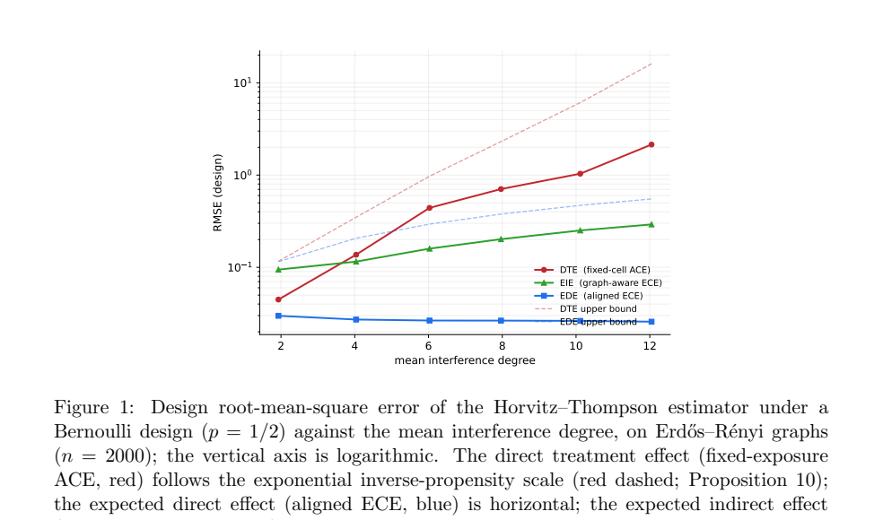

# 邻居也受干预时该估哪一种增量

<!-- 全库方法复筛开始 -->
> **方法储备 · 训练目标与数据反馈**。保留“Average versus expected causal effects under interference: Modeling assumptions and estimation bottlenecks”这一研究问题或机制；是否用于当前业务另行验证。
> 原有阅读范围与证据等级不变；储备不等于效果已验证。
> [[研究前沿/论文库复筛与阅读路线|全库阅读路线]] · [[研究前沿/训练目标与数据反馈/存量论文分层索引|本方向完整分层]]
<!-- 全库方法复筛结束 -->

Average versus expected causal effects under interference: Modeling assumptions and estimation bottlenecks。作者为 Karwa, Vishesh、Airoldi, Edoardo M.、Rubin, Donald B.。arXiv 首投 2026-11-09，本次核验 v1。 [版本记录](https://arxiv.org/abs/2611.12690v1) · [本地 PDF](./assets/source/paper.pdf) · [本地 HTML](./assets/source/paper.html)

## 研究问题

固定邻居的处理状态与对一项分配政策取平均，对应不同的增量目标。目标不匹配时，即使样本增加也可能持续偏离。

## 方法与关键计算

先指定干扰邻域、暴露映射和结局模型。把潜在结果分成自身处理、邻居暴露及其交互。固定暴露做差定义 ACE；对指定政策下的暴露分布平均再做差定义 ECE。用目标暴露概率及其相依关系分析 HT 估计的方差。

$$
Y_i(z,e)=A_i(z)+B_i(e)+zC_i(e)
$$

z 为自身处理、e 为邻域暴露，C 项允许二者交互。把 e 固定或对政策下的 e 求均值得到不同目标。 [原文定位](https://arxiv.org/html/2611.12690v1#S1.Ex1)

## 对照、结果和限制

§7 图 1 在 n=2,000 的随机图和 1/2 伯努利分配中，固定暴露直接效应的 RMSE 随平均度迅速上升，设计一致的期望直接效应较平，期望间接效应呈多项式增长。图 2 展示同一均值差评估两个目标可有不同误差下限。 [原文证据](https://arxiv.org/html/2611.12690v1#S7.F1)

原文 PDF 第 39 页。

结论依赖目标、分配设计和干扰映射。图中数值来自模拟。若目标必须是固定暴露，应改变实验设计或模型，不能简单换个易估目标代替。

## 复用和阅读范围

已核问题设定、方法与上文所列的关键对照，详细证明及未列出的实验以所附全文为准。本次未核实作者公开实现入口。

[[研究前沿/uplift模型迭代/02-可复用方法卡/PolicyExposure-政策平均暴露目标|政策平均暴露目标]] · [[研究前沿/uplift模型迭代/03-实验假设与结果/PolicyExposure-分流网络中固定邻居暴露和对分流政策平均，两种目标的偏差是否随网络密度分化|分流网络中固定邻居暴露和对分流政策平均，两种目标的偏差是否随网络密度分化]]
