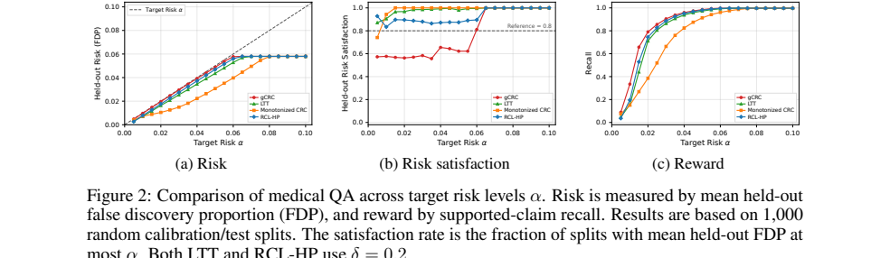

# 策略改变样本分布后怎样限制下一轮超风险概率

<!-- 全库方法复筛开始 -->
> **方法储备 · 训练目标与数据反馈**。保留“High Probability Risk Control for Online Policy Learning”这一研究问题或机制；是否用于当前业务另行验证。
> 原有阅读范围与证据等级不变；储备不等于效果已验证。
> [[研究前沿/论文库复筛与阅读路线|全库阅读路线]] · [[研究前沿/训练目标与数据反馈/存量论文分层索引|本方向完整分层]]
<!-- 全库方法复筛结束 -->

High Probability Risk Control for Online Policy Learning。作者为 Guo, Yihong、Prinster, Drew、Saria, Suchi、Liu, Anqi。arXiv 首投 2026-11-09，本次核验 v1。 [版本记录](https://arxiv.org/abs/2611.13163v1) · [本地 PDF](./assets/source/paper.pdf) · [本地 HTML](./assets/source/paper.html)

## 研究问题

用当前策略收来的样本为下一轮挑阈值时，观察分布也随阈值历史而变。

## 方法与关键计算

估计不同样本在候选策略下成为下一观测的权重，用 Sinkhorn 近似置换权重矩阵，再用高斯 bootstrap 对风险加上分位数修正。按风险阈值挑选候选政策，同时记录保守选择牺牲的奖励。

$$
\widehat {\ell}(\lambda)=\sum_i w_i(\lambda)l_i
$$

λ 为备选风险阈值，权重随候选政策变化。选择时将估计风险和不确定度修正一起与容许上限比较。 [原文定位](https://arxiv.org/html/2611.13163v1#S3.E3)

## 对照、结果和限制

§5 图 2 在 QA 上重复 1,000 个校准/测试划分，报告风险满足比例和保留正确声明的召回。gCRC 较不保守但高概率达标不足，LTT 较保守。该任务未更新策略；图 3 另比较有反馈偏移情形的加权估计。 [原文证据](https://arxiv.org/html/2611.13163v1#S5.F2)

原文 PDF 第 9 页。

保证为正则条件下的渐近性质；密度比、重叠与近似误差必须复核，固定策略 QA 实验不能证明任意线上反馈下有效。

## 复用和阅读范围

已核问题设定、方法与上文所列的关键对照，详细证明及未列出的实验以所附全文为准。已按公开仓库快照核对文件路径。[permutation_weight.py](https://github.com/guoyihonggyh/High-Probability-Risk-Control/blob/601369f3e9809c8420bba12ae25e6711be448bec/permutation_weight.py)

[[研究前沿/uplift模型迭代/02-可复用方法卡/PolicyRisk-反馈偏移下的风险校准|反馈偏移下的风险校准]] · [[研究前沿/uplift模型迭代/03-实验假设与结果/PolicyRisk-分流政策随历史迭代时，加权风险上界能否减少不达标轮次|分流政策随历史迭代时，加权风险上界能否减少不达标轮次]]
