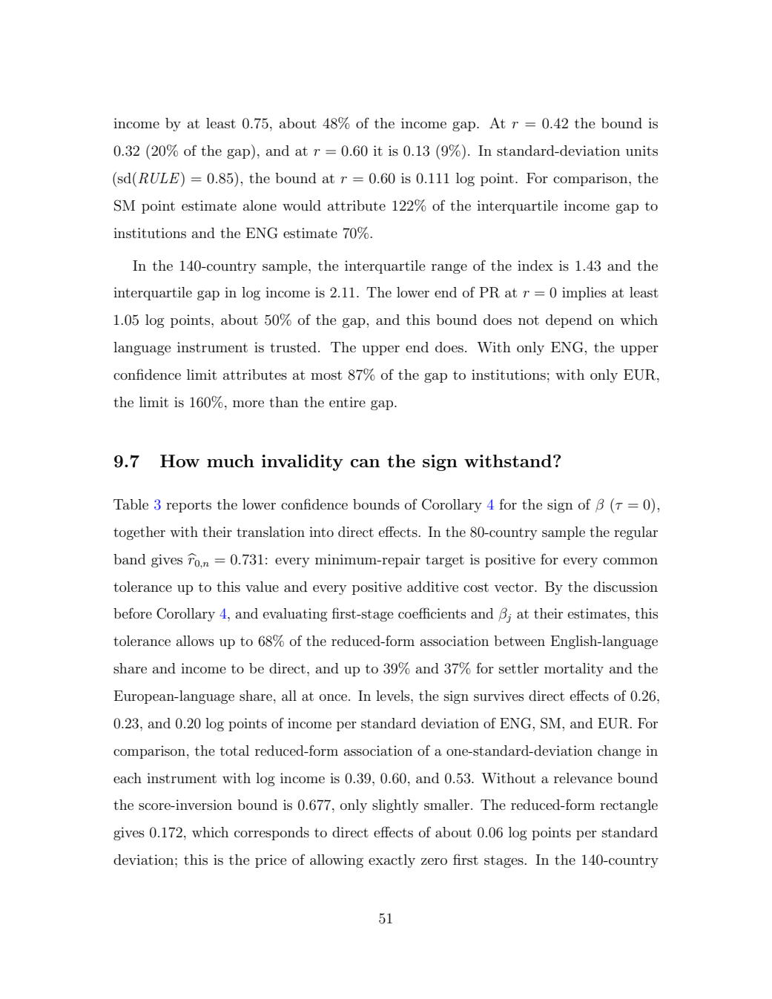

# Inference After Model Refutation: Uniform Post-Relaxation Inference for Partially Identified Models

<!-- 全库方法复筛开始 -->
> **方法储备 · 训练目标与数据反馈**。保留“模型假设被证伪后的推断调整”这一研究问题或机制；是否用于当前业务另行验证。
> 原有阅读范围与证据等级不变；储备不等于效果已验证。
> 已恢复此前因业务距离被移出的原笔记；旧取舍原因仅作历史记录。
> [[研究前沿/论文库复筛与阅读路线|全库阅读路线]] · [[研究前沿/训练目标与数据反馈/存量论文分层索引|本方向完整分层]]
<!-- 全库方法复筛结束 -->

## 几组工具假设都可能失效，挑一种修补后得出的方向还稳吗？

数据能推翻全部工具同时有效，却未必分得清该放弃哪一项。论文对原始可观测矩只构造一个同时置信集，再让所有可能代价最小的假设放松方案都从这个集合投影到因果目标。

Hounyo, Ulrich。arXiv 首投 2026-11-11，本次核验 v1（2026-11-11，来源日期）。[论文与版本](https://arxiv.org/abs/2611.15552v1) · [本地原文](./assets/source/paper.pdf) · [本地 HTML](./assets/source/paper.html)

## 方法与估计对象

先指定允许放松的假设、代价和容差，对估计所依赖的原始矩求同时置信带。对带内每个可能参数判断哪些放松能以最低代价恢复相容，把这些可能方案的目标集合取并。对弱第一阶段另用不先作比值的约化形式。

在原始参数带 $K$ 上汇集各可行参数的最小修补目标集。若多个不等价放松都能恢复相容，只选一个会丢掉其他相容效应。

## 对照与证据

§9.6–9.7、表 2–3 的制度与收入例中，140 国样本在零容差下，所有候选修补投影的下端对四分位收入差至少解释约 50%。只相信 ENG 工具时，对所解释差距的上限为 87%，只相信 EUR 时为 160%；哪项假设放松影响上端，方向在给定候选类内较稳健。80 国样本的常规置信带给出保持正号的共同容差下界 0.731。

§9.6–9.7，不同修补允许的收入差距范围与保持正号的条件。原始 PDF 第 51 页。

## 识别条件与适用范围

同时有效性依赖原始置信带、允许放松的集合及代价真实覆盖可接受假设；案例中的正号仍是工具模型下的推断。界可能较宽甚至不连通。

本轮从论文正文与作者标注中未取得可验证的配套代码入口。

本次精读覆盖上述方法、证据页和相关限制。附录中的其他推导与实验未逐项复算。

[[研究前沿/uplift模型迭代/02-可复用方法卡/投影全部仍可能最小的假设放松方案|投影全部仍可能最小的假设放松方案]] · [[研究前沿/uplift模型迭代/03-实验假设与结果/在工具假设无法区分时单一修补会漏掉多少相容效应|在工具假设无法区分时单一修补会漏掉多少相容效应]]
