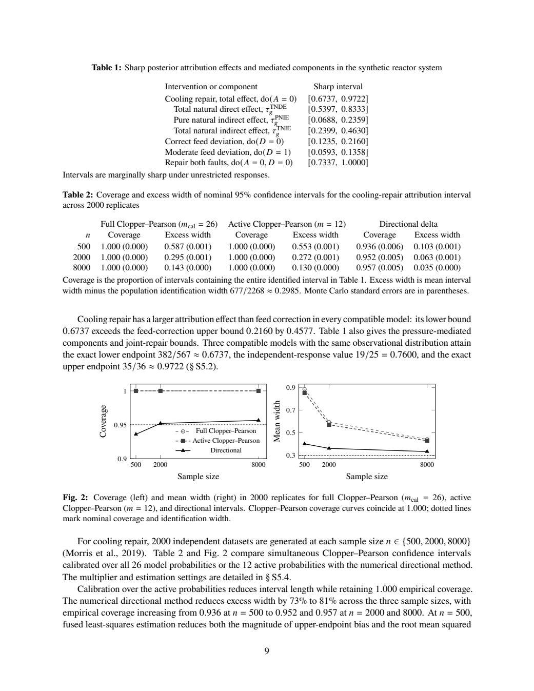

# Sharp bounds for posterior causal attribution given complete factual records

<!-- 全库方法复筛开始 -->
> **方法储备 · 训练目标与数据反馈**。保留“个体因果归因的后验边界”这一研究问题或机制；是否用于当前业务另行验证。
> 原有阅读范围与证据等级不变；储备不等于效果已验证。
> 已恢复此前因业务距离被移出的原笔记；旧取舍原因仅作历史记录。
> [[研究前沿/论文库复筛与阅读路线|全库阅读路线]] · [[研究前沿/训练目标与数据反馈/存量论文分层索引|本方向完整分层]]
<!-- 全库方法复筛结束 -->

## 一条完整的历史记录，能把另一个动作的结果确定到什么程度？

即使某次事件的所有节点取值都已观察，共同出现的事实仍不决定另一条行动路径。论文把每个节点未知的跨世界响应限制成一组可行概率，并在这些约束下求这一次事件的反事实归因范围。

Zhou, Liyao、Sun, Xinwei。arXiv 首投 2026-11-08，本次核验 v1（2026-11-08，来源日期）。[论文与版本](https://arxiv.org/abs/2611.11307v1) · [本地原文](./assets/source/paper.pdf) · [本地 HTML](./assets/source/paper.html)

## 方法与估计对象

输入离散因果图、完整事实取值和可识别的局部响应边际。依事实条件更新每个节点的可行响应单纯形，按图把局部响应拼成反事实期望，再在可行乘积空间上取上下极值。可用额外单调响应约束缩小可行集。

定理 2 表明，有限 Markovian SCM、正概率事实及所需边际可识别时，$[\min_q\Psi(q),\max_q\Psi(q)]$ 内每个值都可由相容模型达到。

## 对照与证据

表 1 在同一合成反应器事实记录上，冷却修复的归因范围为 [0.6737,0.9722]，下界仍高于供料修复的上界 0.2160。表 2 对 n=500 的 2,000 次模拟，方向性区间覆盖 0.936，超识别宽度 0.103；全参数 Clopper–Pearson 为 1.000 和 0.587。区间覆盖与识别集自身宽度是两件事。

表 1–2，合成系统的锐界与区间比较。原始 PDF 第 9 页。

## 识别条件与适用范围

依赖有限状态、已知因果顺序、独立机制与完整事实记录。单个事件的后验归因不能直接替代人群 CATE 或一个可操作的策略收益。

本轮从论文正文与作者标注中未取得可验证的配套代码入口。

本次精读覆盖上述方法、证据页和相关限制。附录中的其他推导与实验未逐项复算。

[[研究前沿/uplift模型迭代/02-可复用方法卡/按完整事实记录组合局部响应约束求反事实界|按完整事实记录组合局部响应约束求反事实界]] · [[研究前沿/uplift模型迭代/03-实验假设与结果/哪些事实约束足以稳定比较两次干预的归因|哪些事实约束足以稳定比较两次干预的归因]]
