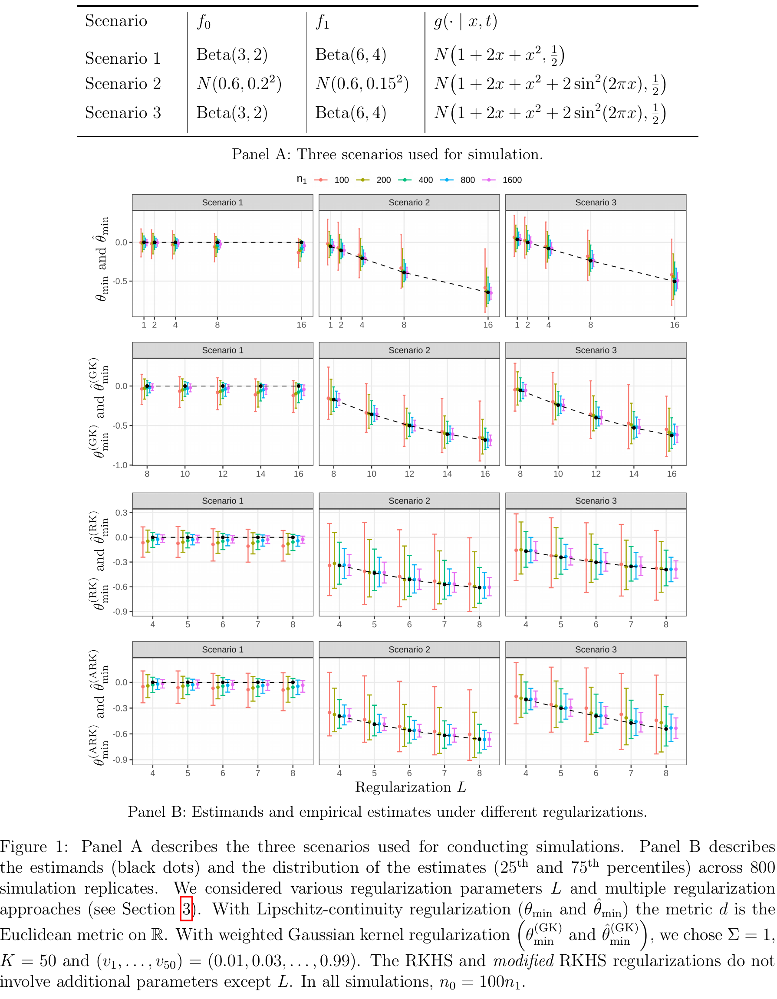

# Estimating Treatment Effects with a Single Arm Clinical Trial and Data Summaries from an External Control Group: is it Possible?

[官方论文](https://arxiv.org/abs/2611.05016) · [本地PDF](./assets/source/paper.pdf) · [HTML快照](./assets/source/paper.html)

版本记录：[Submitted on 3 Nov 2026]；本次核验与精读：2026-11-06。本篇为滚动窗口内首次入库；检索日不等于首次发表日。

阅读范围：§3定义/LP/优化偏差与分割修正，§4模拟和§5限制；补充材料渐近证明未逐行复核。未逐行复证全部数学证明，未声称逐页翻译。[[研究前沿/uplift模型迭代/01-论文原文与精读/PotentialEffectsInterval/阅读覆盖|原文章节与公式索引]]；HTML为原始快照，外部样式和图片可能需要联网，PDF可离线阅读。

代码：本次核验的论文原文与元数据未提供可确认的作者实现入口；代码状态未知，不能据此断言不存在。未运行代码。 [[研究前沿/uplift模型迭代/01-论文原文与精读/PotentialEffectsInterval/代码核验|核验记录]]

## 问题：只有外部对照汇总统计时，点估计可能过度确定

处理组有个体数据，对照只有协变量均值/二阶矩和结果均值。即使样本无限大，少量矩也无法确定对照协变量分布f0。本文定义与汇总统计、支持和正则条件相容的分布集合F，估计可行效果范围：
$$IPE=[\inf_{f\in F}\{\int m_1(x)f(x)dx-\mu_0\},\sup_{f\in F}\{\int m_1(x)f(x)dx-\mu_0\}].$$
它是部分识别区间，**不是95%置信区间**，端点本身还有采样不确定性。

## 权重优化与偏差修正（§3）

相对MAIC指数矩平衡权重，限定log权重剩余项的Lipschitz变化；样本实现要求权重非负、和/一二阶矩匹配、成对权重比界，变成线性规划分别求最小/最大加权结果。另有高斯核权重族GK，L决定允许的分布范围。

直接同样本优化端点会挑中噪声；多最优解时极限为相关高斯变量最小值，产生n⁻¹ᐟ²级偏差。重复分割A/B：A估计极值权重函数，B估值；仅分割仍有估计可行域偏差。Eq27加入从P_A向P_B扰动权重解的方向导数修正，数值用Richardson外推；再平均多分割。Prop3需n1/n0→0等正则，不是有限样本无偏保证。

## 效果证据与边界

§4用真实GBM协变量生成仿真、独立删失、相同条件结果模型，n处理200/对照1000、1000重复。零效应时朴素端点bias−2.66/+2.59月，修正后−0.08/+0.09；参考全个体IPW bias0.27。下端点95%区间在该仿真覆盖95.3%。这是理想外部迁移条件下的模拟，不是某疗法有效性证据。

真值须落在F，L/核族/距离改变结论；仍需要无未测混杂、支持和跨人群条件结果可迁移，不能用区间解决未知选择偏差。原文对不可行优化约定返回0；工程归档应明确失败状态，不能当零效应。可用IPE宽度判断汇总数据是否足以支持迭代方向，以及优先补哪些统计。

## 原文关键图表

原文 Figure 1，PDF 第 9 页；原始裁图，机制和证据解释见上文。裁图坐标与源文件校验值见 assets/source/figure-provenance.json。

## 方法卡

- [[研究前沿/uplift模型迭代/02-可复用方法卡/PotentialEffectsInterval-summary-effect-bounds|由外部汇总统计约束的效果可行区间]]
