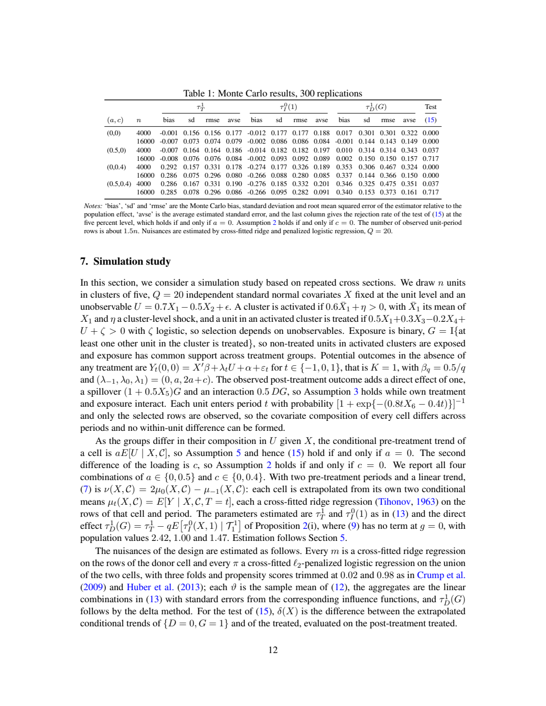

# Doubly robust estimation of direct and spillover effects using multiple pre-treatment periods

<!-- 全库方法复筛开始 -->
> **方法储备 · 训练目标与数据反馈**。保留“处理前面板信息修正外溢效应”这一研究问题或机制；是否用于当前业务另行验证。
> 原有阅读范围与证据等级不变；储备不等于效果已验证。
> 已恢复此前因业务距离被移出的原笔记；旧取舍原因仅作历史记录。
> [[研究前沿/论文库复筛与阅读路线|全库阅读路线]] · [[研究前沿/训练目标与数据反馈/存量论文分层索引|本方向完整分层]]
<!-- 全库方法复筛结束 -->

## 没有完全不受溢出影响的对照组，还能分开直接和邻居效应吗？

处理前若没有提前反应，各组的多期历史都能提供一个零干预基准。先在受处理组和各暴露水平的未处理组分别外推无干预趋势，再在共同支持的人群间迁移溢出，才能拆分处理组的总效应。

Huber, Martin。arXiv 首投 2026-10-27，本次核验 v3（2026-11-12，来源日期）。[论文与版本](https://arxiv.org/abs/2610.37049v3) · [本地原文](./assets/source/paper.pdf) · [本地 HTML](./assets/source/paper.html)

旧稿修订。对照 10 月 29 日 v2 与 v3，核心分解已见 v2；v3 的定理 1 后补充了交叉验证选趋势阶数时唯一最小值与间隔条件，重写仿真讨论并列明按四个历史起点向前验证趋势的方案。

## 方法与估计对象

按自身处理和邻居暴露分组，以多期处理前数据拟合组内反事实趋势。获得处理组总效应与未处理组的暴露效应后，按处理组特征和暴露重加权，以交叉拟合的双重稳健得分迁移到同暴露的处理组。检查干预前预测、重叠以及额外的平行趋势检验。

在文中同质性和重叠成立时，处理组的直接效应 = 总效应 − 迁移到处理组的溢出效应。双重稳健得分用于迁移，不能纠正无干预趋势的结构错设。

## 对照与证据

v3 表 1 以 300 次模拟区分两种违背。n=16,000、a=0、c=0.4 时，三项估计偏差为 0.286、−0.266、0.337，但额外平行趋势检验的拒绝率仍是 0；a=0.5、c=0 时检验拒绝率 0.717，三项偏差仅 −0.008、−0.002、0.002。a 与 c 分别控制不同假设。表 3 的历史专利案例总效应为 0.799，直接 0.418，溢出 0.382。

v3 表 1，两种假设的分离模拟。原始 PDF 第 12 页。

## 识别条件与适用范围

需要正确的无干预趋势、无预期、暴露定义，以及给定特征和暴露后可迁移。受处理后才出现的趋势冲击不必被干预前检验发现。

本轮从论文正文与作者标注中未取得可验证的配套代码入口。

本次精读覆盖上述方法、证据页和相关限制。附录中的其他推导与实验未逐项复算。

[[研究前沿/uplift模型迭代/02-可复用方法卡/用处理前趋势和同暴露迁移拆分总效应|用处理前趋势和同暴露迁移拆分总效应]] · [[研究前沿/uplift模型迭代/03-实验假设与结果/平行趋势检验看不见哪类处理后趋势偏离|平行趋势检验看不见哪类处理后趋势偏离]]
