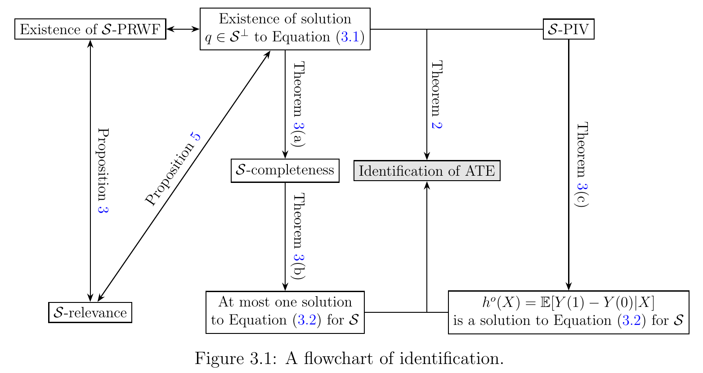

# Estimating Average Treatment Effects with Projected Instrumental Variables

[官方论文](https://arxiv.org/abs/2611.00705) · [本地PDF](./assets/source/paper.pdf) · [HTML快照](./assets/source/paper.html)

版本记录：[Submitted on 31 Oct 2026]；本次核验与精读：2026-11-06。本篇为滚动窗口内首次入库；检索日不等于首次发表日。

阅读范围：§2.2–2.4识别条件、§4.1去偏score与自适应动机、§7模拟和§8应用；一般逆问题与83页证明未逐行复核。未逐行复证全部数学证明，未声称逐页翻译。[[研究前沿/uplift模型迭代/01-论文原文与精读/ProjectedIV/阅读覆盖|原文章节与公式索引]]；HTML为原始快照，外部样式和图片可能需要联网，PDF可离线阅读。

代码：已核验[作者仓库](https://github.com/chensy123-sys/Projected-IV)，commit `262641a8deb5b2078f049832bed36eed3b7538ed`；入口：[PIV.R](https://github.com/chensy123-sys/Projected-IV/blob/262641a8deb5b2078f049832bed36eed3b7538ed/PIV.R)。已读取入口声明/关键片段，未审计全部实现、未安装运行。 [[研究前沿/uplift模型迭代/01-论文原文与精读/ProjectedIV/代码核验|核验记录]]

## 为什么保留

当候选工具变量Z对基线结果有直接关联时，标准IV排除限制失败。本文用允许的基线函数空间S吸收这些关联，在其正交补上保留处理变化；它扩大可用识别结构，但绝不是自动修复任意无效IV。

## 识别与去偏分数（§2、§4）

S为含L2(X)且对有界X系数乘法封闭的闭Hilbert子空间，投影记P_S。取权重π，令r=π−P_Sπ；条件强度κ=E[rA|X]须有界离零。要求基线 $E[Y(0)|Z,X]\in S$，且 $Cov(A r,Y(1)-Y(0)|X)=0$ 对规定权重成立。

$$ATE=E[rY/\kappa(X)].$$

去偏score写成 $\mu(X)+\frac r\kappa[(Y-\eta)-(A-\delta)\mu]$，其中η=P_SY、δ=P_SA，μ是残差加权结果/处理比。用分折训练nuisance、留出折平均score并估方差。自适应权重π*=E[A|Z,X]另需相应影响函数处理权重估计误差，不能直接把插件当已去偏。

空间大更容许直接效应，但会消去工具变量强度、增加方差；空间太小则识别偏差。广义同方差条件下π*的方差优势限于比较的权重泛函类，不是整个较小因果模型的效率下界。

## 实验与边界

§7六DGP、n5000、500重复、5折：PIV1/PIV2覆盖大约0.930–0.964；过于激进PIV3在多个场景覆盖0，DGP1偏差0.6668。TSHT在符合其假设的DGP6覆盖0.948，不能把其他场景胜出理解为无条件压倒基线。实际实现省略内部cross-fit，原文已披露。

§8澳大利亚教育工资实例，PIV2/3/4估计2.75/2.84/6.27反映假设敏感性，不是工具有效性已验证。代码提供公开入口；本次未跑。适合研究结构化无效工具变量和敏感性比较，不适合仅凭日志中任意相关特征产生工具变量。

## 原文关键图表

原文 Figure 3.1，PDF 第 12 页；原始裁图，机制和证据解释见上文。裁图坐标与源文件校验值见 assets/source/figure-provenance.json。

## 方法卡

- [[研究前沿/uplift模型迭代/02-可复用方法卡/ProjectedIV-projected-score|允许基线关联空间之外的IV残差去偏]]
