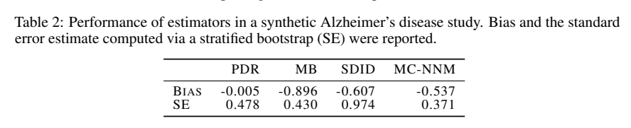

# Proximal Difference-in-Differences for Causal Learning under Confounding and Outcome Drift

<!-- 全库方法复筛开始 -->
> **方法储备 · 训练目标与数据反馈**。保留“代理变量下的近端双重差分”这一研究问题或机制；是否用于当前业务另行验证。
> 原有阅读范围与证据等级不变；储备不等于效果已验证。
> 已恢复此前因业务距离被移出的原笔记；旧取舍原因仅作历史记录。
> [[研究前沿/论文库复筛与阅读路线|全库阅读路线]] · [[研究前沿/训练目标与数据反馈/存量论文分层索引|本方向完整分层]]
<!-- 全库方法复筛结束 -->

当随机试验对照组在延长期改为接受治疗，缺失的是继续不治疗的长期轨迹。作者保留试验内短期结局作为起点，只从外部观测组迁入未处理趋势，并用两类代理校正潜在混杂。

Sihyung Park、Shu Yang、Ilya Lipkovich、Wenyu Ye、Mingyang Shan。arXiv v1 首投 2026-11-06。[版本记录](https://arxiv.org/abs/2611.10310v1) · [原文 PDF](./assets/source/paper.pdf)

## 研究问题与方法

令 $S=1$ 表示试验，$A_{pre}=0$ 表示原对照，$S=0$ 表示外部对照。继续不处理时的长期均值是要补的分量。绝对结局在相同人群特征下仍允许有研究来源差异，但固定观测及潜在特征时，未处理时间趋势必须跨来源可迁移。两端都观察趋势混杂的代理 $W$；来源混杂代理 $Z$ 可只在外部对照观察。代理独立性、完备性和人群覆盖是识别条件。

用外部对照的结局变化 $\Delta Y$ 求趋势桥 $d(W,X)$，用研究来源分布求来源桥 $q(Z,X)$。令 $R=S(1-A_{pre})$，双重稳健估计的样本版为

$$
\hat\tau=\frac{\mathbb P_n\{R[Y_{pre}+\hat d(W,X)]+(1-S)\hat q(Z,X)[\Delta Y-\hat d(W,X)]\}}{\mathbb P_n R}.
$$

第一部分在试验原对照上加上预测趋势，第二部分用外部对照的趋势残差校正。定理 4.2 在代理与迁移假设及正则性条件下，只要求两个桥至少一个正确以得到一致点估计；局部有效性及推断还须更强条件。

## 原文比较

图 3 与附表 4 在 n=500 的 500 次重复中分别错设两个桥；非线性情形仍有有限样本偏差与轻度欠覆盖。表 2 用阿尔茨海默病数据矩特征构造半合成世界，模拟试验对照在第 28 周后改用处理。预测其继续对照到第 52 周的轨迹，PDR 的偏差 −0.005、bootstrap SE 0.478，MB 为 −0.896/0.430，SDID 为 −0.607/0.974，MC-NNM 为 −0.537/0.371。这里对照的真值来自生成器。

## 适用条件与迁移

若隐藏因素对未处理时间趋势的作用在两研究不同，或代理受不该进入它的干预路径影响，双重稳健不能恢复识别。需要多个时间点、稳定口径、来源重叠与可信的代理结构。[作者主页](https://naturale0.github.io/) 记载 2026-03 已作相关主题报告，11-06 为本次 arXiv 首投；作者及 arXiv 标注 NeurIPS 2026 接收，正式出版日期待核。

**精读范围**　§§2–5、定理 3.6、3.7、4.2、表 2、附表 3–4；未复证缺失结果推广。

**作者实现**　未核到与本文对应的公开复现入口。

[[研究前沿/uplift模型迭代/02-可复用方法卡/保留试验短期结局并通过双桥迁移未处理趋势|保留试验短期结局并通过双桥迁移未处理趋势]] · [[研究前沿/uplift模型迭代/03-实验假设与结果/外部对照的水平漂移和趋势漂移怎样影响长周期增量|候选实验]]
