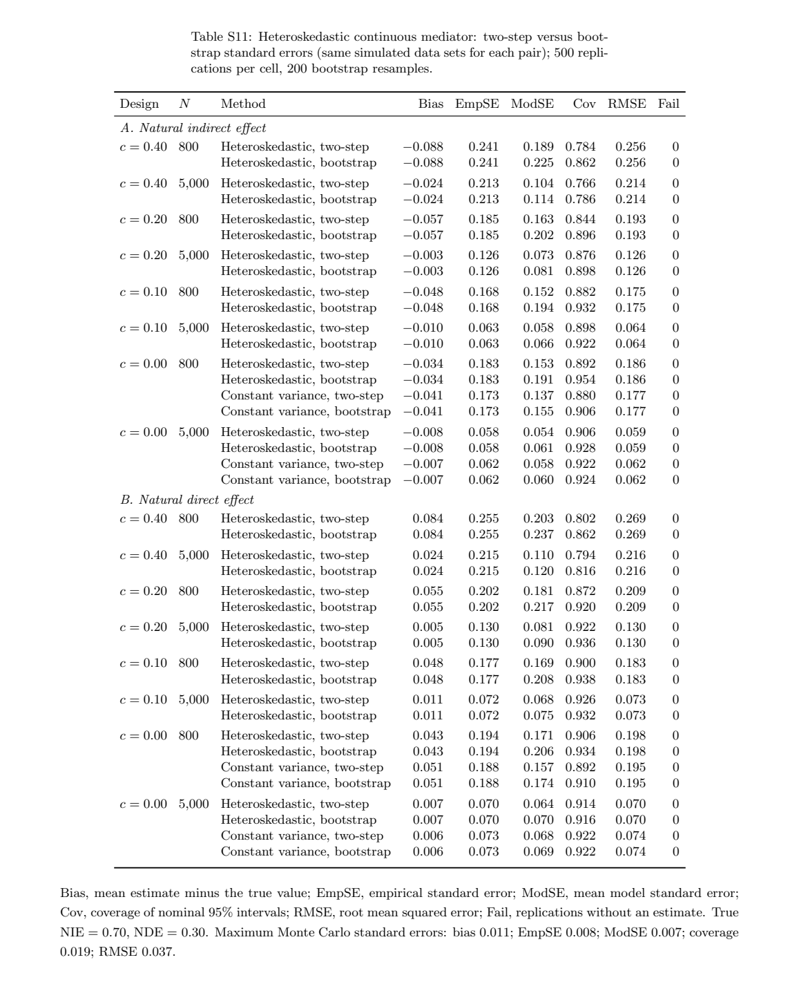

# Ratio-of-mediator-probability weighting for causal mediation analysis: estimation, extensions, and practical guidance

<!-- 全库方法复筛开始 -->
> **方法储备 · 训练目标与数据反馈**。保留“中介变量的密度比加权”这一研究问题或机制；是否用于当前业务另行验证。
> 原有阅读范围与证据等级不变；储备不等于效果已验证。
> 已恢复此前因业务距离被移出的原笔记；旧取舍原因仅作历史记录。
> [[研究前沿/论文库复筛与阅读路线|全库阅读路线]] · [[研究前沿/训练目标与数据反馈/存量论文分层索引|本方向完整分层]]
<!-- 全库方法复筛结束 -->

用中介在两种处理下的条件密度比，可以在不拟合结局回归的情况下重建某些反事实均值。连续中介即便使用了正确的异方差模型，少量极大权重仍会使区间严重欠覆盖。

Linden, Ariel。arXiv 首投 2026-11-09，本次版本 v1（2026-11-09，按来源日期）。 [版本记录](https://arxiv.org/abs/2611.13206v1) · [本地原文](./assets/source/paper.pdf) · [原文 HTML](./assets/source/paper.html)

## 研究问题与机制

§2 复制对应处理组样本，按中介在另一处理下与实际处理下的条件概率或密度之比重加权。通过比较观察均值与加权均值得到自然间接、直接效应，并允许处理与中介交互。作者将连续中介的均值与对数方差一并拟合，并在两步方差中计入权重拟合误差；按副本报告最小有效样本量。基本密度比方法已有先前文献，扩展与继承项由表 1 区分。

把 $a$ 组中介分布变为 $b$ 组时取 $w=f(M\mid T=b,X)/f(M\mid T=a,X)$；$\mathrm{ESS}=(\sum w)^2/\sum w^2$。观察研究还需处理分配的相应调整。

## 对照与证据

补表 S11 固定同样的模拟数据，连续中介强异方差 c=0.40、N=5,000，正确的异方差模型估计间接效应平均偏差 −0.024。500 次重复的经验标准误为 0.213，两步法与 bootstrap 报 0.104/0.114，95% 区间实际覆盖为 76.6%/78.6%。§5.3 同场景的平均最小 ESS 占比为 15.5%。

补表 S11，相同模拟数据下的两步与 bootstrap 标准误。

## 假设、局限与复核范围

处理随机也不保障中介—结局无混杂。对中介分布和重叠的依赖会延续到自然直接/间接效应，重抽样不能恢复缺乏观测支持的区域。

原作者 Stata 程序 mmwsmed.ado，文件头 1.1.0（2026-11-08）修正因子变量遗漏最低非基准水平问题。[Boston College 的 SSC 原文件](http://fmwww.bc.edu/repec/bocode/m/mmwsmed.ado)

本次核查了上文的方法、直接对照与适用条件，尚未本地复现实验。

[[研究前沿/uplift模型迭代/02-可复用方法卡/用中介密度比重建反事实分布并检查有效样本量|用中介密度比重建反事实分布并检查有效样本量]] · [[研究前沿/uplift模型迭代/03-实验假设与结果/方差模型拟合正确时权重集中会不会仍然破坏覆盖|方差模型拟合正确时权重集中会不会仍然破坏覆盖]]
