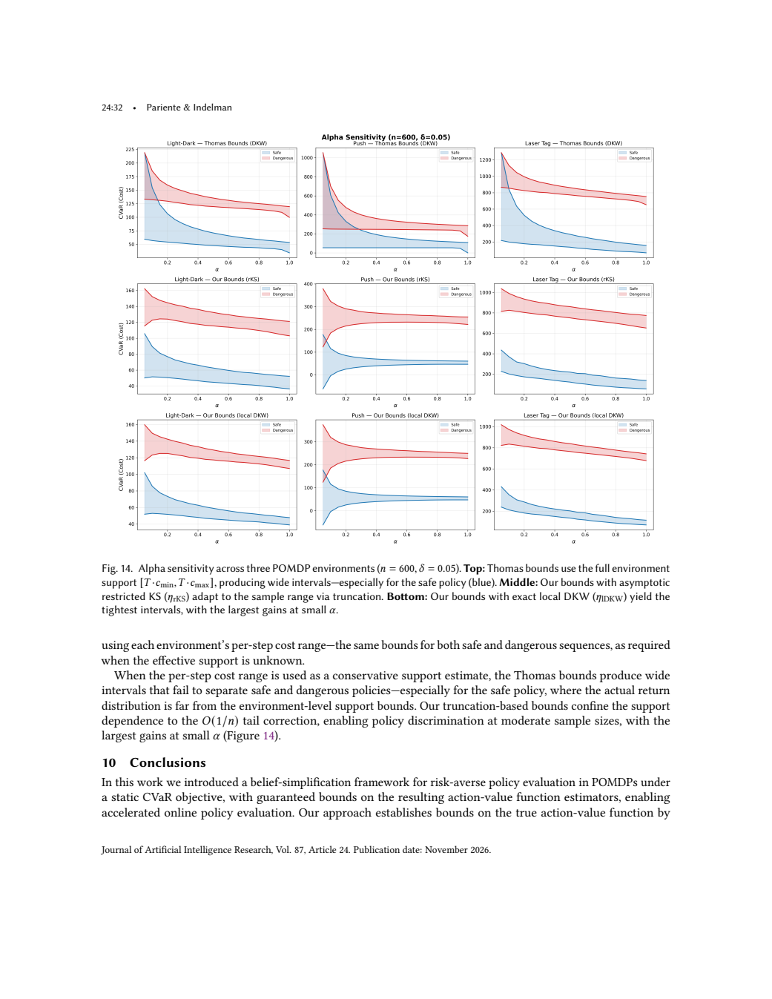

# Accelerated Online Risk-Averse Policy Evaluation in POMDPs with Theoretical Guarantees and Novel CVaR Bounds

<!-- 全库方法复筛开始 -->
> **方法储备 · 业务决策与理论储备**。保留“部分可观察状态下的 CVaR 近似决策”这一研究问题或机制；是否用于当前业务另行验证。
> 原有阅读范围与证据等级不变；储备不等于效果已验证。
> 已恢复此前因业务距离被移出的原笔记；旧取舍原因仅作历史记录。
> [[研究前沿/论文库复筛与阅读路线|全库阅读路线]] · [[研究前沿/业务决策与理论储备/存量论文分层索引|本方向完整分层]]
<!-- 全库方法复筛结束 -->

## 用简化环境评价尾部风险时，何时可以提前淘汰一个动作？

对部分可观测的序列决策，最坏一部分轨迹的累计成本取决于整段路径。作者用较便宜的近似模型构造原模型下的尾部成本界，只有候选动作与另一动作的界完全分开时才提前淘汰。期刊稿进一步比较了怎样缩紧有限样本的风险界。

Pariente, Yaacov、Indelman, Vadim。arXiv 首投 2026-02-26；正式发表于 2026-11-13。[论文与版本](https://doi.org/10.1613/jair.1.22332) · [本地期刊全文](./assets/source/paper.pdf) · [预印本版本页](https://arxiv.org/abs/2602.23073v1) · [本地预印本文本](./assets/source/preprint.html)

2026-02-26 首次公开 arXiv v1。本周事件为 JAIR 第 87 卷第 24 篇于 11-13 正式发表。比对 56 页 v1 与 67 页期刊稿，正式版 §9.6–9.7、图 14–15 增加精确局部 DKW、渐近局部 KS 与全局界的对照，原 v1 图 14 为简化环境计时。

## 方法与估计对象

给定信念状态、固定后续策略与动作，从简化信念转移模型生成分支轨迹。用近似与原模型之间的分布差异界修正累计成本的上尾 CVaR，另计样本误差。正式版将罕见尾部与样本覆盖区间分开，利用局部 DKW 集中界收缩后者；将成本较高且下界已高于其他动作上界的动作排除。

若比较的是成本且候选 $a$ 的下界 $L_a$ 大于另一动作 $b$ 的上界 $U_b$，则在同时成立的界上有 $\mathrm{CVaR}(a)>\mathrm{CVaR}(b)$。界重叠时保留两者；多次比较的误差保证取决于论文所用的界与置信水平。

## 对照与证据

期刊版 §9.6–9.7、图 14–15 在三个 POMDP 环境中比较全局支持区间、截断加渐近局部 KS、截断加精确局部 DKW；作者报告在所测分布的最大样本数下，相对 Thomas–Learned-Miller 界，区间收窄 56%–88%，所试分布和样本量经验覆盖均为 100%。另在固定的 Light-Dark/BetaZero 策略中，简化观测模型在时域 4–12 和回报样本 100–1000 时评价加速 4.4–4.8 倍（图 13），两项比较的基线不同。

图 14，三种置信界在相同样本规模、风险水平下的表现。原始 PDF 第 32 页。

## 识别条件与适用范围

目标是固定策略累计成本的静态上尾 CVaR。最优动作的保证依赖可信的原模型与简化模型误差界、成本支持和采样条件；三类仿真不等于真实系统的风险覆盖，也没有替代历史日志所需的反事实识别。

本轮从论文正文与作者标注中未取得可验证的配套代码入口。

本次精读覆盖上述方法、证据页和相关限制。附录中的其他推导与实验未逐项复算。

[[研究前沿/uplift模型迭代/02-可复用方法卡/利用简化环境的尾部成本上下界筛动作|利用简化环境的尾部成本上下界筛动作]] · [[研究前沿/uplift模型迭代/03-实验假设与结果/区间缩窄能否在相同误淘汰率下减少真实环境采样|区间缩窄能否在相同误淘汰率下减少真实环境采样]]
