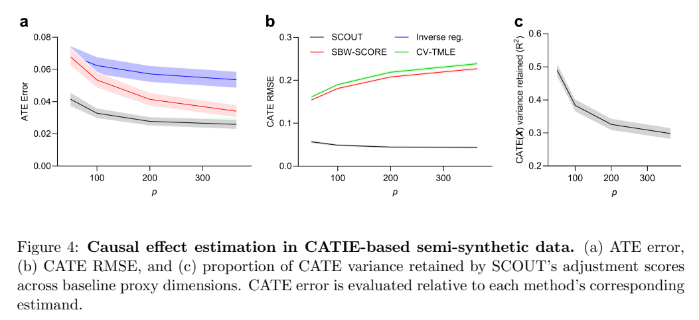

# Causal Outcome Learning with Noisy Proxies

<!-- 全库方法复筛开始 -->
> **方法储备 · 训练目标与数据反馈**。保留“Causal Outcome Learning with Noisy Proxies”这一研究问题或机制；是否用于当前业务另行验证。
> 原有阅读范围与证据等级不变；储备不等于效果已验证。
> [[研究前沿/论文库复筛与阅读路线|全库阅读路线]] · [[研究前沿/训练目标与数据反馈/存量论文分层索引|本方向完整分层]]
<!-- 全库方法复筛结束 -->

SCOUT 同时学一个非负加权结局与两维调整分数，并在随机化检验的每次重复中重学二者。半合成数据中，两维分数保留的原条件效应方差约 30%–49%，比较精度时必须写清所估目标。

Eric V. Strobl。arXiv v1 首投 2026-11-07。[版本记录](https://arxiv.org/abs/2611.10955v1) · [原文 PDF](./assets/source/paper.pdf)

## 研究问题与方法

条件异质性既取决于将哪些结果合成目标，也取决于选哪些特征定义亚组。设每次随访有 $r$ 项事前同向化的结果。先用全部基线代理计算一条处理方向和 $r$ 条经处理残差化的结局方向，经正则化矩阵求解得到至多 $r+1$ 条共同调整分数。这些方向张成每一种候选目标所需的线性空间，因而无需为每个权重从头拟合。

式（2）将处理和每项结局对初始分数残差化，用残差化结局重构残差化处理，以非负最小二乘拟合跨访视共享权重，再归一到和为一；每个访视按观测人数倒数加权。确定权重后只保留处理方向和组合结果方向，在线性工作模型中以处理与最终分数的交互估计 $\tau_k(s)$。这一目标条件在学到的分数上，和条件在全部基线 $X$ 上的 $\tau_k(x)$ 有别。

检验阶段拟合给定各访视分数的倾向，每人每次模拟共用整段访视的一次新分配。异质性原假设允许各项结果存在常数效应，因此按新旧分配差先调整结局，再重跑包括权重选择在内的全流程。用 $Q_k=\sqrt{n_k^{-1}\sum_i(\hat\tau_{ik}-\bar\tau_k)^4}$ 强调少数异质性大的人。

## 原文比较

图 4 的 CATIE 半合成保留真实基线载荷、生成已知效应，n=1,448，代理数从 50 到 364。SCOUT 与 CV-TMLE 的 ATE 误差接近；其各自目标下的 CATE RMSE 不可解释为恢复同一全特征 CATE 的胜负。图 4c 的保留方差约从 49% 降到 30%。真实 STEP-BD 观察数据中 481 人、19 项候选结局，学得组合的跨访视 ATE 0.250，10,000 次条件随机化后 Holm 调整 p=0.0026；异质性检验调整 p=0.033。多结局权重与倾向均由观察数据估计。

## 适用条件与迁移

论文在潜在基线状态上假设可交换性、正值性及相应代理与线性工作模型条件。稀有大偏差在四阶量中占比高，少数高噪声样本可改变检验。针对预先指定的利润或留存指标，重新学组合权重等于重新定义目标。

**精读范围**　§§3.2–4.3、算法 1、图 3–5、补图 S2/S7；未逐项复核所有附图和真实病例。

**作者实现**　[作者 R 包（R/SCOUT.R、R/SCOUT_CRT.R）与 Experiments](https://github.com/ericstrobl/SCOUT)

[[研究前沿/uplift模型迭代/02-可复用方法卡/先学共同调整分数再确定非负多结局目标|先学共同调整分数再确定非负多结局目标]] · [[研究前沿/uplift模型迭代/02-可复用方法卡/在条件随机化的每次重复中重学复合目标|在条件随机化的每次重复中重学复合目标]] · [[研究前沿/uplift模型迭代/03-实验假设与结果/二维修饰分数改善的误差来自估计更准还是条件目标变简单|候选实验]]
