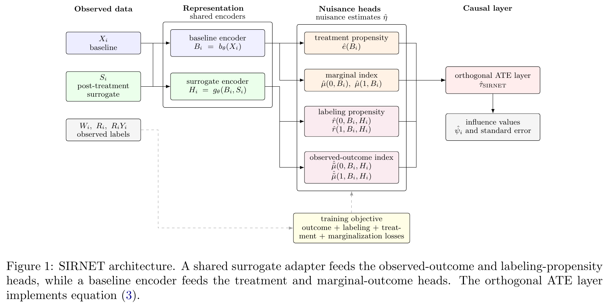
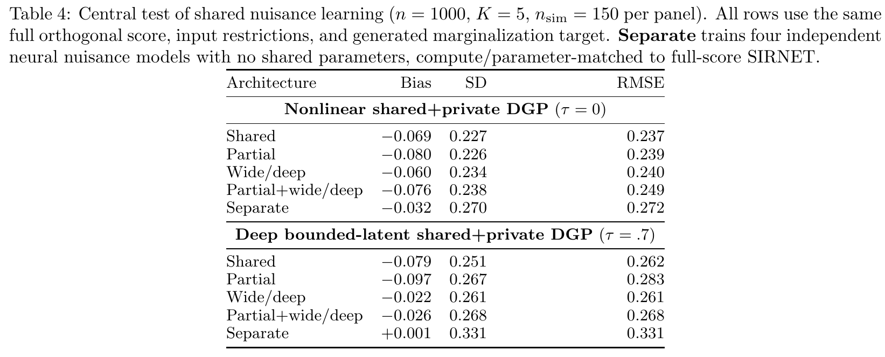

# SIRNET: Causal Adaptation of Pretrained Embeddings for Semiparametric Treatment-Effect Estimation Under Surrogacy

[官方论文](https://arxiv.org/abs/2610.14011) · [本地 PDF](./assets/source/paper.pdf) · [HTML 快照](./assets/source/paper.html)

首次提交：2026-09-29；本次精读：2026-11-05；核验版本：v1。会议正式发表日期未核验。本文是旧队列补精读，不是今日新发表。

阅读范围：核心方法、关键公式、主实验/理论条件及与迁移直接相关的附录。未逐行复证全部证明，也不称逐页翻译；具体覆盖见 [[研究前沿/uplift模型迭代/01-论文原文与精读/SIRNET/阅读覆盖|阅读覆盖]]。HTML 为原始快照，外部样式/图片可能需要联网；PDF 是完整离线原文。

代码状态：原文未提供可核验的公开官方仓库入口；未把文中本地脚本名、提交哈希或同名项目当成已取得代码。本次未运行作者代码。

## 1. 问题与方法定位

有全部人的处理前协变量、处理和短期代理信号，但长期结果只对部分人可见。冻结的通用 embedding 未必适合因果估计所需的多个辅助模型。SIRNET 用共享适配器共同学习这些模型，再用交叉拟合的正交分数计算 ATE 和标准误。它不是直接输出个体处理效应的已验证网络，也不从原始 MRI 端到端训练。

## 2. 数据、识别与相关工作（§2–3）

观测为 $O=(X,W,S,R,RY)$：$X$ 在处理前，$W$ 是二元处理，$S$ 是处理后代理，$R$ 表示长期结果是否观察到。处理可忽略性与重叠，加上 $R\perp Y\mid W,X,S$ 和结果观察概率重叠，是本文识别条件。这里不要求代理完全中介处理对结局的所有路径，但 MAR 不能由随机分组保证。

本文沿用已有半参数有效影响函数，新增价值主要是**与该分数匹配的多任务表征适配**。把已实现的处理后代理固定不变，直接比较两个处理臂的预测，会误处理其分布变化。

## 3. 网络、输入路由与训练（§4、附录A/B/F）

基线编码 $B=b_\theta(X)$；代理适配 $H=g_\theta(B,S)$。处理概率 $e$ 和两臂边际结果头 $\mu_w$ 只接 $B$；缺失概率 $r_w$ 与观察结果头 $\widetilde\mu_w$ 接 $(B,H)$。结果头只在 $R=1$ 的样本计算结果损失；缺失头和处理头用交叉熵。边际头在对应实际处理臂内拟合停止梯度的结果预测：

$$
\mathcal L_M=\sum_{w\in\{0,1\}}\frac{\sum_{i:W_i=w}\{\operatorname{sg}(\widehat{\widetilde\mu}_w(B_i,H_i))-\widehat\mu_w(B_i)\}^2}{\sum_i\mathbf 1(W_i=w)}.
$$

总目标是结果、缺失、处理、边际四类加权损失（原文§4.2）。stop-gradient 切断伪目标的直接回传，不等于完全切断共享编码器的所有耦合路径。

图表为原始PDF裁图，页码见图片说明及附件溯源记录；数字与标记以原图为准。

为紧凑起见，用原文分数的等价整理定义每臂校正量：

$$
D_w=\frac{R}{r_w(X,S)}(Y-\widetilde\mu_w(X,S))+\widetilde\mu_w(X,S)-\mu_w(X).
$$
$$
\widehat\tau=\frac1n\sum_i\left[\widehat\mu_1(X_i)-\widehat\mu_0(X_i)+\frac{W_i\widehat D_{1,i}}{\widehat e(X_i)}-\frac{(1-W_i)\widehat D_{0,i}}{1-\widehat e(X_i)}\right].
$$

**直观理解：** 先估计每个处理臂下代理的平均结果，再用该人的短期代理及实际观察到的长期结果分别纠偏。不是把代理预测直接替换长期结果。

五折交叉拟合：所有编码器、PCA、辅助头及超参数选择都应位于训练折内；留出折只计算分数。A4 完整分数使用折内嵌套选参。理论在辅助误差乘积率等条件下有效；网络优化达到所需误差不是自动保证。

## 4. 模块证据与主实验（Table 1–4）

最有针对性的模块证据是 Table 4：相同数据、折、分数、优化器、预算与接近参数量下，共享网络 vs 独立辅助网络。第一 DGP RMSE 0.237 vs 0.272；深层 DGP 0.262 vs 0.331。但第一 DGP bias −0.069 vs −0.032，主要收益是方差/RMSE，不能说共享令每个偏差都下降。深层 wide/deep 的0.261略优于共享0.262。

图表为原始PDF裁图，页码见图片说明及附件溯源记录；数字与标记以原图为准。

A4 校准半合成 Table 2：两设计 SIRNET RMSE 均0.056，XGBoost完整分数分别0.067/0.061，是有限优势。真实 A4 所选队列1129人，结果可见797人；完整 SIRNET估计 −0.044，SE0.035，95%CI [−0.112,0.024]。这是该分析队列的近零 ATE 结果，不能证明方法更准确，也不能表述为药物有效。

附录B.4保持任务难度、变化共享强度，支持测试范围内的共享收益；不构成任意业务任务都无负迁移的保证。真实数据先排除缺少合格代理的人，进一步限制结论人群。死亡导致的结局缺失、MAR及观察重叠仍是实质问题。

## 5. 迁移判断

适合研究“短期行为/履约轨迹代理长期价值”的辅助任务表征，以及延迟标签的正交估计。若用于 CATE、排序或策略价值，需单独设计目标与验证，不能把本文ATE精度转作个体效应证据。共享表征卡与正交分数卡可分别研究，但完整有效性依赖输入路由、缺失模型与交叉拟合。

## 方法卡与后续实验

- [[研究前沿/uplift模型迭代/02-可复用方法卡/SIRNET-shared-adapter|服务正交估计的共享辅助任务适配器]]
- [[研究前沿/uplift模型迭代/02-可复用方法卡/SIRNET-orthogonal-surrogate|处理后代理的臂内边际化与缺失结果纠偏]]
- [[研究前沿/uplift模型迭代/03-实验假设与结果/2026-11-05-共享辅助任务|共享辅助表征能否提升延迟结果估计精度（未运行）]]
