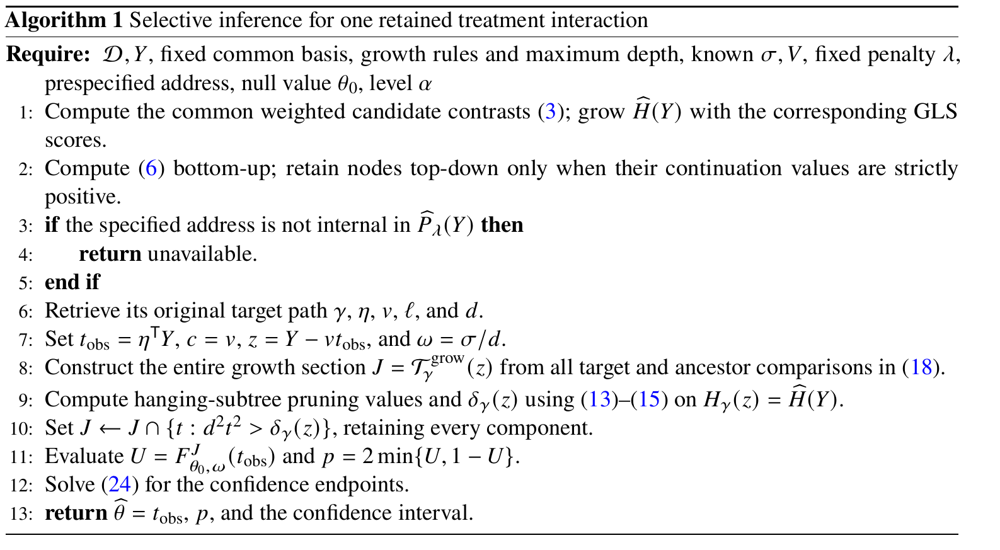

# Selective inference for pruned interaction trees with known unequal variances in randomized trials

[官方论文](https://arxiv.org/abs/2611.01134) · [本地PDF](./assets/source/paper.pdf) · [HTML快照](./assets/source/paper.html)

版本记录：[Submitted on 31 Oct 2026]；本次核验与精读：2026-11-06。本篇为滚动窗口内首次入库；检索日不等于首次发表日。

阅读范围：§3全部算法、§5.4–5.7校准/宽度/估计方差、§6.4和§7限制；证明不逐行复证。未逐行复证全部数学证明，未声称逐页翻译。[[研究前沿/uplift模型迭代/01-论文原文与精读/SelectiveTrees/阅读覆盖|原文章节与公式索引]]；HTML为原始快照，外部样式和图片可能需要联网，PDF可离线阅读。

代码：已核验[作者仓库](https://github.com/tomoshige/selective-inference-for-interaction-tree)，commit `928ba1396c3c645e100464a26c5b9de04de961b6`；入口：[reproduce.R](https://github.com/tomoshige/selective-inference-for-interaction-tree/blob/928ba1396c3c645e100464a26c5b9de04de961b6/reproduce.R)；[gls_tree.R](https://github.com/tomoshige/selective-inference-for-interaction-tree/blob/928ba1396c3c645e100464a26c5b9de04de961b6/gls_tree.R)。已读取入口声明/关键片段，未审计全部实现、未安装运行。 [[研究前沿/uplift模型迭代/01-论文原文与精读/SelectiveTrees/代码核验|核验记录]]

## 问题与整体方法

用同一数据发现人群再检验，尤其只报告剪枝后幸存节点，会夸大显著性。本文对预指定节点地址的原始GLS交互系数做选择后推断；树生长和剪枝都用全数据，但参考分布条件于选择事件。

## 选择事件的计算（§3）

所有节点使用同一预设预后基B与已知正对角方差形状V；处理×子节点指示交互列在[B,A,child]上做加权残差化，得估计 $T=\eta^TY$、目标 $\theta=\eta^T\mu$。生长按标准化交互score平方最大化，固定候选/最大深度；固定λ的剪枝最大化保留score和减λ×节点数，相等则剪去。

固定 $z=Y-cT$、$c=V\eta/(\eta^TV\eta)$，沿 $y(t)=z+ct$ 变化。可行集合
$$J(z)=\mathcal T_{grow}(z)\cap\{t:d^2t^2>\delta_\gamma(z)\}.$$

第二项是剪枝幸存的二次门槛，可用祖先score和旁支剪枝值缓存计算。对所有可行区间上的截断正态CDF计算双侧p值并反演CI。异方差时扰动方向c不是score loading；只改标准误而仍用OLS选择事件是错的。

## 证据与负面结论

§5.4固定高斯已知方差实验：D3、λ4的选择修正FPR约4.78–5.38%，同一保留目标朴素检验94.94–98.79%。强剪枝n100、λ8时，只修正生长FPR14.57%，再修正剪枝5.75%，隔离了新增门槛的贡献。

正确覆盖不等于有用精度。§5.6 n400第三层CI中位8.165，对诚实分割2.267；90分位47.195 vs2.924；根部中位可更短但尾部更长。比较方法各自选中的目标不同，不能当同一参数效率比赛。

保证是每个预指定地址、已知高斯方差、固定λ/生长规则下的条件有效性，**不是全树FWER**。估计方差仅经验检查；ACTG实例非高斯、子样本来源不明，仅名义工作模型计算。目标是有限设计加权交互，不自动等于普通人群ATE差。

可与ValidatableUplift诚实分割方案对比：全量发现换取更强模型假设、计算和可能极宽区间。未提供通用二元结果即用保证。

## 原文关键图表

原文 Algorithm 1，PDF 第 8 页；原始裁图，机制和证据解释见上文。裁图坐标与源文件校验值见 assets/source/figure-provenance.json。

## 方法卡

- [[研究前沿/uplift模型迭代/02-可复用方法卡/SelectiveTrees-pruning-selection|把剪枝幸存纳入交互树的选择后推断]]
