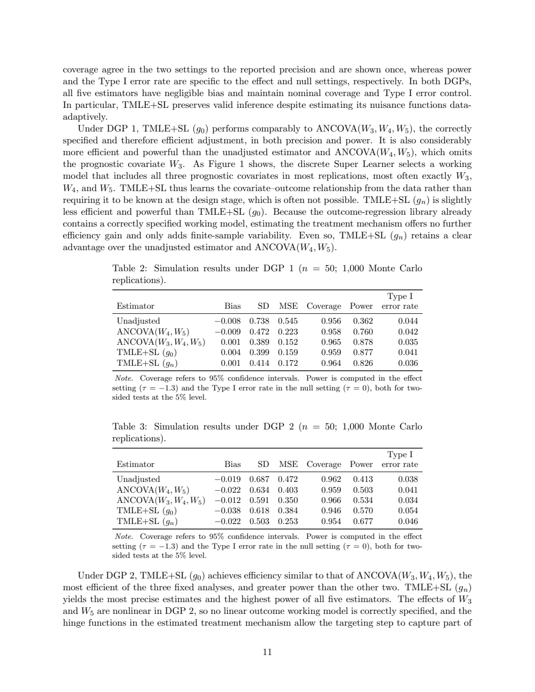

# Improving Efficiency and Power in Small Rare-Disease Trials Through Prespecified, Data-Adaptive Covariate Adjustment

<!-- 全库方法复筛开始 -->
> **方法储备 · 面向决策的履约建模**。保留“随机试验中已知和估计倾向分的反例对照”这一研究问题或机制；是否用于当前业务另行验证。
> 原有阅读范围与证据等级不变；储备不等于效果已验证。
> 已恢复此前因业务距离被移出的原笔记；旧取舍原因仅作历史记录。
> [[研究前沿/论文库复筛与阅读路线|全库阅读路线]] · [[研究前沿/面向决策的履约建模/存量论文分层索引|本方向完整分层]]
<!-- 全库方法复筛结束 -->

## 随机试验只有五十个样本，已知分配概率还值得重新估吗？

随机化已经给出真实分配概率。有限样本下，重新估概率有时能抵消协变量的偶然失衡，代价是另一层拟合噪声。作者在同一套预先指定的 TMLE 与 Super Learner 中只切换概率来源，两个结果机制下排序反转。

Zhou, Tianyue、Gruber, Susan、Lee, Hana、Lee, Wonyul、Nie, Lei、van der Laan, Mark。arXiv 首投 2026-11-11，本次核验 v1（2026-11-11，来源日期）。[论文与版本](https://arxiv.org/abs/2611.15071v1) · [本地原文](./assets/source/paper.pdf) · [本地 HTML](./assets/source/paper.html)

## 方法与估计对象

试验开始前确定结局回归的候选库和交叉验证方案。以已知分配概率或按基线变量重新估计的概率构造更新权重，将初始两臂结局回归瞄准平均效应，最后在共同的试验基线上标准化预测；在相同试验设计下比较覆盖与功效。

目标量为 $E_X[Q(1,X)-Q(0,X)]$；先学 $Q$ 再用指定 $g$ 构造靶向更新，已知随机化本身不依赖模型。

## 对照与证据

表 2–3 均为 n=50、1,000 次模拟。DGP 1 下已知 g 与估计 g 的 TMLE 功效为 0.877 和 0.826；DGP 2 有非线性预后关系时为 0.570 和 0.677，后者的 95% 覆盖为 0.954。DGP 1 下包含三项正确协变量的 ANCOVA 功效为 0.878。两类结果显示，额外拟合不保证提高效率。

表 2–3，两种结局机制下的功效与误报。原始 PDF 第 11 页。

## 识别条件与适用范围

目标是小型随机试验总体 ATE，不能据此断言对多档排序或观察数据也有效。需预先固定候选库、随机机制与评估标准。

本轮从论文正文与作者标注中未取得可验证的配套代码入口。

本次精读覆盖上述方法、证据页和相关限制。附录中的其他推导与实验未逐项复算。

[[研究前沿/uplift模型迭代/02-可复用方法卡/小型随机试验中配对比较已知和估计的处理概率|小型随机试验中配对比较已知和估计的处理概率]] · [[研究前沿/uplift模型迭代/03-实验假设与结果/已知随机化概率再估计的功效排序何时反转|已知随机化概率再估计的功效排序何时反转]]
