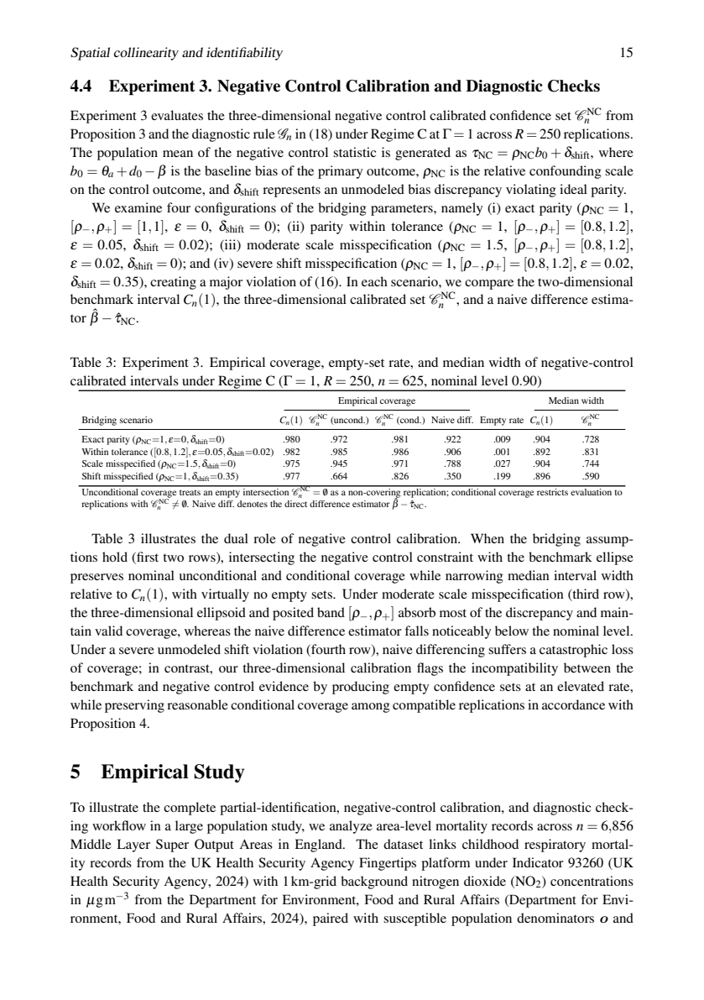

# Identifiability and partial identification under spatial confounding in additive risk models

<!-- 全库方法复筛开始 -->
> **方法储备 · 训练目标与数据反馈**。保留“空间混杂与重叠支持域检查”这一研究问题或机制；是否用于当前业务另行验证。
> 原有阅读范围与证据等级不变；储备不等于效果已验证。
> 已恢复此前因业务距离被移出的原笔记；旧取舍原因仅作历史记录。
> [[研究前沿/论文库复筛与阅读路线|全库阅读路线]] · [[研究前沿/训练目标与数据反馈/存量论文分层索引|本方向完整分层]]
<!-- 全库方法复筛结束 -->

## 空间平滑器自由度相同，为何处理效应还会有不同的可识别程度？

同样数量的空间自由度可以沿暴露方向，也可以与它近乎正交。论文用带 Fisher 权重的方向重叠量刻画损失的信息，再用可观测参照变量约束剩余空间混杂，展示负对照何时会错缩区间。

Pan, Sheng。arXiv 首投 2026-11-12，本次核验 v1（2026-11-12，来源日期）。[论文与版本](https://arxiv.org/abs/2611.16994v1) · [本地原文](./assets/source/paper.pdf) · [本地 HTML](./assets/source/paper.html)

## 方法与估计对象

在空间计数模型中先残差化暴露，分解平滑算子得到它在该方向上的投影；再比较含与不含参照协变量的系数，估暴露效应和基准差的联合协方差。对置信椭圆施加剩余混杂的倍数限制并投影；如有可信负对照，另取交集。

用 $\Gamma$ 乘以可观测基准差的绝对值约束剩余偏差。$\Gamma$ 和负对照桥接容差均为敏感性假设，需随结果一同报告。

## 对照与证据

表 2 中，生成器 C 含未被字典表示的跳变，n=625、10 个设计各 250 次，名义 90% 时真参数覆盖率随 Γ 从 0 到 1 由 0.662 提高到 0.977。表 3 在偏移量错设为 0.35 的负对照场景中，取交集将区间中位宽从 0.896 减至 0.590，含空集的无条件覆盖从 0.977 降到 0.664，19.9% 为空。

表 3，负对照桥接正确与错设的对照。原始 PDF 第 15 页。

## 识别条件与适用范围

目标是特定空间加性风险模型的暴露系数。基准变量及负对照的尺度、偏移若不可靠，收窄会掩盖不确定性。覆盖比较来自模拟而非真实区域干预。

本轮从论文正文与作者标注中未取得可验证的配套代码入口。

本次精读覆盖上述方法、证据页和相关限制。附录中的其他推导与实验未逐项复算。

[[研究前沿/uplift模型迭代/02-可复用方法卡/投影暴露与基准差的联合椭圆核查残余空间混杂|投影暴露与基准差的联合椭圆核查残余空间混杂]] · [[研究前沿/uplift模型迭代/03-实验假设与结果/负对照带来的区间缩窄能否通过错设压力测试|负对照带来的区间缩窄能否通过错设压力测试]]
