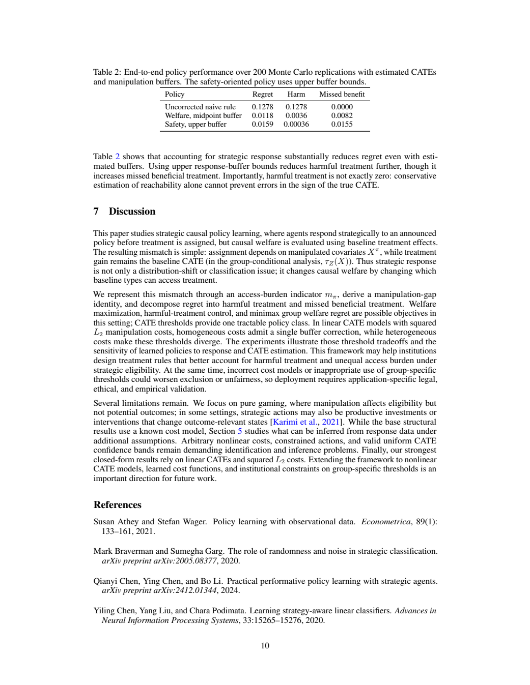

# Strategic Causal Policy Learning with Manipulable Eligibility

<!-- 全库方法复筛开始 -->
> **方法储备 · 训练目标与数据反馈**。保留“Strategic Causal Policy Learning with Manipulable Eligibility”这一研究问题或机制；是否用于当前业务另行验证。
> 原有阅读范围与证据等级不变；储备不等于效果已验证。
> [[研究前沿/论文库复筛与阅读路线|全库阅读路线]] · [[研究前沿/训练目标与数据反馈/存量论文分层索引|本方向完整分层]]
<!-- 全库方法复筛结束 -->

## 当入选资格能被改变，按正增量发放会漏掉谁、又错发给谁？

申请人可以为了获得干预调整申报特征，但真实处理收益仍取决于原来状态。作者把调整到资格边界所需的最低成本写入分配规则，分别比较总福利、伤害与群体遗憾。

Bong, Suhwan。arXiv 首投 2026-11-09，本次核验 v1（2026-11-09，来源日期）。[论文与版本](https://arxiv.org/abs/2611.14572v1) · [本地原文](./assets/source/paper.pdf) · [本地 HTML](./assets/source/paper.html)

## 方法与估计对象

估计初始状态的组内 CATE；由可行申报与成本得到进入资格集的最低代价。把行为响应后的入选指示乘回原始 CATE，按预设福利、安全或最差群体损失选择公布门槛。仿真还把 CATE 拟合、行为拟合、选门槛与评估样本分开。

在线性 CATE、二次成本下，组 $z$ 实际入选当且仅当 $\tau_z(x)\ge k-\rho_z$，其中 $\rho_z=\|\beta\|_2\sqrt{2/\lambda_z}$。

## 对照与证据

表 2 的 200 次端到端仿真中，未修正阈值的遗憾为 0.1278。使用行为缓冲中点后降至 0.0118（伤害 0.0036，错过收益 0.0082）；使用上界为 0.0159（0.00036，0.0155）。表 1 另以已知成本比较规则。

表 2，同时估效应和行为后的福利分解。原始 PDF 第 10 页。

## 识别条件与适用范围

闭式修正要求报告可自由移动、正确定义成本和线性效应，且改报告不改变潜在结局。结果来自仿真；私人价值或噪声能破坏单个确定性行为边界。

本轮从论文正文与作者标注中未取得可验证的配套代码入口。

本次精读覆盖上述方法、证据页和相关限制。附录中的其他推导与实验未逐项复算。

[[研究前沿/uplift模型迭代/02-可复用方法卡/用获得资格的最低成本修正处理效应阈值|用获得资格的最低成本修正处理效应阈值]] · [[研究前沿/uplift模型迭代/03-实验假设与结果/准入信息可调整时怎样分别计量错发和漏发|准入信息可调整时怎样分别计量错发和漏发]]
