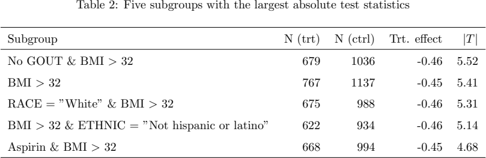

# 重叠人群的最大统计量校正

Assessment of evidence against homogeneity in exhaustive subgroup treatment effect plots · Bornkamp, Björn, Lu, Jiarui, Bretz, Frank。arXiv 首投 2026-02-06，本次阅读版本 v2（2026-11-05）。2 月首投，11 月修订。相较 v1 的置换算法，v2 明列 wild bootstrap 以及生成伪结果的两套算法。 [版本记录](https://arxiv.org/abs/2602.06910v2) · [本地 PDF](./assets/source/paper.pdf) · [本地 HTML](./assets/source/paper.html)

## 研究问题

在大量交叠人群中挑出增益最大的若干组时，小人群和重复比较都会制造看似突出的效果。

## 方法及关键计算

对随机试验生成交叉拟合的处理效应伪结果。用子组与总体的加权差、标准误构造每组统计量 $T_j$。在同质性零假设下以个体为单位对伪结果残差乘随机正负号，同一个受试者在所有子组共用一个符号。每次重采样记录 $\max_j |T_j|$，再由该参考分布给出全局及逐点校正证据。联合重采样保留了子组重叠带来的相关性。

## 关键公式

$$
T_{j,b}=\sum_{i=1}^{N}w_{i,j}\,(\widehat{\delta}+\hat{e}_{i}g_{i,b})\Big/\sqrt{V_{j}},\qquad T_{\max,b}=\max_{j}\left|T_{j,b}\right|
$$

每次重抽 b 时，同一人的随机乘子用于所有所属子组。w 表示子组相对总体的对比权重，残差来自去除共同效应后的伪结局。以每次抽样中最大绝对统计量的分位数统一定阈值，保留重叠组的相关性。 [公式原文](https://arxiv.org/html/2602.06910v2#S3.Ex1)

## 证据、对照与边界

§4 图 2–4：每个情景 2,000 次模拟，每组每臂至少 10 人时，wild bootstrap 的零假设 p 值接近均匀，Bonferroni 较保守。§5 有 1,408 个一阶或二阶子组；表 2 中统计量最大的五组都含 BMI>32，说明多个命中可来自同一信号。该示例使用模拟结果。

表 2　五个最突出的人群共享核心分组条件，原文 PDF 第 13 页。

参考分布要求明确的同质性假设和可用的分组方差；事后反复重新生成子组也须纳入选择流程。发现异质性只给出待独立复核的线索。

## 阅读覆盖与复用

已核对上述设定、关键计算、主对照及限制，附录证明未逐行复证。未从作者版本页、正文或公开检索核实可用的作者代码入口。

[[研究前沿/uplift模型迭代/02-可复用方法卡/SubgroupMaxT-重叠人群的最大统计量校正|重叠人群的最大统计量校正]] · [[研究前沿/uplift模型迭代/03-实验假设与结果/SubgroupMaxT-促销子组中有多少异常能跨独立批次复现|促销子组中有多少异常能跨独立批次复现]]

[[研究前沿/uplift模型迭代/01-论文原文与精读/SubgroupMaxT/原文导航|原文章节和图表索引]]
