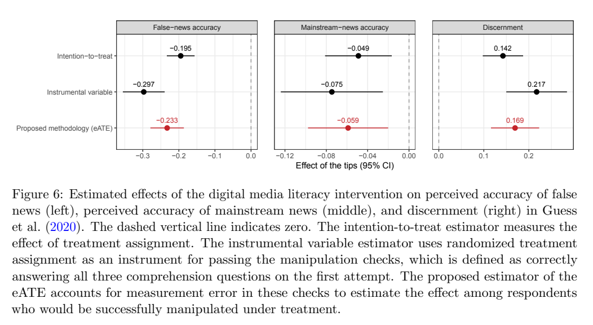

# A General Statistical Framework for Attention and Manipulation Checks

<!-- 全库方法复筛开始 -->
> **方法储备 · 面向决策的履约建模**。保留“潜在参与状态的识别检查”这一研究问题或机制；是否用于当前业务另行验证。
> 原有阅读范围与证据等级不变；储备不等于效果已验证。
> 已恢复此前因业务距离被移出的原笔记；旧取舍原因仅作历史记录。
> [[研究前沿/论文库复筛与阅读路线|全库阅读路线]] · [[研究前沿/面向决策的履约建模/存量论文分层索引|本方向完整分层]]
<!-- 全库方法复筛结束 -->

随机实验中，受试者通过某道题不等于真正接收或理解干预。三项有独立测量误差的检查可估计处理下的真实参与比例；再加上单调性与未参与者平均零效应，能用 ITT 求出该潜在人群的增量。

Kentaro Nakamura、Kosuke Imai。arXiv v1 首投 2026-11-07。[版本记录](https://arxiv.org/abs/2611.10515v1) · [原文 PDF](./assets/source/paper.pdf)

## 研究问题与方法

目标人群由潜在状态 $W(1)=1$ 定义，即“若接受处理就会参与”的人。对照组也有潜在成员，不能直接按各组观测到的通过情况截人。三项测量均可在处理后进行。给定真实参与状态、处理前协变量且实际受处理，三项检查需相互独立；真实参与者必须在每项上平均更高，两类参与状态都须有正概率。

命题 1 用前两项指标及其乘积建立条件矩阵，再以第三项加权形成第二个矩阵。矩阵分解利用第三项区分两类人，并用各检查的正向相关确定标签，从而恢复 $p(x)=P(W=1|T=1,X=x)$。它识别的是人群占比，无需逐人给出确定的参与标签。若实验随机、处理不使任何人从参与变为不参与，且两侧都不会参与者平均效应为零，式（3）给出

$$
\Psi=E[Y(1)-Y(0)\mid W(1)=1]=\frac{E[Y(1)-Y(0)]}{E_X[p(X)]}.
$$

正文用受限条件矩估计与折外单步影响函数求标准误。命题 4 的成对相关性检验可诊断弱检查；拒绝“控制协变量后至少一对无关联”仍不能证明给定潜在状态后的测量独立。

## 原文比较

图 4 的模拟比较了直接选择通过者、IV 与处理测量误差的估计。图 6 重分析数字媒体素养随机试验，在处理组有 65.6% 首次全答对，模型估计潜在参与比例为 83.6%（SE 1.5 个百分点）。用估计的分母缩放 ITT 后，假新闻准确性评分效应为 −0.233，辨识力为 +0.169；量纲为该试验评分。方向依赖目标定义，真实参与状态并未被独立金标准测量。

## 适用条件与迁移

依赖相同提醒或同一追踪组件的读、点、停留可能存在共享测量错误。若未参与者本身受分配影响，ITT 除以参与比例无法识别该潜在人群的效应。

**精读范围**　§§3–7、命题 1–4、图 4–6。未逐行复证渐近论证。

**作者实现**　[作者主页](https://imai.sites.fas.harvard.edu/research/attncheck/) 列出论文；未核到公开实现。

[[研究前沿/uplift模型迭代/02-可复用方法卡/用三项有误差的检查估计若受处理会参与的比例|用三项有误差的检查估计若受处理会参与的比例]] · [[研究前沿/uplift模型迭代/03-实验假设与结果/共享测量噪声何时破坏三项触达检查的参与者效应|候选实验]]
