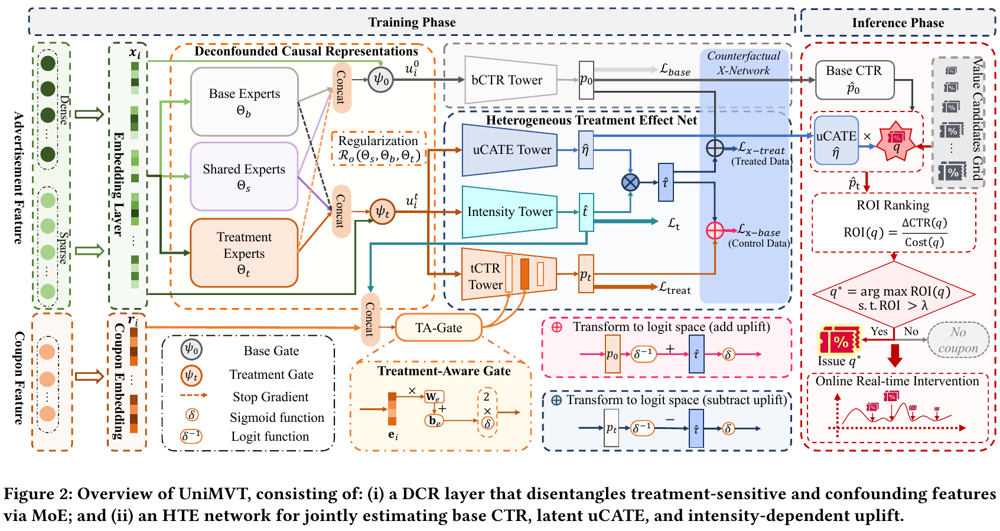

# Jointly Optimizing Debiased CTR and Uplift for Coupons Marketing: A Unified Causal Framework

[官方论文](https://arxiv.org/abs/2602.12972) · [本地PDF](./assets/source/paper.pdf) · [HTML快照](./assets/source/paper.html)

版本记录：[Submitted on 13 Feb 2026 ( v1 ), last revised 8 Sep 2026 (this version, v3)]；本次核验与精读：2026-11-06。本篇为已播报历史队列补精读，不是新论文。

阅读范围：§3–5假设、全部网络公式、理论草图和离线/线上表格。未逐行复证全部数学证明，未声称逐页翻译。[[研究前沿/uplift模型迭代/01-论文原文与精读/UniMVT/阅读覆盖|原文章节与公式索引]]；HTML为原始快照，外部样式和图片可能需要联网，PDF可离线阅读。

代码：本次核验的论文原文与元数据未提供可确认的作者实现入口；代码状态未知，不能据此断言不存在。未运行代码。 [[研究前沿/uplift模型迭代/01-论文原文与精读/UniMVT/代码核验|核验记录]]

## 问题与整体结构

同时学习无券基础CTR和不同券额响应，避免多阶段误差。DCR三组专家（base/shared/treatment）经两路门控；交叉组stop-gradient降低梯度冲突，专家参数正交正则减少冗余。HTE网络有基础/干预塔、剂量预测头和单位敏感度头，联合事实BCE、剂量L1+L2、X-Network一致性MSE训练。

## 可采用的计算（§3–4）

核心结构是**logit空间线性单调**：
$$p_t(x)=\sigma(\operatorname{logit}p_0(x)+t\eta(x)),\quad\eta(x)=\operatorname{ReLU}(f(x))\ge0.$$
$\eta$为log-odds单位敏感度，不等于概率空间每单位恒定CATE。概率增量为 $p_t-p_0$。TA-Gate每层按动作嵌入产生 $a^{(l)}=2\sigma(W_ge_t+b_g)$ 并逐元素缩放隐藏层。

X-Network在处理样本把 $t\eta$加到base logit重构事实结果；对控制样本先用处理组训练的剂量头得到可行 $\hat t$，从处理塔logit减 $\hat t\eta$重构控制结果。两路与事实标签做MSE。部署枚举券额，按 $\Delta CTR/(q p_q\gamma)$ 及系统ROI阈值筛选。

重要边界：正交参数/stop-gradient不证明因果解耦；仍需无混杂、支持重叠、结构正确。连续剂量重叠应理解为支持上的密度条件，正文写成点概率表达并不严谨。§4.4证明草图Eq20–22改用了概率空间线性加法和绝对误差，与§3的logit形式及MSE定义不一致；本次不把该草图作为已验证的一致性保证。

## 实验与证据（§5）

三组合成数据各8万训练/8000 RCT测试，生成曲线严格满足本文结构假设，属于有利设定。生产数据中CS-Qini 0.0293，去正交0.0097、去共享专家0.0132、去反事实损失0.0042、去logit空间0.0008；CTR AUC相应变化小于uplift变化（Table2）。这些是模型内组件消融，尚无多种子区间。

快手10%流量AB相对旧两阶段系统：券收入+18.14%、无券+0.37%、ROI列+8.80；表中ROI没有百分号，不能写成+8.80%。券PCOC误差减少86.51%，无券减少50%。这是整体系统对照，未隔离TA-Gate或正交层的线上贡献，未报告样本量、时长和置信区间。互斥用户分桶也不自动排除市场干扰。

CS-AUUC按敏感度排序后计算前缀结果对剂量的回归斜率积分，和常见二元AUUC不可直接比数值；观察生产数据中的斜率仍可能受分配混杂。迁移优先检验曲线形状是否适合业务，不应仅因高CTR接受因果结论。

## 原文关键图表

原文 Figure 2，PDF 第 4 页；原始裁图，机制和证据解释见上文。裁图坐标与源文件校验值见 assets/source/figure-provenance.json。

## 方法卡

- [[研究前沿/uplift模型迭代/02-可复用方法卡/UniMVT-logit-dose|基础响应加非负logit剂量斜率]]
- [[研究前沿/uplift模型迭代/02-可复用方法卡/UniMVT-expert-xnet|隔离梯度专家与跨塔事实一致性训练]]
