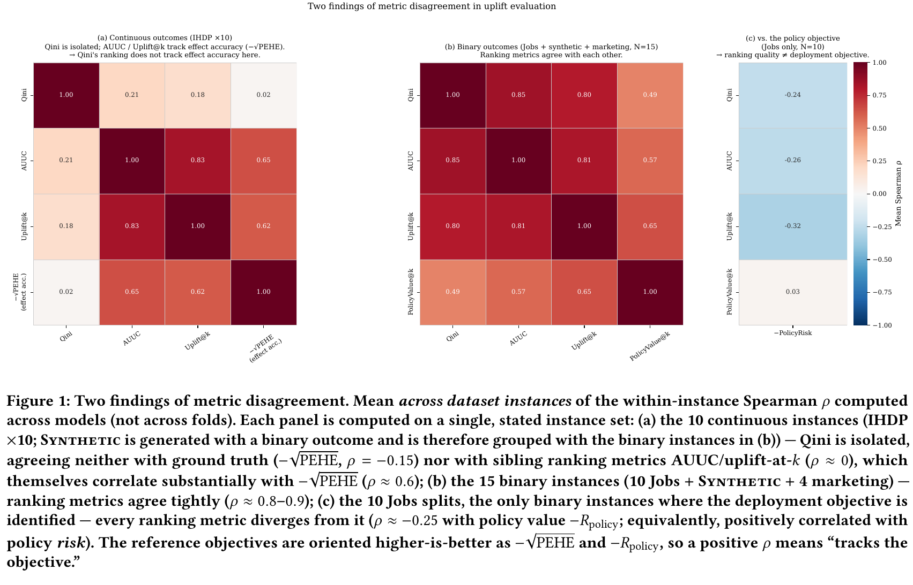

# UpliftBench: Revealing Outcome-Regime and Objective Mismatch in Uplift Evaluation

[官方论文](https://arxiv.org/abs/2608.00915) · [本地PDF](./assets/source/paper.pdf) · [HTML快照](./assets/source/paper.html)

版本记录：[Submitted on 2 Aug 2026]；本次核验与精读：2026-11-06。本篇为已播报历史队列补精读，不是新论文。

阅读范围：§4–9协议、主结果、稳健性、限制和代码声明；附录对象保留定位未逐表复算。未逐行复证全部数学证明，未声称逐页翻译。[[研究前沿/uplift模型迭代/01-论文原文与精读/UpliftBench/阅读覆盖|原文章节与公式索引]]；HTML为原始快照，外部样式和图片可能需要联网，PDF可离线阅读。

代码：已核验[作者仓库](https://github.com/binshuangli/uplift-bench)，commit `604cf7caee4f2f1322e0eac81968161741c7a99f`；入口：[scripts/run_bench.py](https://github.com/binshuangli/uplift-bench/blob/604cf7caee4f2f1322e0eac81968161741c7a99f/scripts/run_bench.py)；[scripts/f2_threshold.py](https://github.com/binshuangli/uplift-bench/blob/604cf7caee4f2f1322e0eac81968161741c7a99f/scripts/f2_threshold.py)。已读取入口声明/关键片段，未审计全部实现、未安装运行。 [[研究前沿/uplift模型迭代/01-论文原文与精读/UpliftBench/代码核验|核验记录]]

## 价值：选择指标本身也需要验证

12种估计器、统一LightGBM/另用XGBoost复核、训练内预处理与调参、固定折与种子。主运行2112折级记录（2052成功、60二元方法不适用连续结果跳过），300数据×模型格含12超时；不把超时补成零。原文提供git/config级结果追踪。

## 两个核心结论（§4–5）

第一，Qini与效果误差的对应不是恒定的。对排序前缀，记处理计数 $T_k$、两组前缀均值差 $u(k)$，则 $g(k)=T_ku(k)$。Qini带处理计数深度权重；本文前缀均值AUUC与常用库累计增益AUUC也不同，比较必须明确实现。

100个IHDP realization上Qini对 $-\sqrt{PEHE}$ 的相关0.07，95%CI[-0.03,0.16]，AUUC相对相关优势0.49[0.40,0.59]。但ACIC和收入合成数据差距分别0.11[-0.03,0.25]、−0.02[-0.19,0.17]；**不是“连续结果都不能用Qini”**，重尾解释也未复现。修复处理模型类型、去掉DR/R、切换基学习器/调参目标后保留IHDP现象。

第二，任何仅依赖排序的指标对 $\hat\tau\mapsto\hat\tau+c$ 不变，而零阈值策略 $1[\hat\tau\ge0]$ 会变。因而排序指标不足以识别依赖绝对值的最优策略。Jobs重复划分中排序选模遗憾0.026–0.028，约参考风险14–15%；在选择折校准阈值后Qini选择遗憾下降81%至0.0049，CI不再排除0。若目标和评估均为固定预算policy value，差距消失。

## 可复用评估流程

先声明部署规则（top-k、零阈值、成本阈值/金额分配），再选择对应policy value/risk；训练/调参/阈值选择与最终评价分开。结果同时保存原始预测、指标定义、数据划分、git和失败状态。在RCT可对分桶差分做uplift校准；观察数据直接分桶差分ECE不一定可识别，不能混合汇总成“失校准”证据。

## 证据边界

Jobs10个单位是同一样本重切分，不是10个独立真实实验；bootstrap描述划分变异，可能低估总体不确定性，内部倾向模型也未完全嵌套。营销数据无个体真值；10K上限下排名与100K探针约零相关，榜单不等于全量结论。这里可迁移的是评估接口、目标对齐与失败诊断，不是某个估计器永远最好。

## 原文关键图表

原文 Figure 1，PDF 第 5 页；原始裁图，机制和证据解释见上文。裁图坐标与源文件校验值见 assets/source/figure-provenance.json。

## 方法卡

- [[研究前沿/uplift模型迭代/02-可复用方法卡/UpliftBench-policy-metric|按部署规则选择指标和校准阈值]]
- [[研究前沿/uplift模型迭代/02-可复用方法卡/UpliftBench-metric-audit|同预测上的uplift指标实现与稳定性审计]]

## 待验证想法

[[研究前沿/uplift模型迭代/03-实验假设与结果/2026-11-06-评估目标与阈值校准|评估目标与阈值校准（未运行）]]
