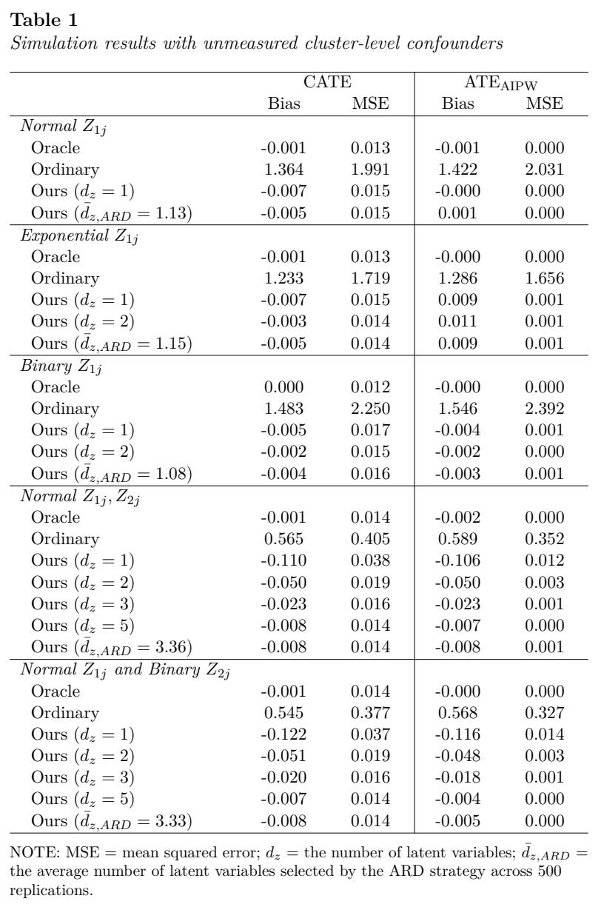

# Causal Machine Learning for Multilevel Studies with Unmeasured Cluster-Level Covariates via Variational Autoencoders

<!-- 全库方法复筛开始 -->
> **方法储备 · 模型自进化**。保留“潜变量聚类与隐藏混杂建模”这一研究问题或机制；是否用于当前业务另行验证。
> 原有阅读范围与证据等级不变；储备不等于效果已验证。
> 已恢复此前因业务距离被移出的原笔记；旧取舍原因仅作历史记录。
> [[研究前沿/论文库复筛与阅读路线|全库阅读路线]] · [[研究前沿/模型自进化/存量论文分层索引|本方向完整分层]]
<!-- 全库方法复筛结束 -->

把同一群组多人的处理和结局残差汇总，可用来修正群组共有、未观测的加性偏移。作者的仿真中，若该因子同时改变处理效应，条件增量依然有偏。

Youmi Suk、Yuxuan Li。arXiv v1 首投 2026-11-08。[版本记录](https://arxiv.org/abs/2611.11483v1) · [原文 PDF](./assets/source/paper.pdf)

## 研究问题与方法

同校学生、同站点受试者可能共享研究者没有记录的因素。普通 R-learner 用观测特征拟合 $m(X)=E[Y|X]$ 和 $e(X)=P(T=1|X)$，再用结局残差对处理残差拟合条件增量。若隐藏群组因素同时移动两种残差，普通残差化依然保留混杂。

算法 1 按群组分折，并在训练群组内嵌套分折产生初始倾向/结局的折外残差。将每组已标准化残差的统计量传给编码器。解码器的两项 offset 似然将原预测固定为起点，仅学习剩余的群组偏移 $\delta_Y(Z_j),\delta_A(Z_j)$；编码器和解码器用重构似然加 KL 正则联合训练。带帽的偏移用群组潜变量的后验均值计算。

$$
m^*_{ij}=m^{(0)}_{ij}+\delta_Y(Z_j),\quad e^*_{ij}=\operatorname{logit}^{-1}(\operatorname{logit}e^{(0)}_{ij}+\delta_A(Z_j)),\quad
\min_\tau\sum_{ij}[(Y_{ij}-m^*_{ij})-(T_{ij}-e^*_{ij})\tau(X_{ij},W_j)]^2 .
$$

多站点随机试验已知处理概率，算法 2 只修正预后模型，从其他组员的残差推断该成员的群组因子。观察版为保留处理与结局的联合信号使用全组统计量。两者的数据可见性不同。

## 原文比较

表 1 在 500 次模拟中，单个正态群组混杂因子情形，普通 R-learner 的 CATE 偏差/MSE 为 1.364/1.991，自适应潜维度 VAE-R 为 −0.005/0.015，观测真因子的 oracle 为 −0.001/0.013。表 3 的正确设定、无拆折固定效应方法在其设定也有低误差。实际多站点随机试验的 AIPW 点估计均为 0.020，群组 bootstrap SE 从 0.040 变为 0.033；没有个体效应真值。补充 S3 将隐藏因子设成效应修饰因子，观察设计下 CATE 有偏。

## 适用条件与迁移

适用于组内重复足够、遗漏因素主要共享、对结局加性且没有处理交互的研究。离线估计可访问组员处理及结局，向未来全新群组部署时必须核对时点；尚无任何历史结果的群组不能直接计算同样残差摘要。

**精读范围**　算法 1–2、图 3–4、表 1–3、附录 S3。未重跑两个教育案例。

**作者实现**　正文指向第一作者 GitHub；未核实与该版本一一对应的代码文件。

[[研究前沿/uplift模型迭代/02-可复用方法卡/用群内残差的潜变量修正 R-learner 的两项辅助回归|用群内残差的潜变量修正 R-learner 的两项辅助回归]] · [[研究前沿/uplift模型迭代/03-实验假设与结果/群组隐藏因素何时让残差编码改善平均效应却损害条件效应|候选实验]]
