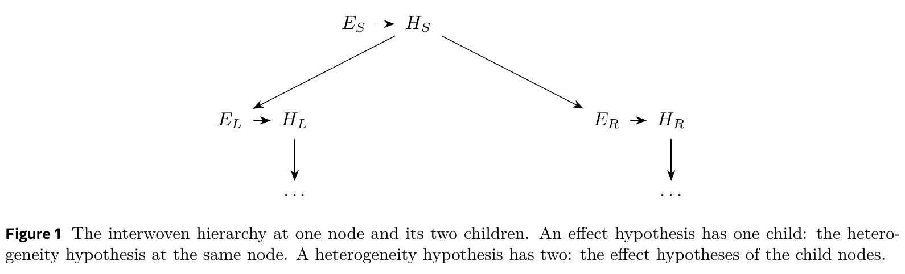

# Interpretable and Validatable Uplift Modeling

[官方论文](https://arxiv.org/abs/2610.37966) · [本地PDF](./assets/source/paper.pdf) · [HTML快照](./assets/source/paper.html)

版本记录：[Submitted on 27 Oct 2026]；本次核验与精读：2026-11-06。本篇为已播报历史队列补精读，不是新论文。

阅读范围：§2–6方法、Proposition1条件与§7全部模拟结果；证明只核对论证结构。未逐行复证全部数学证明，未声称逐页翻译。[[研究前沿/uplift模型迭代/01-论文原文与精读/ValidatableUplift/阅读覆盖|原文章节与公式索引]]；HTML为原始快照，外部样式和图片可能需要联网，PDF可离线阅读。

代码：本次核验的论文原文与元数据未提供可确认的作者实现入口；代码状态未知，不能据此断言不存在。未运行代码。 [[研究前沿/uplift模型迭代/01-论文原文与精读/ValidatableUplift/代码核验|核验记录]]

## 问题与方法

对一个uplift树报告很多“有效人群/异质分支”，会产生多重检验与训练后选择偏差。本文先把数据分成训练与独立评估两部分：训练侧拟合任意uplift模型、浅回归树、检验方向与阈值；评估侧只负责检验。训练侧可以做复杂搜索，不能看评估数据再改方向或权重。

每节点有“效应超过阈值”的单侧假设 $E_S$，每内部节点有左右差异的单侧假设 $H_S$，组成 $E_S\to H_S\to\{E_L,E_R\}$ 交织层级。训练方向例如预测右侧更好，则检验 $\tau_R\le\tau_L$。评估实现用Welch均值差/差分之差；有限样本p值有效性仍取决于底层检验近似。

## TrickleDown显著性预算（§4–6）

节点拿到 $\alpha_i$，只用 $v_i\alpha_i$ 检验；子节点权重和为1。拒绝时子节点拿 $w_j\alpha_i$，未拒绝时仍拿 $w_j(1-v_i)\alpha_i$。$v=1$退化为失败即停止的固定层级检验，$v=0.5$允许在上层效应较弱时继续发现深层异质性。

Proposition 1在有效节点p值下给出强FWER控制 $P(\text{至少一项误拒})\le\alpha$；通过层级预算归纳/并集界，无须节点检验互相独立。属于既有图形多重检验框架的专门化，创新价值在于效应与异质性的交织和可操作流程。§6用弱化单侧零假设的反演给未拒节点界限；不能把它解释成免费得到任意两侧同时置信区间。

## 证据与局限

§7模拟4000次、样本4000、$\alpha=0.05$：Table2中TrickleDown FWER为0.0447±0.0033（固定树）/0.0457±0.0033（拟合树）。Table3在四分之一人群受损、效应scale0.45时，发现真实结论数3.15±0.03，普通Bonferroni2.86、层级Bonferroni2.36、Fixed1.90；scale1时7.58 vs普通7.45。Table4显示浅层发现可能略少，深层更强，不能说所有节点都更有力。

本文证据是理论与模拟，没有线上收益。独立评估集会牺牲拟合样本；深树叶样本小，检验功效不足；训练决定的方向可能错。可将“效应大小/排序好坏”和“哪些声称有统计保证”作为两个评估层。与全数据选择后推断的SelectiveTrees是不同折衷。

## 原文关键图表

原文 Figure 1，PDF 第 3 页；原始裁图，机制和证据解释见上文。裁图坐标与源文件校验值见 assets/source/figure-provenance.json。

## 方法卡

- [[研究前沿/uplift模型迭代/02-可复用方法卡/ValidatableUplift-honest-hierarchy|独立评估上的效应—异质性交织检验]]
- [[研究前沿/uplift模型迭代/02-可复用方法卡/ValidatableUplift-trickle-down|保留预算继续向下的TrickleDown检验]]
