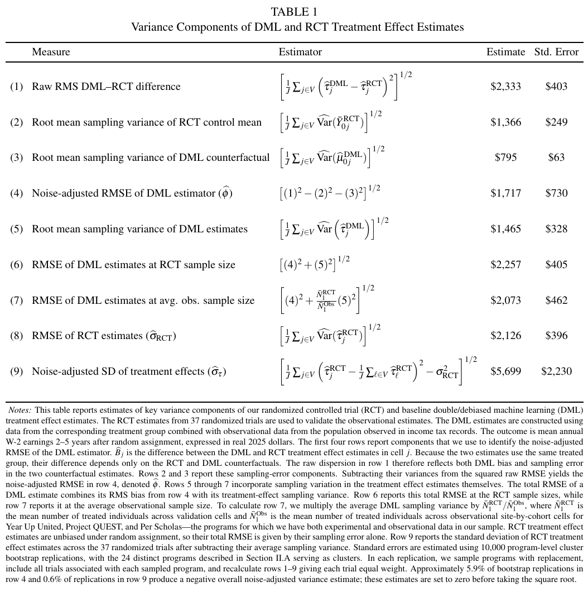

# Experimentally Validated Digital Twins: Evaluating Workforce Training Programs in the Age of Big Data

用 37 项职业培训 RCT 给观察估计的误差定标。按典型观察样本量折算，DML 总 RMSE 为 2,073 美元，RCT 为 2,126 美元；按相同 RCT 样本量比较，DML 为 2,257 美元。

Raj Chetty、Jamie Fogel、Lawrence F. Katz、Kadeem Noray、Sonya Porter、James Reisinger。arXiv 首次提交 2026-11-02，本次核验 v1（2026-11-02）。[论文与版本记录](https://arxiv.org/abs/2611.03938v1) · [原文 HTML](https://arxiv.org/html/2611.03938v1) · [本地完整 PDF](./assets/source/paper.pdf)

**阅读覆盖**　§§II–V、表 1–2、图 3–4 的方差与规格对照；长期收入机制和统计附录未逐项复算。美国 Census 在 2026 年 10 月已有 CES-26-69 工作论文，本周是 arXiv 上传。[机构工作论文](https://www.census.gov/library/working-papers/2026/adrm/CES-WP-26-69.html)

**代码与数据**　作者项目列出论文与幻灯片；本次未核实公开的完整复现代码，原始税务微观数据并非公开训练集。[作者项目索引](https://opportunityinsights.org/paper/)

## 1. 训练的是未受干预的反事实

输入为各项目、站点、入组年度下的参与者及外部对照，含处理前收入、行业、人口属性、居住史。结果为实际 2025 美元计价的年 W-2 收入。两类 LightGBM 分别拟合外部对照的结局 $m_0(x)$ 和参与倾向 $e(x)$，五折交叉拟合；不使用 RCT 对照训练，后者留给验证。式（6）的处理组目标为

$$
\widehat\tau^{DML}=\frac{1}{N_1}\sum_{i:D_i=1}(Y_i-\widehat m_0(X_i))
-\frac{1}{N_1}\sum_{i:D_i=0}\frac{\widehat e(X_i)}{1-\widehat e(X_i)}(Y_i-\widehat m_0(X_i)).
$$

第一项比较参与者与模型预测的未处理结果。第二项把外部对照的预测残差重新加权，对正则化偏差作校正；隐藏选择仍可能留下系统误差。验证样本的处理组按随机指派定义以对齐 RCT 的意向治疗比较（§IV.A 及注 16）。

## 2. 为什么不能直接对 RCT 差值算 RMSE

每个试验中观察估计和 RCT 估计共享处理组，同一观察收入在差值中抵消。保留的噪声来自两套对照反事实。记差值为 $\widehat B_j$，按试验等权，式（14）–（16）的简写如下。

$$
\widehat\phi^2=J^{-1}\sum_j\big[\widehat B_j^2-\widehat V_{0j}^{RCT}-\widehat V_{0j}^{DML}\big],\qquad
\widehat{\mathrm{RMSE}}_{DML}^2=\widehat\phi^2+J^{-1}\sum_j\widehat V_j^{DML}.
$$

第一式扣除对照抽样噪声后估计跨试验平方偏差，第二式加回目标样本量下估计器本身的抽样方差。若两边另有重叠需显式计算协方差。本文利用 37 项等权试验、24 个项目聚类 bootstrap；偏差分布能否外推到新项目是单独的 Assumption 1。

## 3. 哪部分差异能用实证量化

表 1 的两估计器原始均方根差 2,333 美元，两个反事实抽样噪声分量分别为 1,366 与 795，扣除后 RMS 偏差 1,717（标准误 730）。按平均观察样本量折算总误差 2,073（标准误 462），RCT 2,126（396）；不能由这点差宣称统计显著优胜。主要结果是随机分配后第 2–5 年平均年收入。

表 2 的 LaLonde 风格小样本 OLS 的噪声校正 RMSE 为 4,485，美国家庭人口对照、丰富历史和灵活 DML 合用后为 1,717（约降 62%，摘要概括为 60%）。图 3 仅工作史为 3,822；图 4 展示灵活度和样本量互动。这个改变量属于多因素组合，并不识别 LightGBM 或倾向修正的独立贡献。§V 的站点和年度差异需要额外偏差可迁移条件，个体级增量准确度也未据此验证。

## 方法卡与实验

[[研究前沿/uplift模型迭代/02-可复用方法卡/用多项RCT扣除对照噪声估计观察偏差|用多项RCT扣除对照噪声估计观察偏差]]

[[研究前沿/uplift模型迭代/03-实验假设与结果/按活动留出的观察增量误差校准|按活动留出的观察增量误差校准]]
