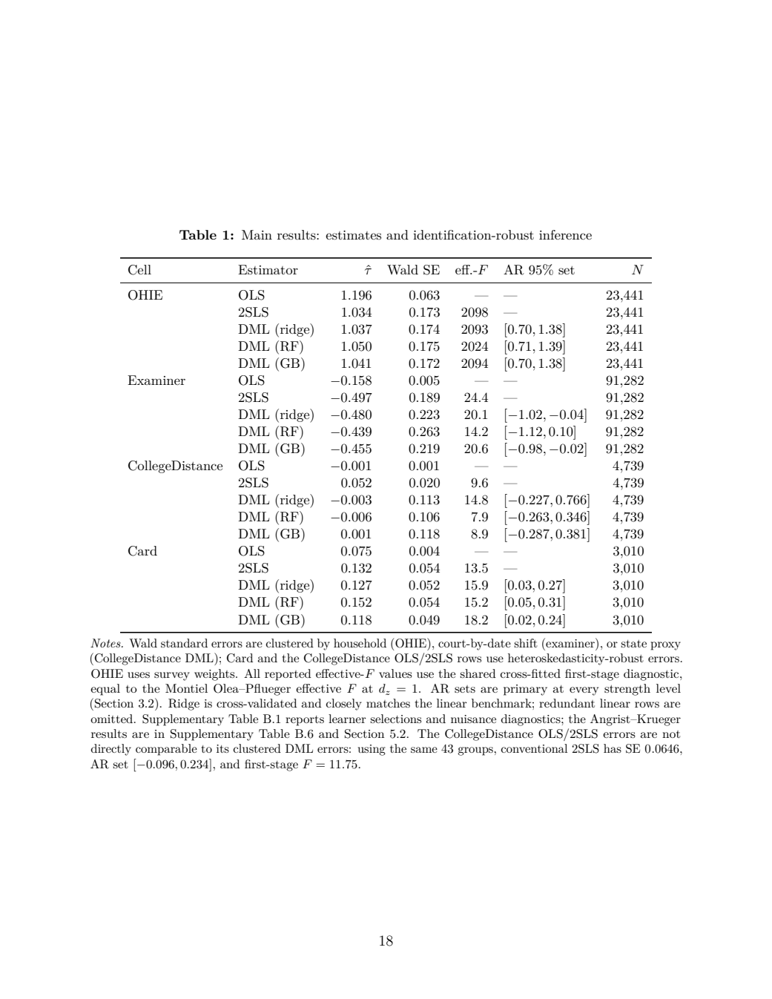

# Weak-Instrument Inference and Model Diagnostics in Double Machine Learning for Linear Instrumental Variable Models

<!-- 全库方法复筛开始 -->
> **方法储备 · 训练目标与数据反馈**。保留“弱工具变量下的双重机器学习”这一研究问题或机制；是否用于当前业务另行验证。
> 原有阅读范围与证据等级不变；储备不等于效果已验证。
> 已恢复此前因业务距离被移出的原笔记；旧取舍原因仅作历史记录。
> [[研究前沿/论文库复筛与阅读路线|全库阅读路线]] · [[研究前沿/训练目标与数据反馈/存量论文分层索引|本方向完整分层]]
<!-- 全库方法复筛结束 -->

## 工具变量经过机器学习残差化后，估计很小能说明没有效应吗？

在弱工具条件下，两个接近零的样本矩的比值可以不稳定。论文在每个候选效应值上直接检验残差矩，允许组内相关，反演成置信集，并用相同样本比较不同残差学习器带来的工具强度变化。

Meng, Airui。arXiv 首投 2026-11-07，本次核验 v1（2026-11-07，来源日期）。[论文与版本](https://arxiv.org/abs/2611.10863v1) · [本地原文](./assets/source/paper.pdf) · [本地 HTML](./assets/source/paper.html)

## 方法与估计对象

按独立抽样单位或簇分折，折外估处理、结局和工具关于基线变量的条件均值。对每个候选系数，把工具残差乘上“结局残差减去候选系数乘处理残差”，按抽样簇汇总得分并计算稳健检验；保留不能被拒绝的系数，同时报告残差化第一阶段强度。

令 $\tilde Z,\tilde D,\tilde Y$ 为折外残差，反演的矩条件是 $E[\tilde Z(\tilde Y-\theta_0\tilde D)]=0$，无需先除以弱的一阶段样本矩。

## 对照与证据

表 1 固定 91,282 个 examiner 设计观测。岭回归的有效 F 为 20.1，Anderson–Rubin 95% 集为 [−1.02,−0.04]；随机森林为 14.2、[−1.12,0.10]。同表 OHIE 的三个学习器有效 F 均高于 2,000，三组端点接近。稳健检验与工具排除限制分别评估。

表 1，按数据与学习器分层的工具强度和置信集。原始 PDF 第 18 页。

## 识别条件与适用范围

需要有效工具、正确目标、相应簇抽样结构和辅助学习收敛率。一个残差学习器让区间跨零不代表另一个发现是错的，也不能按显著性挑学习器。

本轮从论文正文与作者标注中未取得可验证的配套代码入口。

本次精读覆盖上述方法、证据页和相关限制。附录中的其他推导与实验未逐项复算。

[[研究前沿/uplift模型迭代/02-可复用方法卡/按候选效应反演交叉拟合的弱工具稳健检验|按候选效应反演交叉拟合的弱工具稳健检验]] · [[研究前沿/uplift模型迭代/03-实验假设与结果/替换辅助学习器后工具强度和置信集怎样变化|替换辅助学习器后工具强度和置信集怎样变化]]
