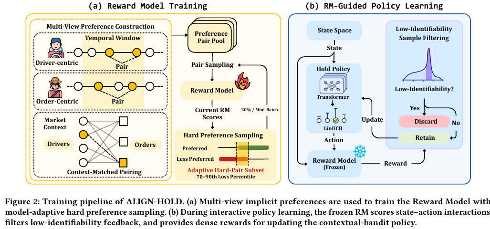
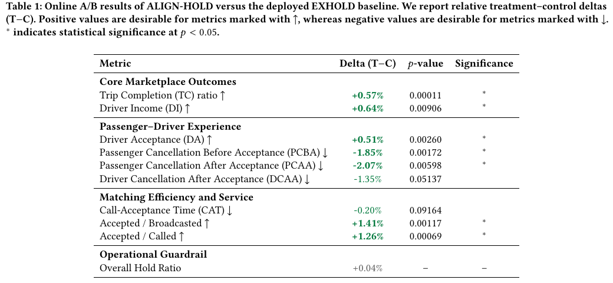
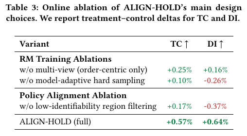

# ALIGN-HOLD: Experience Alignment for Real-Time Hold Control in Large-Scale Ride-Hailing Matching at DiDi

作者：Zuhao Zhang、Xu Liu、Kai Wan、Zihao Lu、Li Ma、Shuai Li。首次提交：2026-09-09；修订：无后续修订记录；本次阅读：2026-11-05。状态：arXiv 预印本，未据此认定会议录用。

[官方摘要与版本](https://arxiv.org/abs/2609.09685) · [已读 HTML](https://arxiv.org/html/2609.09685v1) · [本地 PDF](./assets/source/paper.pdf) · [本地 HTML](./assets/source/paper.html)

**阅读深度：关键方法精读。** 已读方法、主实验及下列关键附录；不声称逐节全文精读或已完成复现。PDF 是完整原文；HTML 已保存，但其外链资源不保证离线加载。

## 问题与完整流程

对司机–订单候选边，系统要决定立即放行或暂缓。ALIGN-HOLD 从完成/未完成的相关交互构造偏好，先学奖励模型，再冻结它指导仿真中的等待策略训练。线上沿用 Transformer–LinUCB 的四档策略与受约束的档位到时长映射，奖励模型不进入线上推理链路。

Figure 2（p.4）：左边是离线偏好学习；右边是冻结奖励模型后的策略学习。仿真器、时长映射和线上架构继承 EXHOLD，不是本篇新增贡献。

## 三个重要模块

[[研究前沿/动态等待与匹配决策/02-可复用方法卡/ALIGN-HOLD-preferences|多视角轨迹偏好与平衡抽样]]

[[研究前沿/动态等待与匹配决策/02-可复用方法卡/ALIGN-HOLD-hardpairs|避开极端噪声的动态困难偏好采样]]

[[研究前沿/动态等待与匹配决策/02-可复用方法卡/ALIGN-HOLD-filter|冻结奖励模型与切片密度带过滤]]

同订单轨迹、同司机时间窗、相邻本地匹配图三种视角，都只用“完成优于相关未完成”的偏好，不规定各类失败之间的顺序。MLP–Transformer 输出分数，以 Bradley–Terry 损失训练：

$$
\ell_\phi=-\log\sigma\big(r_\phi(s^+,a^+)-r_\phi(s^-,a^-)\big).\qquad\text{(7)}
$$

每批 80% 样本按三视角等比例抽样，20% 来自当前混合池损失的 70–90 分位，避开最极端的高损失尾部。冻结 RM 后按留出集均值/标准差归一化奖励；训练切片中的密集分数带用于过滤弱可辨识交互。过滤是经验代理，不证明样本没有因果信息。

## 证据：整体与消融分别看

Table 1（p.6）：2026-05-31 至 06-27，巴西五城、28 天、每天约 10 万请求、30 分钟时间片随机 A/B。相对 EXHOLD，完单率相对 **+0.57%**（$p=0.00011$），司机收入 **+0.64%**（$p=0.00906$）；接单前/后乘客取消分别 -1.85%/-2.07%。这些都是相对变化，不是百分点。司机接单后取消及呼叫到接单时间未达到文中 0.05 显著性门槛。

Table 3（p.6）：去除多视角、难例抽样、过滤后，TC/DI 分别变为 +0.25%/+0.16%、+0.10%/-0.26%、+0.17%/-0.37%。这是整链路移除组件的结果，支持组件在这套系统中的作用，不代表独立移植后的收益。Table 4 的三视角联合 Pair Acc. 为 0.845，单订单视角为 0.792。

## 迁移与局限

可迁移的是从相关轨迹构造偏好、适度困难样本采样，以及冻结 RM 后过滤模糊反馈的训练流程。不能将 RM 分数解释成校准完单概率或动作因果效应；历史行为仍受未观测偏好与供需影响。线上有效性来自作者系统实验，本地尚未验证。移植过滤器尤其应检查被过滤群体及分数漂移，不直接沿用数值阈值。

代码：在已核验原文中未找到官方实现链接，记为未知；不能把论文给出的配置当作已开源代码。关键实现可追溯至附录 B.1–B.4。

[[研究前沿/动态等待与匹配决策/03-实验假设与结果/2026-11-05-ALIGN-HOLD-候选假设|候选实验：待设计、未运行]]
