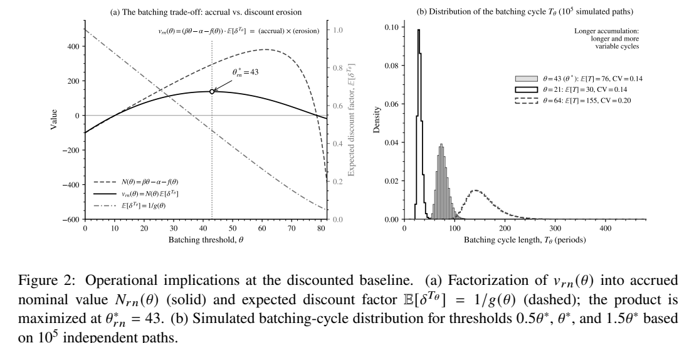
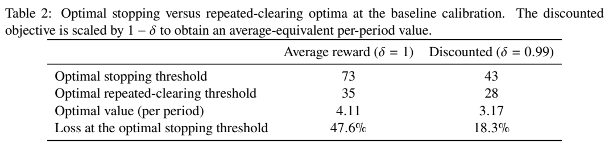

# Optimal Batching with Abandonment: Threshold Policies Under Risk-Neutral and Risk-Sensitive Criteria

<!-- 全库方法复筛开始 -->
> **方法储备 · 业务决策与理论储备**。保留“Optimal Batching with Abandonment: Threshold Policies Under Risk-Neutral and Risk-Sensitive Criteria”这一研究问题或机制；是否用于当前业务另行验证。
> 原有阅读范围与证据等级不变；储备不等于效果已验证。
> [[研究前沿/论文库复筛与阅读路线|全库阅读路线]] · [[研究前沿/业务决策与理论储备/存量论文分层索引|本方向完整分层]]
<!-- 全库方法复筛结束 -->

**能改哪一环？** 改平台收到举手后何时结束一轮 PK 的等待基线。论文表 2 在同一折现条件下，一次清空与重复清空的触发量分别为 43 件和 28 件。迁移的是“把下一轮也纳入决策”，两个数都是件数。

**第一步怎么验证？** 在同一举手到达流和候选退出模拟中，对照现有固定窗口、按单轮收益定阈值、按重复轮次收益定阈值。冻结 PK 择优规则，按全部进入请求比较完单、超时与等待。若连续轮次阈值在实测耐心范围内没有优势，保留固定窗口。（本地验证未运行。）

有取消风险时，最优批量取决于清空后是否开始下一轮。作者的折现标定中，一次性结算在累积到 43 件时触发，重复清空的最优阈值是 28 件。

arXiv v1 预印本。作者 Shuren Wang、Guodong Pang。首次提交 2026-11-08，核验于 2026-11-12。11 月 10 日分类公告。核读 PDF 的 §2–4、定理 1–4、图 2、表 2，以及附录 G 算法。对照附录 A 的折现风险敏感扩展，未逐引理复证附录 B–H。

[一手发布页](https://arxiv.org/abs/2611.11281v1) · [离线 PDF](./assets/source/paper.pdf) · [离线 HTML](./assets/source/paper.html)

## 谁在什么时候决定清空

每期开始观察同质库存 $x$，可立即处理所有件或再等一期。继续时每件独立以概率 $p$ 离开，每期独立以概率 $q$ 新到一件，二者独立。故 $X_{t+1}=x-A_t+D_t$，其中 $A_t\sim\mathrm{Bin}(x,p)$、$D_t\sim\mathrm{Bern}(q)$。每期最多向上走一级，可同时向下掉多级。没有队间配对、最大批量和服务占时。清空所得为 $\beta x-\alpha$，$\alpha$ 是一次固定成本。期初每件持有费为 $c$，期末每次离开罚 $\gamma$。

## 一次清空的阈值怎样算

折现因子 $\delta$ 下，式 (8) 的风险中性价值为

$$V(x)=\max\{\beta x-\alpha,\;-(c+\delta\gamma p)x+\delta\,\mathbb E[V(x-A_t+D_t)]\}.$$

从 0 首次到达阈值 $\theta$ 必经所有中间状态。按式 (10)–(13) 从小到大分别递推成本累积 $f$ 和折现累积 $g$，再算 $v(\theta)=(\beta\theta-\alpha-f(\theta))/g(\theta)$。若至少有一个正收益候选，定理 1 证明在正值区域单峰，取首个 $v(\theta+1)-v(\theta)\le0$ 的阈值，可有相邻两点并列。观测到 $x\ge\theta$ 就清空。保证以已知随机转移下所有可行停止时刻为基准。

## 清空后重新开始会改变哪个分母

§3 从零库存重复独立周期。令 $R_\theta$、$T_\theta$ 为一次周期的净收益和时长。长期平均按 $\mathbb E[R_\theta]/\mathbb E[T_\theta]$ 比较不同阈值。有折现时按 $\mathbb E[R_\theta(\delta)]/(1-\mathbb E[\delta^{T_\theta}])$ 比较。定理 4 给出两种重复清空阈值目标的单峰性质。单批多等一次可以多收物品，代价还包括推迟所有后续周期。

表 1 的共同收费为固定成本 100、每件收益 10、每件每期持有费 0.01、退出罚 0.5，到达与退出概率为 0.8 与 0.01。表 2 中，单次结算在无折现下取 73，重复结算在长期平均目标下取 35。把 73 用于重复清空，比最优长期平均收益低 47.6%。折现为 0.99 时两阈值为 43 和 28，按重复清空最优值计损失 18.3%。图 2 在阈值 21、43、64 下各模拟十万条独立路径，平均周期约 30、76、155 期，支持“阈值升高后到达阈值耗时加快增长”的这组标定观察。没有竞争算法排名或实际骑手等待试验。

## 如何处理风险偏好

无折现时，偏好高波动收益的指数效用可用边际成本首次越过单件收益确定阈值。厌恶风险时，未加限制的指数期望可能发散。作者改为有 KL 惩罚且密度比封顶的稳健目标，最坏扰动服从截断 Gibbs 形式，再解 Bellman 方程（定理 3）。比较定理只在相应前提下将稳健厌恶阈值、风险中性阈值、偏好风险阈值由小到大排列。折现的原始指数目标还会引入随时间变化的有效风险参数。若等待改变匹配质量、取消概率依等待年龄而变或有多个服务类型，单一队长将不足以描述转移。

图 2　单批价值的分解与模拟周期分布。PDF 第 20 页。

表 2　单次与重复清空阈值的同标定对照。PDF 第 22 页。

## 实现与关联

作者在 §9 公开 Python 实现。已核实仓库中的 batching_core.py、generate_tables.py 与 verify_paper_numbers.py，未运行脚本。[作者代码](https://github.com/Ahkfor/Optimal-Batching-with-Abandonment)

- [[研究前沿/动态等待与匹配决策/02-可复用方法卡/AbandonBatch-first-passage|有退出风险时如何从队长确定一次清空阈值]]
- [[研究前沿/动态等待与匹配决策/02-可复用方法卡/AbandonBatch-renewal|按单位时间和后续周期重新选择合批阈值]]
- [[研究前沿/动态等待与匹配决策/03-实验假设与结果/AbandonBatch-renewal-objective|单批调出的触发阈值，在重复清空时会损失多少收益]]

先区分等待退出的风险和时间顺序，再测试是否达到组批条件。 [[研究前沿/面向决策的履约建模/01-论文原文与精读/KMBias/精读|另一方向的对照]]
