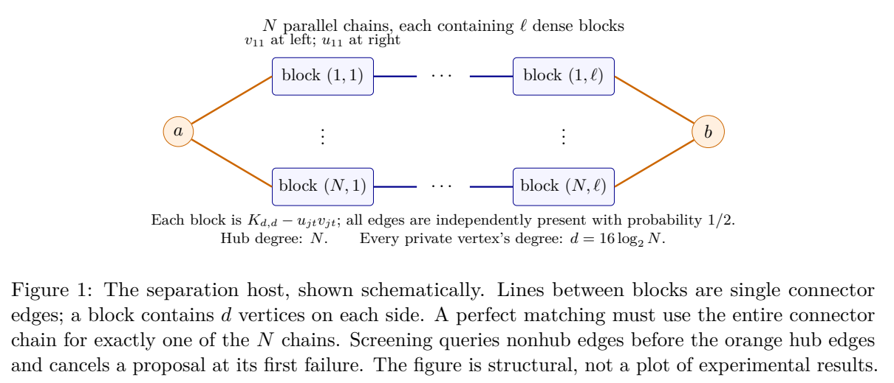

# Adaptive Stochastic Matching: An Expected Query Bound and the Cost of Mandatory Batching

作者 Maximilian Kornstein。首次发布 2026-11-04，此次核验的版本为 1.0.0（2026-11-04），阅读于 2026-11-09。独立公开预印本，PDF 首页自标 version 1、Zenodo 元数据标 1.0.0。阅读 9 页正文的 §2–5，核对算法、定理、反例构造和范围；没有独立重做所有常数证明。来源为 Zenodo 版本 DOI。

[作者原文](https://zenodo.org/records/23959746) · [离线 PDF](./assets/source/paper.pdf)

## 为什么询问顺序会改变预算

已知可行二分图 $G$，每条边独立地以 $1/2$ 概率真实可用。查询一条边会同时耗费其两个端点的额度。发现成功边后可保留到最后，再选最大匹配。一个难题是既要给所有端点规定最坏情况下的查询上限，又要逼近能预知整张真实图的最大匹配。与在线到达时必须立即确认的模型相比，这里允许延期确认，且查询时图已知。

## 两个结果解决不同层次的问题

**任意有限二分图。** §3 使用已有的乐观最大匹配轮次算法。保留成功边图 $H$，从乐观图 $U$ 删除已知失败边。每轮先取 $U$ 的任意最大匹配，再查询其中所有未知边。每一轮每个端点至多被问一次，最终在 $H$ 中求最大匹配 $A_R$。Thm. 3.1 的新贡献是固定 $p=1/2$ 时的有限输入期望损失界，记 $\mu=\mathbb E[\nu(G_{1/2})]$，
$$
\mathbb E[\nu(G_{1/2})-A_R]\le \frac{2\log 3}{R\log(3/2)}\mu.
$$
取 $R=\lceil6/\varepsilon\rceil$ 即可。证明以原图最小点覆盖的子集索引随查询增长的覆盖，只在证明中使用这些子集；实际运行按轮求普通二分图最大匹配。目标是两个期望的比值，作者未给每次样本都达到该匹配率的结论。

**强制完成每批的代价。** §4 图 1 构造 $N$ 条平行链，共享两个高度数枢纽；完美匹配必须完整打通其中一条链。若总要问完本次乐观匹配中的所有边，即使普通连接已经失败，枢纽也会花掉查询额度。§4.4 先查普通边，任何一条失败就删边、取消剩余查询并重新提案。仅在普通边全部通过后才询问至多两个枢纽边，若完成即返回；枢纽试验失败满 16 次则返回累计成功图的最大匹配。

| 原文定位 | 对照与量纲 | 范围 |
|---|---|---|
| §3 Thm. 3.1，PDF 第 3 页 | 任意有限二分图，每个端点硬上限 $\lceil6/\varepsilon\rceil$ 可达期望 $(1-\varepsilon)$ 近似 | 无随机到达、无并发占用、可保留重叠的成功边。 |
| §4 Thm. 4.1 及式 (12)、(13)，PDF 第 5、7–8 页 | 在构造族及同一精度 $\varepsilon_N$，强制完成批次的硬预算至少 $\Omega(1/[\varepsilon_N\log^2(1/\varepsilon_N)])$，筛选策略为 $O(\log(1/\varepsilon_N))$ | 下界允许自适应打破最大匹配平局。对数上界借助双枢纽结构；一般图没有这一结论。 |

这是作者的理论分析，含 AI 辅助推导披露，无实测样本或线上实验。查询顺序对一批需要多条边同时可行的提案很重要。直接把真实乘客/司机的接受反馈建成独立、可不承诺并可长期保留的硬币，需要业务机制支持。

## 原文证据

图 1，两个共享枢纽与多条私有链的构造；橙色边表示延后查询的枢纽连接，PDF 第 6 页。

## 代码与关联

作者在 Zenodo 提供的 sources.zip 含论文 TeX、图的 TeX、README 和许可证。核对其文件清单，算法实现入口未知。[作者附件](https://zenodo.org/records/23959746)

- [[研究前沿/动态等待与匹配决策/02-可复用方法卡/AdaptiveMatchingQueries-round-cap|乐观图逐轮匹配的端点查询上界]]
- [[研究前沿/动态等待与匹配决策/02-可复用方法卡/AdaptiveMatchingQueries-interior-first|稀缺端点延后询问与批内中止]]
- [[研究前沿/动态等待与匹配决策/03-实验假设与结果/AdaptiveMatchingQueries-screening-budget|同一匹配覆盖目标下，批内中止能节省多少热点询问]]
