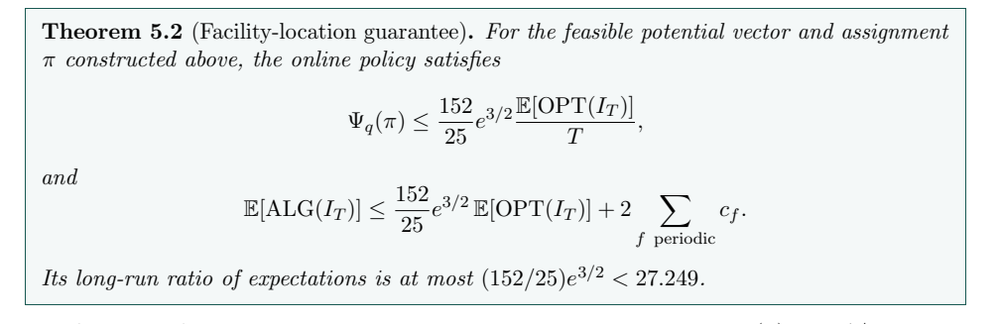

# Online Network Design with Additive Delays and Poisson Arrivals

<!-- 全库方法复筛开始 -->
> **方法储备 · 业务决策与理论储备**。保留“网络在线服务的累计等待成本”这一研究问题或机制；是否用于当前业务另行验证。
> 原有阅读范围与证据等级不变；储备不等于效果已验证。
> 已恢复此前因业务距离被移出的原笔记；旧取舍原因仅作历史记录。
> [[研究前沿/论文库复筛与阅读路线|全库阅读路线]] · [[研究前沿/业务决策与理论储备/存量论文分层索引|本方向完整分层]]
<!-- 全库方法复筛结束 -->

可以选哪处服务请求时，固定分区与固定时钟也有理论保证。设施选址、多根树合批和树上移动服务的长期期望成本比分别小于 27.249、94.415 和 24.326，比较对象允许每批重新选择地点或路径。

作者 Tianhang Lu、Runtian Ren、Shengcai Liu。首次提交 2026-11-10，本次核验同一 v1，未见独立的修订或正式发表日期。本期核读§2–3 概览、定理 5.2、6.13、7.8 及三个算法的构造。附录分段计算与有限证书未复算。

[arXiv 版本页](https://arxiv.org/abs/2611.13859v1) · [本地 PDF](./assets/source/paper.pdf) · [本地 HTML](./assets/source/paper.html)

## 问题、机制与证据

每个类型独立按已知泊松率到达，等待按每个请求累加。设施每次开启付费、并按请求逐个支付连接距离。多根树每批可另选根，移动服务器还会把位置带进下一轮。三个模型分别和看见整个序列的同模型离线最优比较，均将最后一次服务计入成本。

**选设施。** 按周围需求能承担的开门费为各设施长出服务半径，由小到大选代表，给客户固定分配。合并后的到达率记为 $\Lambda$、开门费为 $c$；比较到达即开门的成本率 $c\Lambda$ 与按时钟服务的上界 $\sqrt{2c\Lambda}$，空批次跳过。§5 构造时空不拥挤的请求作为基准下界。27.249 是全策略的理论上界。

**多根树。** 把启根费变成终端边，在有限支持的连通分区中择取调度证书最小的一项。各区的请求沿唯一路径汇到同一根，再使用嵌套时钟。证明把固定分区的代价与其内在线调度的代价分别界住。有理输入可作多项式时间预处理，定理 6.13 的总界为 94.415。

**移动服务。** 选按到达率加权的树重心作基地，删去基地的任何一个分支都至多占总需求率的一半。以分支需求率和移动距离算嵌套时钟，到点选所有有待服务请求的到期路径，往返走一趟并顺路服务。定理 7.8 比较允许任意停留和移动的离线轨迹，界为 24.326。没有线上或仿真增益；三项常数不能据大小判定三个不同业务模型的优劣。

定理 5.2 的设施选址上界，原文 PDF 第 14 页。

## 实现与后续验证

正文未列作者代码。设施时间表见 §5.2；多根分区见 §6.2、6.5；移动时钟递推见式 (14) 与 §7.3。

- [[研究前沿/动态等待与匹配决策/02-可复用方法卡/AdditiveNetwork-facility|先按需求密度分配服务点，再决定多久开一次]]
- [[研究前沿/动态等待与匹配决策/02-可复用方法卡/AdditiveNetwork-roots|把可选服务根固定成连通区域]]
- [[研究前沿/动态等待与匹配决策/02-可复用方法卡/AdditiveNetwork-centroid|移动服务按需求重心安排往返]]
- [[研究前沿/动态等待与匹配决策/03-实验假设与结果/AdditiveNetwork-location|固定服务分区对到达率漂移有多敏感]]
