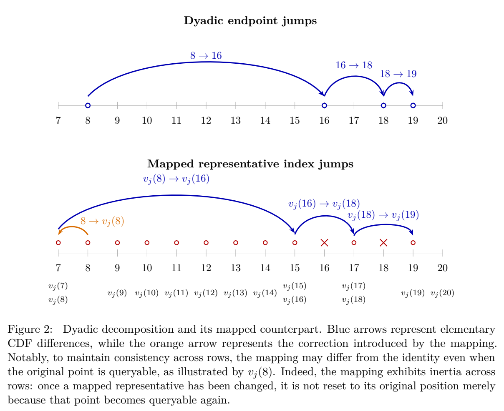

# Optimal Regret for Profit Maximization in Bilateral Trade

作者 Matteo Castiglioni、Anna Lunghi、Alberto Marchesi。首次发布 2026-11-06，此次核验的版本为 v1（2026-11-06），阅读于 2026-11-10。cs.GT 11 月 9 日公告。读 §1–7 问题、分阶段消除、CDF 相对估计、重映射及主定理；未逐行复证附录。

[作者原文](https://arxiv.org/abs/2611.09558v1) · [离线 PDF](./assets/source/paper.pdf)

## 一个成交位能同时告诉平台多少买卖两侧的信息

每轮有新买卖双方，平台同时选定给卖方的报价 $p$ 和向买方收取的价格 $q$，若 $S\le p$ 且 $B\ge q$ 即成交，收入 $q-p$。估值对跨轮独立同分布，同一轮内允许相关。令 $X=(S,1-B)$、$x=(p,1-q)$，一位成交反馈的均值是二维 CDF $F(x)$，故期望利润 $r(x)=(1-x_1-x_2)F(x)$。基准是未知分布下的最佳固定报价对。

## 候选集为何需要外围的查询点

若把二维网格每个格点当作独立选项，离散化与标准多臂算法平衡后只有约 $T^{3/4}$ 量级。作者利用 CDF 的累积结构共享信息。但淘汰不优价格后，上轮的中间格点可能已不可查询，重建候选价格间的利润差就会断开。

1. §4 算法 1 按精度分阶段。较严格阈值保留可能最优的目标点；较宽阈值允许在少量暂时用来探测的价格上取样。每一步采样仍有近最优的利润差上界。
2. 在每一行选一个参考点直接估计。其余 $F(i,j)-F(i',j)$ 拆为 $O(\log K)$ 个标准二叉区间的差，许多候选对能复用同一基本差分。
3. 遇被排除的端点，§5 式 (2) 将端点映射至可查询的附近代表，加上两端校正。跨行共享代表时，可在固定端点的一段行中利用累积质量的单调性二分。§6–7 同时控制区块数、查询点的最优差距、重复计入的概率质量；缺任一项都不能套用复杂度。
4. §4 Definition 4.1 把估计精度从 $\varepsilon$ 改为 $\varepsilon/8$。一阶段在目标精度 $e$ 的查询次数约为 $\widetilde O(K/e^2+1/e^3)$；取 $K$ 约 $T^{1/3}$，平衡离散化和探索损失。

## 理论证据与迁移

Thm. 3.1 给出 $O(T^{2/3}\log^{9/2}T)$ 的期望利润遗憾。即使退化为只需学习一侧的定价问题，也有 $\Omega(T^{2/3})$ 的已知下界。两者比较的是随轮数增长的最坏情形阶，没有离线订单实验或线上收入结果。

可用于买卖两侧接受结果仅以“成交/未成交”返回的重复报价。按价格单调的接受模型、跨轮稳定性和可实际发布探测报价是迁移所需条件。共享运力、多次邀请、取消、排队和自行选择交易时点另需建模。同周独立研究包含对抗序列和分布条件的不同结果，见 [[研究前沿/动态等待与匹配决策/01-论文原文与精读/BilateralPrices/精读|不同分布条件下的双边利润遗憾界]]。

## 原文证据

图 2，蓝色为可共享的基础差分，橙色为重映射引入的端点校正，PDF 第 19 页。

## 代码与关联

核查 arXiv 摘要页、PDF/HTML 正文与公开题名检索，尚未核到作者发布的实现仓库。算法入口见文中伪代码。

- [[研究前沿/动态等待与匹配决策/02-可复用方法卡/BilateralCDF-relative-cdf|保留探测报价的分阶段 CDF 差分估计]]
- [[研究前沿/动态等待与匹配决策/03-实验假设与结果/BilateralCDF-joint-grid|价格网格中共享成交概率差能否减少探索损失]]
