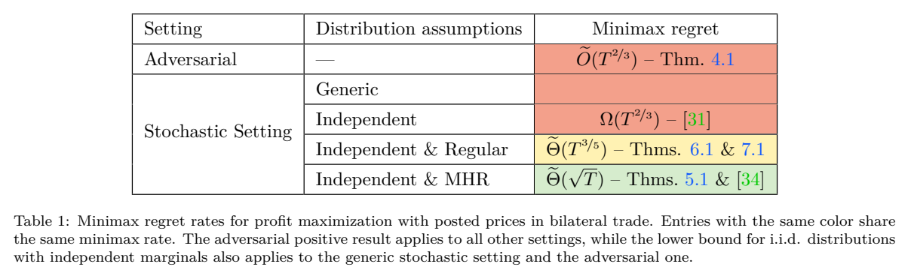

# Regret Bounds for Profit Maximization in Bilateral Trade: Learning the Best Posted-Price Mechanism

作者 Johannes Brüstle、Simone Di Gregorio、Federico Fusco、Stefano Leonardi。首次发布 2026-11-05，此次核验的版本为 v1（2026-11-05），阅读于 2026-11-10。cs.GT 的 11 月 6 日公告，本次滚动窗口补录，精读 §2–7 的反馈、算法 1–6、表 1 及正则分布下界的构造思路；未逐行复证全部 71 页。

[作者原文](https://arxiv.org/abs/2611.08173v1) · [离线 PDF](./assets/source/paper.pdf)

## 什么时候仅凭成交就能更快学会双边报价

每轮给卖家 $p$，给买家 $q$。模型容许 $p>q$ 的亏损交易；最佳固定比较对象总可选在 $p\le q$ 的三角形中。平台能从成交位 $Y$ 计算已实现利润 $(q-p)Y$，无须判断是谁拒绝。基准是回看全部序列的最佳固定双报价；随机版本对固定分布的最佳期望利润计遗憾。

| 环境 | 核验的上界 | 证据与适用条件 |
|---|---|---|
| 序列预先确定，可任意变化 | $O(T^{2/3}\log^{7/3}T)$ | 定理 4.1。算法无需估值平稳；对手在开始前固定整段序列。退化的一侧定价提供 $\Omega(T^{2/3})$。 |
| 独立、正密度、双边正则 | $O(T^{3/5}\log^5 T)$ | 定理 6.1、7.1 的上/下界匹配到对数。正则指买方虚拟价值、卖方虚拟成本分别单调。 |
| 独立、正密度、双侧 MHR | $O(\sqrt T\log^{5/2}T)$ | 定理 5.1。买侧 $f_B/(1-F_B)$ 不减，卖侧反向风险率 $f_S/F_S$ 不增。两侧为各自方向的条件。 |

## 三种假设如何改变可用算法

**预固定序列。** §4 算法 1–2 维护所有参照价的权重。每轮 OneRound 给出一个随机提案，含报价以及成功/失败两种可能的参照权重更新。乘法权重内循环近似求解一轮极小极大问题。局部估计引理 4.8 证明对近优价格可用低代价查询区分利润，定理 4.2 将它转成利润差和反馈信息的约束；该信息不等式支撑最坏情形界。多项式运行时间不等于实际时间预算可行。

**独立 MHR。** $\mu(p,q)=(q-p)F_S(p)[1-F_B(q)]$，其负对数在 $p<q$ 的内部凸。先在二叉网格只抽查 $O(K\log K)$ 个特定报价，借独立性从交叉价格重建更多成交率、筛出利润尺度可控的凸区域。之后在某一报价持续探测直至成交。若等待轮数为 $N$，$H_{N-1}=\sum_{j=1}^{N-1}1/j$ 对 $-\log P(\mathrm{trade})$ 无偏；结合已知价差即可给凸优化器损失观测。处置一次失败时直接取对数会出现无穷值。

**仅正则。** 同一负对数不再具备所需凸性。§6 为若干平衡系数 $\lambda$ 构建辅助利润
$$
r_\lambda(p,q)=\frac{4(q-p)}{(\lambda/F_S(p)+\lambda^{-1}/[1-F_B(q)])^2}.
$$
各自满足 $1/r_\lambda$ 凸，且 $r_\lambda\le\mu$。合适的 $\lambda$ 可在最优附近贴合实际利润，参考报价与两个交叉报价用于一位反馈估计。§7 构造困难实例，说明仅有正则时不能普遍继承 MHR 的速度。

## 使用边界

表 1 是理论速率比较；没有订单实测、模块消融或线上实验。更快两档依赖不同的额外假设。若买卖双方共同受供需冲击，独立乘积和交叉价恒等式会失效。动态市场中报价影响后续供需、等待和曝光，仍需补转移模型。同期间另有独立研究给出允许轮内相关的 IID 分阶段估计方案。[[研究前沿/动态等待与匹配决策/01-论文原文与精读/BilateralCDF/精读|二维 CDF 与保守淘汰]]

## 原文证据

表 1，不同分布假设下单比特报价的 minimax 遗憾；颜色对应相同阶，PDF 第 4 页。

## 代码与关联

核查 arXiv 摘要页、PDF/HTML 正文与公开题名检索，尚未核到作者发布的实现仓库。算法入口见文中伪代码。

- [[研究前沿/动态等待与匹配决策/02-可复用方法卡/BilateralPrices-profit-information|按成交位更新参照价权重的利润与信息权衡]]
- [[研究前沿/动态等待与匹配决策/02-可复用方法卡/BilateralPrices-mhr-convex|单调风险率下用成交等待轮数估计凸损失]]
- [[研究前沿/动态等待与匹配决策/03-实验假设与结果/BilateralPrices-assumption-shift|双边接受相关时，基于独立性的报价会损失多少利润]]
