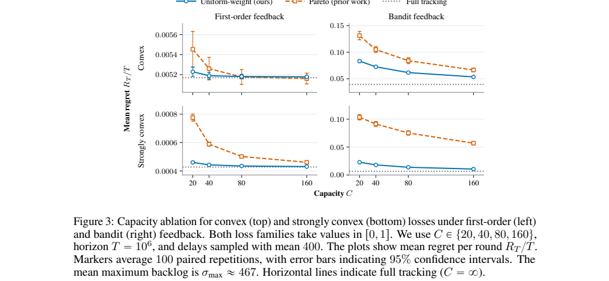

# Capacity-Constrained Online Convex Optimization with Delayed Feedback

<!-- 全库方法复筛开始 -->
> **方法储备 · 业务决策与理论储备**。保留“Capacity-Constrained Online Convex Optimization with Delayed Feedback”这一研究问题或机制；是否用于当前业务另行验证。
> 原有阅读范围与证据等级不变；储备不等于效果已验证。
> [[研究前沿/论文库复筛与阅读路线|全库阅读路线]] · [[研究前沿/业务决策与理论储备/存量论文分层索引|本方向完整分层]]
<!-- 全库方法复筛结束 -->

当待反馈槽位有限且迟到反馈更有信息时，观测概率随延迟变动会放大加权噪声。作者新增的合成对照中，给各轮相同追踪概率的调度器在仅见标量损失时优于 Pareto 追踪。

Alexander Ryabchenko, Idan Attias, Daniel M. Roy。首次提交 2026-06-10，本次核对修订 2026-11-09 v2。以上日期为 UTC；本批未独立核实正式发表日期。对读 v1/v2 全文目录、算法 1、§5 保证及 v2 新 §6/附录 H，检查作者仓库入口。中间概率界与优化器调参未复算。

[arXiv 版本页](https://arxiv.org/abs/2606.11711v2) · [本地 PDF](./assets/source/paper.pdf) · [本地 HTML](./assets/source/paper.html) · [首稿 PDF](./assets/source/v1.pdf)

## 决定是否保留某一轮的反馈

每轮先做连续凸域的决策，反馈延迟若干轮后才来。最多保留 C 项，在槽满时跳过新项，或在当初随机设定的追踪期限到时释放旧槽；被放弃的结果不再可用。半可预知设定是反馈到期事件可观察，但决策时不知道真正的延迟。

## 代理保留期限与权重

每轮抽代理期限 d′，只有入槽时有空间且代理期限不早于真实反馈才观测。算法 1 用覆盖真实延迟的代理生存概率构建权重，并把槽满导致的丢失单独控制。Pareto 代理对长延迟给更小的覆盖率，因此权重可以更大；二点代理以固定概率保留至反馈、否则跳过，非饱和时的权重一致。再接收延迟的加权 FTRL 或单点 bandit 版。

## v2 实质增加了哪项证据

v1 已给 §3–5 的归约和遗憾界；v2 新设 §6、附录 H、图 3。合成序列在行动前生成，平均延迟约 400，损失和延迟相关。图中每个点取 100 次配对重复，以平均每轮遗憾和 95% 区间比较。梯度可见时均匀调度已接近全追踪；只见损失值时两策略都有差距且 Pareto 更差。追踪占用反映收集反馈的能力，和可派出的执行资源是不同的容量。

v2 图 3，反馈形式与追踪容量的受控对照，原 PDF 第 10 页。

## 实现与验证入口

作者提供 [cc-oco 仓库](https://github.com/alex-rbch/cc-oco)，已核到根目录 run.py 与 src/。

- [[研究前沿/动态等待与匹配决策/02-可复用方法卡/CapacityDelayOCO-proxy|给未回传结果分配随机追踪期限]]
- [[研究前沿/动态等待与匹配决策/03-实验假设与结果/CapacityDelayOCO-delay|当迟到结果系统性不同，哪种追踪规则更稳]]
