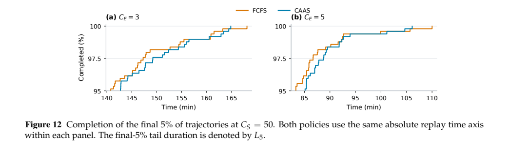

# Reducing Batch Makespan for LLM Agent Workloads through Inference-Environment Coordination

<!-- 全库方法复筛开始 -->
> **方法储备 · 业务决策与理论储备**。保留“Agent 批处理的尾延迟与吞吐权衡”这一研究问题或机制；是否用于当前业务另行验证。
> 原有阅读范围与证据等级不变；储备不等于效果已验证。
> 已恢复此前因业务距离被移出的原笔记；旧取舍原因仅作历史记录。
> [[研究前沿/论文库复筛与阅读路线|全库阅读路线]] · [[研究前沿/业务决策与理论储备/存量论文分层索引|本方向完整分层]]
<!-- 全库方法复筛结束 -->

固定外部执行槽位后，按到达时间分档，档内优先推进已走过更多步骤的任务。作者回放中最后 5% 任务的完成区间缩短约两成，但达到 95% 完成的时间更晚。

Wei Feng, Meiling Chen, Boxiao Chen, Lu Liu, Bin Zi, Libin Ye, Xingyu Lu, Lei Xu, Jun Zhou。首次提交 2026-11-12，本次核对首版 v1。以上日期为 UTC；本批未独立核实正式发表日期。核读 §3 的容量及路由依赖、§4–5 的策略与分开控制、图 11–12 和表 2/3，查看附录 A 的实验配置。未复现真实推理运行。

[arXiv 版本页](https://arxiv.org/abs/2611.16661v1) · [本地 PDF](./assets/source/paper.pdf) · [本地 HTML](./assets/source/paper.html)

## 同一条轨迹反复占用两类资源

任务在模型推理和环境执行之间多次交替。若把样本准入上限锁在环境槽数，部分任务等待环境时 GPU 可能闲置。作者分设样本准入 $C_S$ 与真实执行槽 $C_E$，回放中保留实测环境响应与时长，模型按记录的长度执行推理。

## CAAS 只改槽位释放时的次序

每个环境请求入队时冻结优先级。首先按到达时间带保证跨带先来先服务；同带先选已完成推理轮数更多者，再以过去平均推理时长的离散档和入队编号破同分。用已揭示深度代替未知剩余链长。推理侧另有缓存分配、跨工作者哈希路由和前缀调度。

## 局部对照和全系统收益

图 11 固定 FCFS，放宽样本准入到 10 后，相对统一准入两档环境槽总工期都约少三分之一。图 12 在准入 50 且其他配置一致时才单独换 CAAS；最后 5% 时长缩短，同时前 95% 完成更晚。端到端线上式评估用两个 Ling 模型、多个工作负载，包含一组联动修改，不能用整组提升替代 CAAS 单项结果。

图 12，固定并发后的最后 5% 区间，原 PDF 第 20 页。

## 实现与验证入口

未核到此工作可复现实验的公开仓库。§4.2 式 (13)–(16)、图 11–12 与附录 A.2 给出顺序及配置。

- [[研究前沿/动态等待与匹配决策/02-可复用方法卡/ChainAdvancing-bands|按到达档和已揭示链深分配执行槽]]
- [[研究前沿/动态等待与匹配决策/03-实验假设与结果/ChainAdvancing-tail|推进深链缩短的是末批还是多数请求的等待]]
