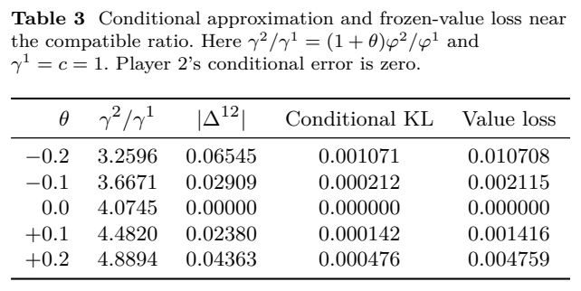

# 分别学出的多方响应，能否同时来自同一套联合行动概率？

<!-- 全库方法复筛开始 -->
> **方法储备 · 业务决策与理论储备**。保留“条件均衡的相容性与识别”这一研究问题或机制；是否用于当前业务另行验证。
> 原有阅读范围与证据等级不变；储备不等于效果已验证。
> 已恢复此前因业务距离被移出的原笔记；旧取舍原因仅作历史记录。
> [[研究前沿/论文库复筛与阅读路线|全库阅读路线]] · [[研究前沿/业务决策与理论储备/存量论文分层索引|本方向完整分层]]
<!-- 全库方法复筛结束 -->

各自合理的条件选择模型可能无法拼成联合分布。用交叉导数及其误差检查，可提前发现这类不一致。

## 文献与版本

Time-Local Conditional Equilibria for N-Player Stochastic Differential Games with Exploratory Policies。Jisheng Liu。Research Square v1 于 11-13 发布。 检索及精读于 2026-11-15。精读 §2–4 的相容条件、§6 线性二次示例和表 2–3。 [一手来源](https://doi.org/10.21203/rs.3.rs-11534523/v1)

本地资料　[paper-v1.pdf](./assets/source/paper-v1.pdf)

## 方法与关键计算

把其他参与方当前动作在预测时域内冻结，按各自的熵正则控制问题得到条件 Gibbs 响应。要存在联合密度，各主体对自身动作的对数条件密度导数，必须能共同作为同一标量势函数的梯度。对光滑正密度、单连通动作域，需熵系数缩放后的交叉偏导相等，且势函数可归一化。存在偏差时沿坐标路径构造近似联合分布，适当条件下条件 KL 误差按相容性缺口的平方上界增长。

## 效果证据与对照

表 3 的双人线性二次算例中，噪声温度比等于相容值 4.0745 时，条件 KL 和冻结对手下的价值损失均为 0；比值上调 20% 时分别为 0.000476 和 0.004759。数值积分与解析式相符到约 10⁻¹²。

这是已知控制模型下的理论和数值核对。给出条件反应在冻结对手时近似一致的范围；原文未用真实市场估计多方同时改变策略后的实际收益。

表 3，相容比值附近的条件误差与价值损失。 [原文第 34 页](./assets/source/paper-v1.pdf#page=34)

## 能迁移到什么问题

迁移到分别拟合双方连续响应的模拟器时，可先在可见动作网格上检验梯度能否对应同一联合密度。离散接受/拒绝需要另用概率相容性检验，不能直接套连续导数公式。

论文代码声明为可向作者索取，未验证公开执行入口。可复核命题 3.3 和 §6 解析式。

[[研究前沿/动态等待与匹配决策/02-可复用方法卡/ConditionalResponseCompatibility-检验条件响应能否组成联合分布|检验条件响应能否组成联合分布]] · [[研究前沿/动态等待与匹配决策/03-实验假设与结果/ConditionalResponseCompatibility-在已知联合行为的仿真里检验响应模型相容性|在已知联合行为的仿真里检验响应模型相容性（未运行）]]
