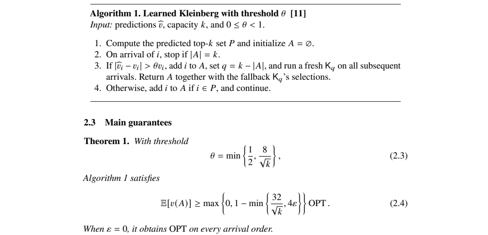

# Multiple-Choice Secretary Problem with Predictions

<!-- 全库方法复筛开始 -->
> **方法储备 · 业务决策与理论储备**。保留“预测辅助的多次选择秘书算法”这一研究问题或机制；是否用于当前业务另行验证。
> 原有阅读范围与证据等级不变；储备不等于效果已验证。
> 已恢复此前因业务距离被移出的原笔记；旧取舍原因仅作历史记录。
> [[研究前沿/论文库复筛与阅读路线|全库阅读路线]] · [[研究前沿/业务决策与理论储备/存量论文分层索引|本方向完整分层]]
<!-- 全库方法复筛结束 -->

预先有完整候选名单与价值预测时，可以只监测预测前 k 名的分界。即便单个价值偏差很大，只要没有候选跨过分界，按原名单接纳就能取得离线最优。

Jing Yuan, Qi Cai, Xin Gao, Shaojie Tang。首次提交 2026-11-10，本次核对首版 v1。以上日期为 UTC；本批未独立核实正式发表日期。核读 §2、§3、§6–7 与算法 1，对照原始误差和分界误差两条保证。未逐项复算 §4–5 的积分不等式。

[arXiv 版本页](https://arxiv.org/abs/2611.14651v1) · [本地 PDF](./assets/source/paper.pdf) · [本地 HTML](./assets/source/paper.html)

## 哪些信息可以在接纳前使用

所有带标签候选及其预测价值在第一轮前已知；实际价值到达时揭示，必须立即接受或放弃。比较对象是知道全部实际价值的前 k 名总和。纯 Kleinberg 策略不读预测，已有 Learned Kleinberg 策略在首次大偏差时接纳该项，再把剩余额度交回随机序列算法。

## 新结果怎样得到

令 θ=min(1/2,8/√k)。沿用切换规则，以误报项数量和首次误差时还剩多少容量分析，作者把最坏损失的量级由带 log k 的旧界改到 O(1/√k)。§7 在预测前 k 名和其余候选两侧共用最低入选预测值 τ，只有真值朝改变入选顺序的方向偏离才触发。触发项会占用一格，然后才对剩余序列启用回退。

## 判读竞争界

若 η 是使两侧分界不等式都成立的最小相对松弛，回报下界为 $\max(0,1-\min(32/\sqrt{k},4\eta))\,\mathrm{OPT}$。零误差的逐序列保证比一般情形更强。小 k 或误差较大时显式数值界可能为零。论文没有用户日志或现场实验；现实若在决策后才知道真值，触发条件不可直接观测。

算法 1 与重设的阈值，原 PDF 第 3 页。

## 实现与验证入口

实现入口未核到。算法 1 与 §7 式 (7.2) 给出可复现规则。

- [[研究前沿/动态等待与匹配决策/02-可复用方法卡/CutoffSecretary-boundary|什么时候放弃预测前 k 名名单]]
- [[研究前沿/动态等待与匹配决策/03-实验假设与结果/CutoffSecretary-switch|同一份排序是否因无害估值误差提前回退]]
