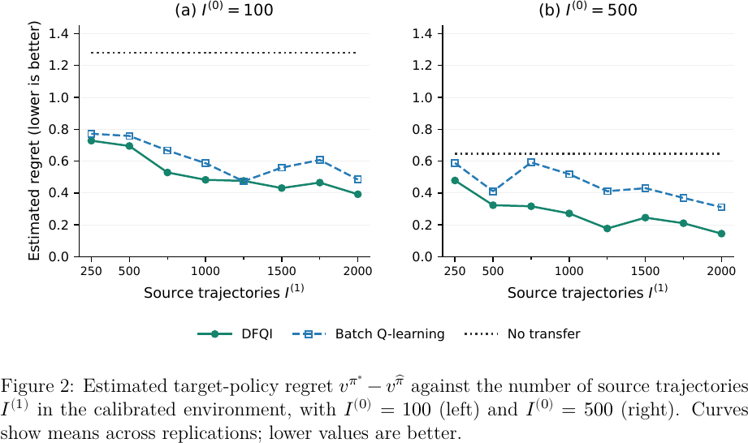

# DFQI · 把相邻市场样本纳入每一次动作价值更新

目标市场样本稀少时，怎样借其他市场的历史轨迹，又容许奖励和转移规律不同？先看每个市场如何形成自己的 Bellman 目标，再对照目标市场单训。半合成环境中学到的策略仍需在目标环境验证。

[[研究前沿/动态等待与匹配决策/README#供需或等待成本变化后还能用吗|比较同一问题的其他方法]] · [[研究前沿/动态等待与匹配决策/02-可复用方法卡/DFQI-目标与源市场的 Bellman 联合回归|目标与源市场的联合回归]] · [[研究前沿/动态等待与匹配决策/03-实验假设与结果/DFQI-检验小流量市场跨域训练的负迁移|未运行：检验负迁移]]

Direct Knowledge Transfer for Offline Q-Learning

Luo, Zhanye, Gan, Guangyan, Cong, Lin William。arXiv v1 首投 2026-11-01。历史补录，11 月 1 日首投，检索于 2026-11-09，会议发表日期未核验。[版本页](https://arxiv.org/abs/2611.01942) · [本地 PDF](./assets/source/paper.pdf) · [本地 HTML](./assets/source/paper.html)

## 小市场为什么不宜直接合并训练
§3 将相同状态、动作空间下的多个市场写成相关 MDP。每个任务自行计算即时奖励与下一时刻最大动作价值组成的 Bellman 目标。若奖励或转移核不同，直接合并会把源市场的偏差带进目标市场。
## 每轮联合估计
§4 算法 1 让目标和各源任务用同一组基函数、各自一组系数。在各自 Bellman 残差的加权平方损失之外，式 (3) 加入融合惩罚
$$
\lambda_\Delta \left\|\beta^{(0)}-\sum_{k=1}^K w_k\beta^{(k)}\right\|_1 .
$$
每轮同时估计全部系数，再用新函数更新各自下一轮伪标签。这允许目标相对加权源系数在部分方向偏离。§5 分别给出共同或不同转移核下的估计与策略界，包含任务间差异、逼近误差与样本规模。
## 判别迁移是否有用
§6.1 用共享转移、改变奖励的模拟比较目标单训、两步 batch Q-learning 和联合估计。每种配置 100 次重复，图 1 的 DFQI 中位估计误差更低。§6.2 从 MIMIC-III 年龄队列校准模拟环境，生成训练轨迹、再用独立生成的目标轨迹评估 regret。临床记录用于校准模拟器，未观察部署策略后的真实回报。

## 原始证据

§6.2 图 2 的半合成实验中，目标 500 条轨迹时，DFQI 在所有源样本规模下的平均 regret 最低。目标 100 条、源 1,250 条时与两步法几乎持平。

原图 2　固定目标样本量时，策略 regret 随源轨迹数的变化。

## 阅读范围和迁移边界

适合检验低流量城市或冷启动策略的借样本价值。跨城市策略差异和司机供给反馈可以破坏可迁移性；模拟 regret 不能折算成交提升。

阅读深度为核心方法、主实验与证据边界精读；数值来自作者，未逐行复证全部附录推导。查阅版本页、正文所列链接并按标题检索，未核验到作者实现入口。

[[研究前沿/动态等待与匹配决策/02-可复用方法卡/DFQI-目标与源市场的 Bellman 联合回归|目标与源市场的 Bellman 联合回归]] · [[研究前沿/动态等待与匹配决策/03-实验假设与结果/DFQI-检验小流量市场跨域训练的负迁移|检验小流量市场跨域训练的负迁移]]

[[研究前沿/动态等待与匹配决策/01-论文原文与精读/DFQI/原文导航|原文章节及图表公式导航]]
