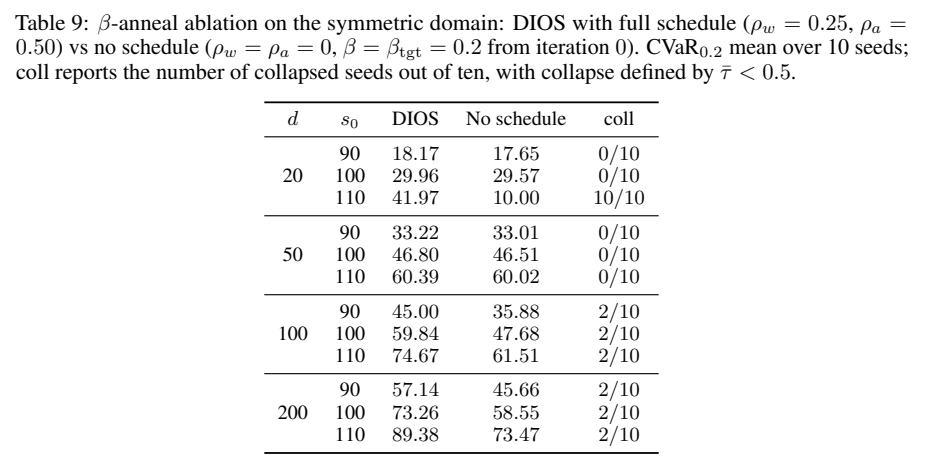

# CVaR Deep Optimal Stopping

<!-- 全库方法复筛开始 -->
> **方法储备 · 业务决策与理论储备**。保留“CVaR 风险目标的深度停止”这一研究问题或机制；是否用于当前业务另行验证。
> 原有阅读范围与证据等级不变；储备不等于效果已验证。
> 已恢复此前因业务距离被移出的原笔记；旧取舍原因仅作历史记录。
> [[研究前沿/论文库复筛与阅读路线|全库阅读路线]] · [[研究前沿/业务决策与理论储备/存量论文分层索引|本方向完整分层]]
<!-- 全库方法复筛结束 -->

在可观察所有候选停止时刻收益的路径上，DIOS 用全路径训练停止概率，再用抽到的停止收益估计分位数。24 组期权模拟中其平均下尾收益均居首，与最接近基线的差距在多组很小。

arXiv v1 预印本。作者 Yechan Jeong、Youngjoon Hong。首次提交 2026-11-08，核验于 2026-11-12。11 月 10 日公告。核读 §2–5、算法 1、表 1 与附录 C–E（尤其表 5、9），查验附录 F–H 的实验范围；未逐步复证收敛证明。作者在摘要页标注 NeurIPS 2026。

[一手发布页](https://arxiv.org/abs/2611.11332v1) · [离线 PDF](./assets/source/paper.pdf) · [离线 HTML](./assets/source/paper.html)

## 若只关心最差的一部分回报

在有限个时点从外生轨迹选择一次停止，回报只在停止时产生。若用最低 $\beta$ 比例回报的平均值评价，策略既要探索延后停止的机会，也不能忽略早停损失。设 $R_t$ 为该路径若在 $t$ 停止所得。式 (10) 将选时问题的下尾 CVaR 化为外层标量 $\nu$ 与内层随机停止策略的优化：

$$\sup_\nu\left\{\nu-\frac{1}{\beta}\inf_\tau\mathbb E[(\nu-R_\tau)_+]\right\}.$$

固定 $\nu$ 后，低于它的回报按缺口受罚。定理 3.3 在论文状态假设下证明可取 Markov 停止策略，策略时钟与状态已经足够；$\nu$ 用于训练目标。

## 一条轨迹怎样提供多个时点的反馈

在每个未停止的时点，网络输出当期停止的条件概率 $\phi_t$，从起点看在第 $t$ 期停止的概率为 $\psi_t=\phi_t\prod_{s<t}(1-\phi_s)$，最后一步强制停止。每条训练路径抽取一次停止收益，整批计算其经验分位数 $\hat\nu$。暂时固定 $\hat\nu$，用 $-\sum_t(\hat\nu-R_t)_+\nabla_\theta\psi_t/\beta$ 更新策略。即使实际抽到的是好结果，路径中其他时点的坏结果也可提供梯度。先在 $\beta=1$ 预热，再逐步缩小到目标尾部。定理 4.2 在固定尾部水平和正则性假设下控制最佳迭代的平稳性，实际 Adam、退火和 BatchNorm 未获同一保证。

## 收益差有多大

主实验为 12 个对称波动、12 个非对称波动的 Bermudan 看涨期权设置，四种资产维度、三档初始价格，10 个候选时点。每组 10 个训练种子，以独立评测路径最差 20% 的收益均值衡量 CVaR。比较 CVaR-PG、MIX、RET-CAP、CVaR-VaR。DIOS 在 24 组均获得最高均值和最短记录训练时间；在对称 $d=200,s_0=110$ 时，与 CVaR-VaR 仅 89.378 对 89.375。种子配对检验只在 5/24 组得到未校正 $p<0.05$。RET-CAP 的调参后得分与早期计时配置不同。

附录 D.4 表 9 对比完整退火与固定尾部水平：对称 $d=20,s_0=110$ 时，两组 CVaR 为 41.97 和 10.00，后者十个种子全都几乎立刻停止。两组 hold 阶段分位数秩也有细小差异，应把对照理解为两套训练日程。转到订单等待时，如果等待会改变未来可选资源或已停样本无法观察后续回报，必须先建立可信的轨迹模型。

表 9　停止策略下尾退火的消融实验。PDF 第 25 页。

## 实现与关联

NeurIPS 检查表“Open access to data and code”写明稿件未附公开实现，网络、分位数和评估细节见附录 C。

- [[研究前沿/动态等待与匹配决策/02-可复用方法卡/DIOS-tail-gradient|用完整轨迹训练下尾收益的停止策略]]
- [[研究前沿/动态等待与匹配决策/03-实验假设与结果/DIOS-tail-replay|优化最差五分之一回报能否避免过早停止]]
