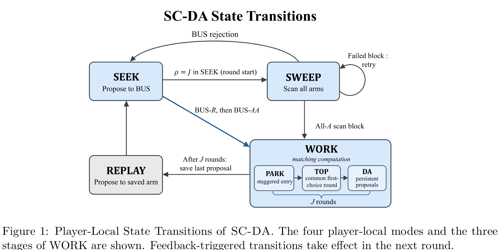

# Decentralized Dynamic Stable Matching

[官方论文](https://arxiv.org/abs/2610.41912) · [本地PDF](./assets/source/paper.pdf) · [HTML快照](./assets/source/paper.html)

版本记录：[Submitted on 30 Oct 2026]；本次核验与精读：2026-11-06。本篇为滚动窗口内首次入库；检索日不等于首次发表日。

阅读范围：§2完整模型、§3算法1/上界、§5学习协议与保证；附录状态机证明未逐行复证。未逐行复证全部数学证明，未声称逐页翻译。[[研究前沿/动态等待与匹配决策/01-论文原文与精读/DecentralizedMatching/阅读覆盖|原文章节与公式索引]]；HTML为原始快照，外部样式和图片可能需要联网，PDF可离线阅读。

代码：本次核验的论文原文与元数据未提供可确认的作者实现入口；代码状态未知，不能据此断言不存在。未运行代码。 [[研究前沿/动态等待与匹配决策/01-论文原文与精读/DecentralizedMatching/代码核验|核验记录]]

## 问题

固定K个资源、活跃参与者不超过K，严格固定双边偏好，人口仅有限次加入退出；无公共时钟、无变化通知、无直接通信，只能看到本地提案接受/拒绝。目标是逐轮追踪参与者最优稳定匹配POSM，不是总收益最大化。

## SC-DA与SC-PC（§2–5）

SC-DA四状态Replay/Seek/Sweep/Work。BUS资源的优先接受竞争形成发起者；巡扫所有资源把其他参与者拉回协调；Work按Park→Top→deferred acceptance执行固定长度。完成后重放已求匹配；被拒或本地期限到则重新协调。

关键自校准：记本次本地年龄a和上次输出年龄ℓ，重放长度 $L=H+2(a-\ell)$，下一期限a+L。不同入场时间通过两次输出间隔对齐，不依赖全局时钟。拒绝并非唯一触发，定期重算可发现仍被接受却已非POSM的状态。

未知偏好SC-PC另保留接受交互样本和置信候选；资源轮换服务未解决候选，只有有偏好见证的拒绝才删除边，避免删掉稳定边。探索样本跨协调阶段保留。

## 理论证据与限制

Theorem1已知偏好累计不匹配轮数 $O(t_*+K^2\log T)$；Theorem4未知偏好期望 $O(t_*+K^4\Delta_{min}^{-2}\log T)$。t*是最后人口变化时刻，变化持续到T时该界可能平凡；不是按事件次数的动态遗憾保证。未知偏好下界只匹配T与间隙量级，不声明K最优。

未给真实市场或仿真实验。协调占用BUS/PARK、资源要支持规定协议，不能仅部署一个客户端等待公式。每个参与者偏好任何对象胜过不匹配、偏好均值固定、人口轨迹独立于协议随机性是强条件。可迁移事件触发与周期复核结合、保留探索证据，但非直接集中派单策略。

## 原文关键图表

原文 Figure 1，PDF 第 8 页；原始裁图，机制和证据解释见上文。裁图坐标与源文件校验值见 assets/source/figure-provenance.json。

## 方法卡

- [[研究前沿/动态等待与匹配决策/02-可复用方法卡/DecentralizedMatching-self-calibration|本地输出间隔驱动的异步匹配复核]]

## 2026-11-09 版本复核

v2 将 SC-PC 定理 4 的间隙从 POSM 相关比较扩大至最终市场全部偏好对，可能放宽实例上界；SC-DA 的维护计数改以 H 起步，主定理改写为 T>H。主阶与静态下界系数保留，无新增独立模块或实证。 [[研究前沿/动态等待与匹配决策/01-论文原文与精读/DecentralizedMatching/版本更新-2026-11-09|v2 对照及新版原文]]
