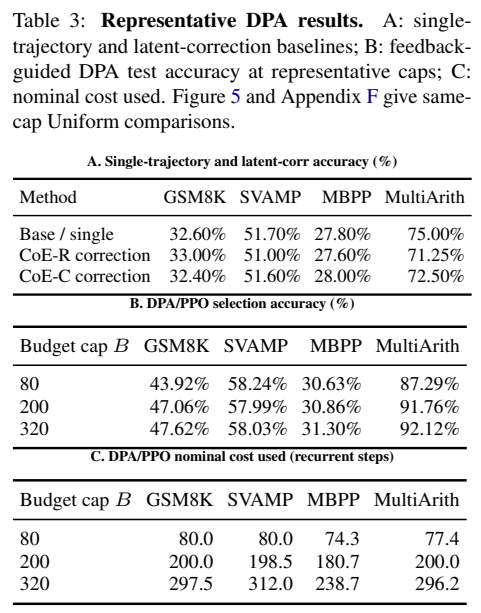

# Depth as a Candidate Source: Portfolio Allocation for Recurrent Test-Time Scaling in Large Language Models

<!-- 全库方法复筛开始 -->
> **方法储备 · 模型自进化**。保留“自适应循环深度分配计算”这一研究问题或机制；是否用于当前业务另行验证。
> 原有阅读范围与证据等级不变；储备不等于效果已验证。
> 已恢复此前因业务距离被移出的原笔记；旧取舍原因仅作历史记录。
> [[研究前沿/论文库复筛与阅读路线|全库阅读路线]] · [[研究前沿/模型自进化/存量论文分层索引|本方向完整分层]]
<!-- 全库方法复筛结束 -->

可以把同一模型的不同递归深度当作互补候选来源，按剩余预算决定再取一个还是停止。相同名义预算下，适应性分配多数时候优于均匀取样，个别任务和预算会回落。

作者 Chaoyuan Hao、Wentao Yue、Yanyan Wu、Boyuan Gao、Tianyou Lai、Maolin Wang、Yongxin Ni、Hanwen Du、Youhua Li。首次提交 2026-11-09，本次核验同一 v1，未见独立的修订或正式发表日期。本期核读§3–5，图 2–5、表 1–3 和附录 F 表 12–14；核查固定候选池、标签用途和名义预算口径。

[arXiv 版本页](https://arxiv.org/abs/2611.12293v1) · [本地 PDF](./assets/source/paper.pdf) · [本地 HTML](./assets/source/paper.html)

## 问题、机制与证据

同一个冻结模型在更深的递归层并不总能保住浅层已经答对的题目。作者先在多个深度重复取候选，比较答对题目的交集、深度之间相互救回的比例，再在等候选数或等名义成本约束下测“候选池是否至少有一个正确答案”。这项覆盖率使用真值作诊断；最终正确率另由同一个冻结选择器所选的答案计算。

**顺序动作。** 每轮看到题目特征、已取候选表征与选择器分数、各深度的取样数和剩余预算，动作是选一个深度或停。每次取样消耗该深度的名义循环步数，每个深度最多五个候选，掩去不可行动作。训练样本有标签，奖励是增加一个候选后选择器正确性之差，总回报与最后选中答案相关；测试仅用当时已观察到的状态。作者用 PPO 训练分配器，在冻结的题目×深度候选池中按需取样，避免在线反复生成掩盖分配影响。

**同上限对照。** 附录 F 表 12 在预算上限 320 时，MBPP 上 PPO 正确率 31.30%、使用 238.7 个名义步；均匀为 30.94%、304 步。MultiArith 同一上限反而是 92.12% 对 92.27%。选择器、生成器和候选池均影响成绩。未使用的预算既可能来自主动停止，也可能来自无合适动作；名义步不含解码、评分与决策开销，不能换算为生产端到端延时。

表 3 的预算、准确率与名义开销，原文 PDF 第 8 页。

## 实现与后续验证

作者在官方摘要及正文给出匿名仓库。网页和文件 API 均返回 403；文件入口、提交号及一键重现能力未核实。训练与评测协议见 §4.2、附录 D/F。[作者链接](https://anonymous.4open.science/r/LLM-latent-B7BC/)

- [[研究前沿/动态等待与匹配决策/02-可复用方法卡/DepthPortfolio-pool|不同候选来源值得在何时多取一次]]
- [[研究前沿/动态等待与匹配决策/03-实验假设与结果/DepthPortfolio-selector|分配收益来自候选覆盖、更多实际计算，还是更好的停止时机]]
